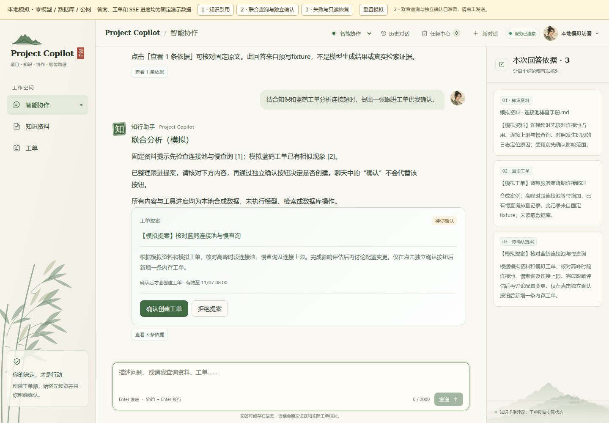
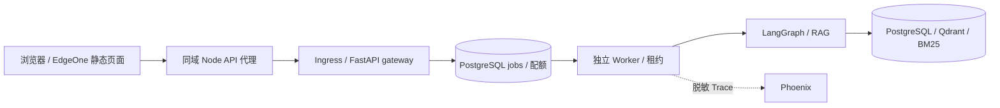

# Project Copilot

中文研发知识与工单协作工作台：通过 RAG 核对资料，使用 LangGraph 联合查询工单，并在用户独立确认后创建工单。模型提出工具调用；后端控制权限、预算和事务。

## 当前界面

支持知识引用、工单提案、任务进度与只读恢复；历史对话默认仅在页面内存，主动开启后按账号保存展示内容。当前代码包含 EdgeOne 同域代理、Cookie 登录、持久任务及独立 Worker；发布状态默认 **CLOSED**，源码功能不等于公网安全验收通过。



[390px 手机预览](docs/evidence/INTERVIEW_DEMO_390.png) · [历史对话与执行权限](docs/CHAT_HISTORY.md) · [聊天事件协议](docs/CHAT_EXPERIENCE.md)

截图来自固定合成 fixture，展示当前界面；不是新的真实模型、数据库或公网运行证据。

## 快速体验：无需密钥的本地模拟

安装 Node.js 22 或更新版本，在仓库根目录运行：

```bash
node scripts/interview_demo.mjs
```

打开 **http://127.0.0.1:4173/**，选择顶部场景并点击发送：知识引用 → 联合查询与提案独立确认 → 任务失败与原编号只读恢复。端口被占用可加 `--port 4174`。退出按 Ctrl+C。

仅监听 `127.0.0.1`；启动时使用真实 `build_edgeone.mjs` 生成独立临时静态目录。所有答案、工单、身份和 SSE 事件均为模拟，零模型、数据库和公网请求，无需 `.env`、Docker 或 npm 安装。工具栏始终注明模拟；重置只清除本演示状态和合成账号的任务恢复索引。没有任意上游代理，生产构建不包含模拟逻辑。

[3 分钟 / 10 分钟面试路线与验证命令](docs/INTERVIEW_GUIDE.md)。需真实模型和存储时使用下方 Docker 流程；公网模式另按[部署准备](docs/EDGEONE_DEPLOYMENT.md)和[安全模型](docs/SECURITY_MODEL.md)，本地模拟不授予任何发布权限。

## 架构



身份 Cookie、页面内执行 Context、可选展示 history 分开管理；恢复任务只读 GET/SSE，不重放 POST 或模型调用。提案确认走独立接口，经过账号、Context、指纹、有效期和事务校验。完整数据流见[架构说明](docs/ARCHITECTURE.md)。

## 证据与限制

| 证据 | 能证明的范围 |
| --- | --- |
| [本地模拟验收](docs/INTERVIEW_GUIDE.md#自动验证与截图) | 当前真实前端构建、浏览器交互、合成响应、确认与恢复边界 |
| [Agent 任务合同基线](docs/AGENT_TASK_BENCHMARK_REPORT.md) | 实际编译图＋脚本模型的30个场景，30/30合同通过；不代表真实模型自主决策质量 |
| [工具观察去重对照](docs/AGENT_OBSERVATIONS.md) | 同配置观察字符减少24.05%，工具执行与合同结果不变；不等于实测token或费用减少 |
| [历史最终验收](docs/FINAL_ACCEPTANCE.md) / [原始审计](docs/evidence/D32_FINAL_ACCEPTANCE.json) | 记录当时的真实 Docker、PostgreSQL、模型及 Phoenix 回读；不是本轮重测 |
| [前端真实验收](docs/evidence/FRONTEND_VERIFICATION_20261031.json) | 当时的浏览器与后端闭环，具体调用数和失败见记录 |
| [冻结保留集](evals/reports/FINAL_HOLDOUT.md) | 9 道可答题 MRR@5：0.944444 → 1；Recall@5 均为 1，另 1 道无答案不入均值 |
| [发布清单](docs/RELEASE_CHECKLIST.md) | 公网门禁、证据和仍需完成的验收；不能由本地模拟替代 |

小型自建评测不证明普遍质量提升；没有生产压测或 SLA、跨设备聊天同步、持久化 LangGraph/checkpoint 恢复。浏览器停止等待不取消后台任务、不退款；展示历史不会恢复确认权限。本机旧同步入口与公网受控任务入口有不同边界，不能把本机 `POST /tickets` 当作已开放公网写接口。真实模型请求、数据库状态和 Phoenix 收存均需独立验证。

## Docker运行

本机已有GPU镜像和模型缓存时，日常启动直接执行`bash start.sh`。脚本会启动依赖并重新建立API挂载，自动沿用现有本机验收配置（若存在`data/auto-final/deploy.env`），保留数据卷；不构建镜像、不调用模型。首次部署或CPU模式仍按下面步骤及部署指南操作。

需要Docker Desktop/Engine、本项目`.env`、固定模型缓存；GPU部署还需要兼容CUDA 13的NVIDIA驱动及Docker GPU支持。保留已有`.env`，按[配置模板](.env.example)补齐本项目智谱/DeepSeek密钥，不要用模板覆盖真实文件。API镜像不包含密钥或模型权重。

```bash
cd project-copilot
export PROJECT_COPILOT_CONTAINER_UID="$(id -u)"
export PROJECT_COPILOT_CONTAINER_GID="$(id -g)"
mkdir -p data/manifests

docker compose --env-file .env.example \
  -f docker-compose.yml -f docker-compose.deploy.yml -f docker-compose.gpu.yml build api
docker compose --env-file .env.example \
  -f docker-compose.yml -f docker-compose.deploy.yml -f docker-compose.gpu.yml up -d --wait api
```

完整栈为API、一次性迁移、PostgreSQL、Qdrant、Phoenix。API等待存储/追踪健康及Alembic成功退出；PostgreSQL/Qdrant复用既有项目卷，Phoenix有独立卷。CPU部署去掉GPU overlay并构建CPU镜像，详细条件、代理排查、模型挂载和停止/重建方法见[部署指南](docs/DEPLOYMENT.md)。

| 入口 | 本机地址 |
| --- | --- |
| 普通用户工作台 | `http://127.0.0.1:8002/` |
| 开发接口 / Swagger | `http://127.0.0.1:8002/docs` |
| API存活检查 | `http://127.0.0.1:8002/health` |
| PostgreSQL | `127.0.0.1:5433`，容器内`postgres:5432` |
| Qdrant | `http://127.0.0.1:6433`，容器内`qdrant:6333` |
| Phoenix UI | `http://127.0.0.1:6007`，容器内OTLP为`phoenix:6006/v1/traces` |

部署使用`.env.example`作Compose插值，真实`.env`只读挂到API；容器环境覆盖数据库/Qdrant URL为服务名。模型目录只读，清单目录读写。当前仅绑定localhost，无完整身份认证或Phoenix登录，不直接对外暴露。原数据卷和缓存保留，停止服务不删除数据。

## HTTP功能和确认边界

| 接口 | 行为 |
| --- | --- |
| `POST /documents/upload` | multipart文件字段`file`，TXT/MD/PDF；成功返回HYBRID_RERANK及真实文档/片段ID |
| `POST /rag/ask` | `question`，返回结构化回答及原文citations |
| `POST /tickets`、`GET /tickets`、`GET /tickets/{id}` | 普通工单创建、状态/关键词筛选、真实详情 |
| `POST /agent/ask` | 问题及可选有界历史；只读工具get_ticket、search_tickets、search_knowledge |
| `POST /agent/contexts` | 返回局部上下文凭据；令牌只首次返回、数据库仅存哈希 |
| `POST /actions/preview`、`GET /actions/{id}` | 持久化或查看不可变待确认内容、指纹和有效期 |
| `POST /actions/{id}/confirm`、`reject` | 同上下文＋payload_fingerprint，明确确认或拒绝 |

Agent带`X-Copilot-Context-ID`和`X-Copilot-Context-Token`且认证有效时，可使用propose_ticket；普通聊天里的“确认”不授权写入。后端持行锁检查有效期，以action ID唯一创建键把工单与completed/ticket_id一并提交；重复确认同action返回相同ID。不同action不保证语义去重，历史文本不是服务端持久会话。

响应X-Run-ID与X-Trace-ID可关联Phoenix。只有当前请求OTLP导出收到接受回执才显示X-Trace-Exported=true；仍需从Phoenix回读证明存储。导出失败保留业务响应并记录明确诊断，关追踪不影响业务。Span仅含安全元数据，不记录原文、请求头、令牌或异常原文。

## 历史能力验收与原始证据

最终逐项结果、样本量、成功/失败Trace及费用边界见[最终验收](docs/FINAL_ACCEPTANCE.md)，原始记录见[最终审计](docs/evidence/D32_FINAL_ACCEPTANCE.json)。

| 能力 | 演示入口 |
| --- | --- |
| 上传中文研发资料 | documents/upload；新文档返回稳定片段ID |
| 知识问答和证据 | rag/ask；答案与citations原文核对 |
| PostgreSQL真实工单 | tickets列表、详情及数据库独立核对 |
| 知识/工单联合分析 | agent/ask；两类实际来源和工具事件 |
| 提案与独立确认 | pending预览→错误指纹拒绝→确认/重复确认→实际ID |
| Phoenix查看执行 | UI＋实际REST回读的成功、业务失败与上游失败Trace |
| RAG优化实验 | [D17保留集](evals/reports/FINAL_HOLDOUT.md)、[D16重排](evals/reports/RERANK_V3.md)及公开原始产物 |

开发集26道可答题的Hybrid→Rerank证据MRR@5为0.897436→0.971154，Recall@5均1；Recall@3从1降至0.935897，保留4题改善/2题退化。冻结后的保留集9道可答题，V0→Final的MRR@5为0.944444→1，Recall@5均1；另1道无答案排除于这些均值。自建小数据集不证明普遍提升或回答准确率，保留集未用于重新调参。

## 真实服务测试与复现（历史批次）

后端开发验收完整回归为 **1386 passed、0 failed、0 skipped**，启用真实PG、Qdrant及GPU；另有最终指标边界定向测试。Docker CPU/GPU镜像实际构建、CPU和GPU模型实际推断、存储容器重建以及Phoenix真实收存分别留证。前端扩展的自动检查与浏览器验证记录在[前端验收记录](docs/evidence/FRONTEND_VERIFICATION_20261031.json)；Mock、受控模型、真实服务和真实模型按证据区分。

前端本轮默认Python回归1336 passed、63 skipped、0失败；客户端25项及受控Chromium15项通过。真实Docker浏览器闭环、PostgreSQL独立核对与Phoenix7条Trace回读另行通过；门禁跳过的旧真实集成测试未重跑。只增加HTML/CSS/JS与静态路由，无新增生产依赖。

```bash
OMP_NUM_THREADS=2 MKL_NUM_THREADS=2 \
PROJECT_COPILOT_RUN_POSTGRES_INTEGRATION=1 PROJECT_COPILOT_RUN_QDRANT_INTEGRATION=1 \
PROJECT_COPILOT_RUN_FINAL_QDRANT=1 PROJECT_COPILOT_RUN_FINAL_GPU=1 HF_HUB_OFFLINE=1 \
.venv/bin/python -m pytest -q -p scripts.retain_test_qdrant
```

真实PG测试需先启动独立postgres-test服务；测试保留远端Qdrant集合。最终演示脚本为[scripts/final_acceptance.py](scripts/final_acceptance.py)，新输出目录与显式`--live`才允许模型请求；Phoenix回读和指标脚本为[scripts/final_metrics.py](scripts/final_metrics.py)。历史实验verify只读原档案，不重新调用模型或重签历史SHA。
