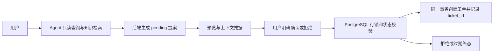

# Project Copilot 当前架构

## 知识检索与回答

```mermaid
flowchart LR
    U[用户问题] --> R[统一最终检索服务]
    R --> D[Dense Top 10]
    R --> B[BM25 Top 10]
    D --> F[RRF c=60 Top 10]
    B --> F
    F --> X[BGE Cross-Encoder CUDA float16]
    X --> T[最终 Top 5 原文与来源]
    T --> Q[/rag/ask 回答与引用]
    T --> A[/agent/ask search_knowledge]
```

`FinalRetriever`由普通RAG和Agent知识工具共用。完成清单与Qdrant中的实际片段验证身份；BM25快照包含同一清单和片段，按清单变化在锁内重建，在验证临时文件后原子替换。上传在清单提交和当前BM25快照发布后才返回indexed；失败后重试复用D18稳定ID。读写进程须共享清单目录及其文件锁；该方案依赖文件系统正确支持`flock`和原子rename，不等同于跨主机分布式锁。

重排固定`BAAI/bge-reranker-v2-m3` revision `953dc6f6f85a1b2dbfca4c34a2796e7dde08d41e`，CUDA float16、batch 2、max length 512；只读取本地缓存。每个应用进程独立保存一个模型实例、首次使用时加载并预热，线程内串行推断；多进程各占自己的显存。明确配置cpu/float32可以运行同一完整流水线，不自动回退。GPU错误、超时、快照或任一检索分支错误明确失败；空清单返回无证据。超时无法强杀底层CUDA调用，实例失效并等待已启动工作结束后释放。

## 工单与Agent

PostgreSQL工单API经Pydantic→Service→独立Session/事务→数据库，数据库生成真实ID和时间；查询使用绑定参数。LangGraph按AIMessage.tool_calls→后端白名单/Schema→真实只读服务→匹配tool_call_id的ToolMessage循环，受模型、工具、上下文和时间预算限制。最终来源由后端构建，合法来源不等于模型每句话都已得到事实支持。请求history只在本次使用，未实现持久聊天会话。

D29受控写入功能须在本次最终检索验收及独立推送后重新实现；仅有模型文本不能成为写入权限。D32部署和D33 Phoenix Trace仍待执行，当前`trace_exported=false`。


## 工单确认与事务



上下文随机令牌只保存哈希、作为有限范围的bearer凭据，尚无用户登录和租户授权。提案内容和终态受数据库触发器保护，确认事务以action ID唯一创建键保证重复和并发确认不重复写工单；检索仍使用统一FinalRetriever，模型不能访问确认工具。请求异常或提交失败时事务回滚；无法强杀的Agent工具线程在极窄取消竞争下可能留下未确认提案，但不能创建工单。

当前保留的D20 `POST /tickets`是本地开发直建接口，本身没有身份认证，也不经过D29提案确认。D29的确认保障适用于Agent受控创建路径；如果部署到不可信网络，必须先为包括该旧接口在内的所有写接口增加真实身份认证、授权及网络隔离，不能将本地bearer上下文冒称完整安全边界。
