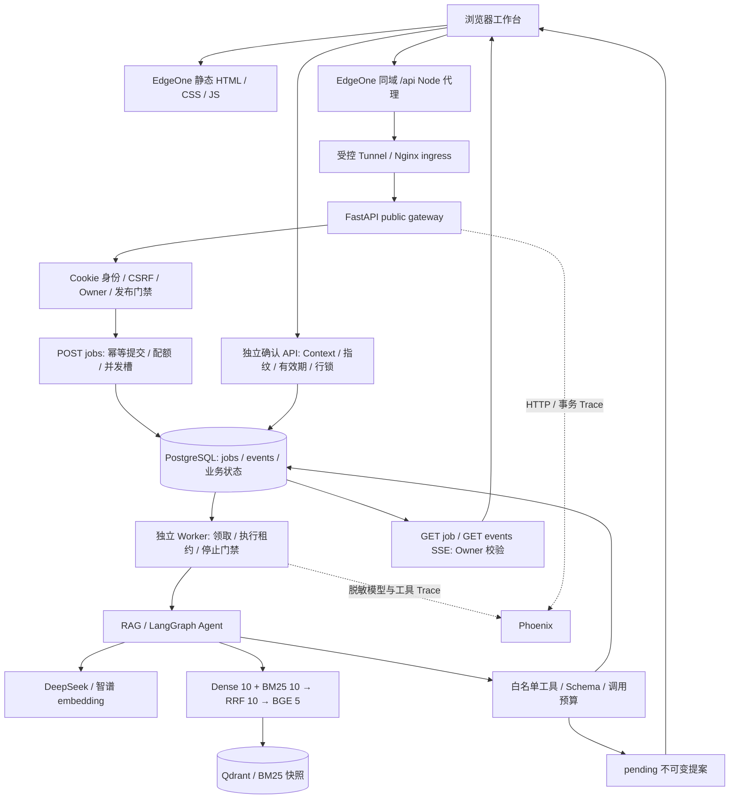

# Project Copilot 当前工程架构

本文描述当前源码的两条运行路径：公网形态的 EdgeOne → gateway → jobs → Worker，以及本机 FastAPI 同步入口。默认发布状态 CLOSED；PERSONAL_DEMO 是独立的限时、已有账号授权模式，不代表 STAGING/PUBLIC 验收。历史 D32 的本机部署证据见 [FINAL_ACCEPTANCE](FINAL_ACCEPTANCE.md)。

## 组件与接口

| 层 | 源码入口 | 职责 |
| --- | --- | --- |
| 页面与历史 | `web/assets/app.js`、`api.js`、`conversations.js`、`task-center.js` | 同域请求、最终回答与引用、安全 Markdown、提案确认、展示历史和任务恢复 |
| 静态构建 / 云函数 | `scripts/build_edgeone.mjs`、`cloud-functions/` | 显式资产白名单；只将 API 前缀替换为 `/api`；代理校验方法、路径、来源和请求大小 |
| 公网入口 | `infrastructure/public_gateway.py`、`api/access.py` | 校验代理身份、真实登录、发布状态、Owner 和写入 CSRF；拒绝旧同步模型接口和调试入口 |
| 持久任务 | `api/jobs.py`、`db/jobs.py` | 一次幂等提交、额度预留、账号/会话/Context 绑定；状态与事件保存在 PostgreSQL |
| 执行 | `services/ai_worker.py`、执行租约模块 | 独立领取、门禁复核、实际模型/工具调用、终态保存；不因浏览器断线重放任务 |
| Agent / RAG | `agent/`、`rag/` | LangGraph 条件路由与工具循环；共享最终 Hybrid＋BGE 检索 |
| 业务事务 | `services/approvals.py`、`db/` | 不可变提案、Context 校验、指纹、行锁、唯一创建键与事务提交 |
| 观测 | `infrastructure/tracing.py`、Phoenix | run_id / trace_id 与脱敏 Span；存储需 Phoenix 实际回读核实 |

Node 只用于 EdgeOne 云函数、构建、测试及独立面试模拟。包内本机页面由 `api/web.py` 直接提供，没有 Node 运行时要求。浏览器不持有供应商密钥，不直连 PostgreSQL、Qdrant 或 Phoenix。

## 一次任务和流式读取

1. 浏览器通过 Cookie 身份与 CSRF 发起一次 `POST /jobs`，携带幂等键；Agent 操作还使用页面内 Context。后端原子记录任务与额度预留。
2. Worker 领取任务，复核执行许可和租约；调用 RAG 或编译的 LangGraph，实际阶段写入事件 journal。
3. 浏览器使用 `GET /jobs/{id}` 和 `GET /jobs/{id}/events` 读取原任务。SSE 的 progress/delta 是过程展示；终态后再 GET 已校验结果，替换草稿。
4. 停止等待、刷新或流断线只影响读取。恢复按同一 job_id 查询，不重发 POST，不再次执行模型。failed/unknown 不能被界面自行改成成功；没有取消后台或退款语义。

任务持久化与图状态恢复不同：当前保存任务和结果，不持久化 LangGraph checkpoint。Worker 崩溃后的未知任务必须按运行手册调查，不自动重放可能产生副作用的步骤。详见[事件与失败语义](CHAT_EXPERIENCE.md)、[执行槽](PERSONAL_EXECUTION_SLOTS.md)。

## Cookie、执行 Context 与展示 history

| 数据 | 位置和寿命 | 授权边界 |
| --- | --- | --- |
| 登录 Cookie | 浏览器 HttpOnly Cookie；服务器保存会话状态 | 标识真实账号；公开写操作还校验 CSRF / Owner / 发布门禁 |
| CSRF | 从已认证会话取得，页面内存 | 写请求防护；不进入历史或恢复索引 |
| 执行 Context | 页面 `ContextSession` 内存；服务端只保留令牌哈希等权限状态 | 工具提案与确认的局部能力；不是 history，也不替代登录 |
| 展示 history | 默认页面内存；用户主动开启后为按账号隔离的 IndexedDB 白名单 DTO | 普通问答、最终来源、只读历史提案；不含 Cookie/CSRF/Context token/审批指纹，不恢复确认权限 |
| 任务恢复索引 | 按账号隔离的 localStorage 有限元数据 | 保存 job_id、类型、时间等，仍须后端鉴权 GET；不保存正文或凭据 |

切换或返回历史时丢弃可执行 Context；旧提案只供查看。继续对话由一次新的主动发送建立新 Context。模型接收的有界 history 是普通消息文本，不是授权凭据。IndexedDB 不是端到端加密，也不保证跨设备、隐私模式或清理存储后的保留。详见[历史对话](CHAT_HISTORY.md)。

## 检索与索引一致性

当前业务参数为切分 750/150、embedding-3 的 2048 维向量、Dense 10＋BM25 10、RRF c=60 取 10、BGE 重排取 5。`BAAI/bge-reranker-v2-m3` 固定 revision `953dc6f6f85a1b2dbfca4c34a2796e7dde08d41e`，batch2、max_length512、本地模型缓存。GPU 为 cuda/float16，CPU 为显式 cpu/float32；重排 logit 不是置信概率。

上传与查询共享完成清单及文件锁；BM25 快照不匹配时校验临时文件、fsync 并原子替换。检索错误明确失败，不静默使用过期快照或降级纯 Dense。锁要求共享且支持 flock/rename 的文件系统，不是分布式索引协议。GPU 按进程占显存；等待超时不能强杀正在运行的 CUDA 线程。

## 工单确认与事务

模型只能调用白名单工具。无有效 Context 时只有只读查询；有凭据时可提出 `propose_ticket`，不会获得确认工具。聊天中的“确认”不是写授权。

浏览器先读取服务端不可变提案，再由独立确认接口检查身份、Context、payload_fingerprint 和有效期。事务持行锁，以 action ID 的唯一创建键创建工单并更新 completed/ticket_id；重复确认同一 action 返回同一工单，不保证不同 action 的语义去重。写入响应不明确时只读查询实际状态，不自动重发。

本机旧 `POST /tickets` 是兼容本地直建接口；公网形态通过 gateway/入口限制和业务鉴权使用受控路径，不能直接对外暴露旧本机接口。

## Trace 与部署边界

HTTP 与 Worker 执行分别建立 Trace；Worker 使用 job_id 关联执行。Span 只含阶段名、状态、数量、数字 usage 等安全元数据，不含原文、请求头、Context token、密钥或异常原文。事务明确区分等待提交、提交和回滚。

OTLP 接受回执不等于查询收存证明，仍需 Phoenix 回读。导出失败保留业务结果并记录脱敏诊断；SSE 不为回填 Trace header 缓存整个流。父子 Span 嵌套耗时不能直接相加当作端到端延迟。

本机 Docker 运行 API、迁移、PostgreSQL、Qdrant、Phoenix；公开模式另有 ingress 和独立 Worker。密钥、模型与私有证据不进入前端构建。新增迁移、源码或发布条件需按运行手册重新核对，不能用环境开关或模拟证据绕过 CLOSED。[部署](DEPLOYMENT.md)、[公网安全](SECURITY_MODEL.md)、[发布清单](RELEASE_CHECKLIST.md)分别记录边界。

## 本地面试模拟的隔离

`node scripts/interview_demo.mjs` 是独立 Node 原生服务，只绑定 127.0.0.1，在系统临时目录调用真实静态构建。它只在内存 HTML 中注入模拟标识和场景工具栏；生产 JS/CSS、EdgeOne 构建白名单和后端均无模拟开关。固定 fixture 模拟 API 与 SSE，不调用模型、数据库、追踪或任何上游；所有未知路由失败关闭。它验证交互合同，不证明真实部署的权限、并发或模型质量，详见[面试指南](INTERVIEW_GUIDE.md)。
