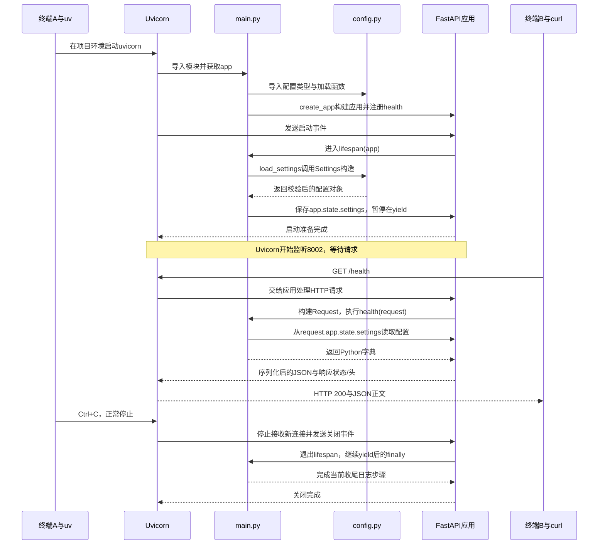

# D1：设计、代码与运行导读

补讲日期：2026-10-10。对应首次提交 `8c2de0c`。本次补教学流程和文档，不新增业务功能。下文命令供逐步复现，输出标为预期；本次未重新启动服务，也未登记用户完成操作。

用途更新（2026-10-11）：本导读保留为ChatGPT代码与架构教学参考。按 [三方协作规则](COLLABORATION_RULES.md)，Codex不默认进行系统逐行教学；下文命令/脚本不是当前操作指令。用户完成学习并主动要求“开始今天的手动测试”后，Codex一次只指导一个环节，等待反馈再继续。

## 1. 今天实现了什么，为什么这样分

当前目标是让独立后端启动、读到正确配置、回应一次HTTP请求。后续RAG和Agent沿用这个入口，先把基础运行问题单独验证。

| 新增内容 | 职责及阅读重点 |
| --- | --- |
| `pyproject.toml` | 项目名、Python要求、三个运行依赖；uv_build负责构建src布局的Python包 |
| `.python-version` | uv选择Python3.13；不会替代依赖声明 |
| `uv.lock` | 具体依赖版本和来源，由uv生成；检查版本/来源，无需逐行背包元数据 |
| `.venv` | 本项目依赖安装位置，未提交Git；无需手动激活即可使用uv run |
| `.gitignore` | 排除.env、虚拟环境、缓存及数据；保留无密钥的.env.example |
| `.env.example` | 可选配置模板；程序不会自动读取它，实际读取新项目根目录.env |
| `src/project_copilot/__init__.py` | 标识独立Python包，当前只有说明 |
| `config.py` | 字段、配置来源、校验与加载；不负责启动HTTP服务器 |
| `main.py` | 应用构建、生命周期、健康路由；不负责声明配置约束 |
| README与docs | 运行说明、路线、实施证据、学习和面试记录 |

参考原 `src/agent/api.py` 和 `src/agent/utils/config.py` 的入口与Settings模式。原入口还初始化向量库和Trace，本日新入口按当前需求自行精简设计；实际导入不会构造Settings或连接外部资源，但会执行应用构建和路由注册。

## 2. 先学会启动和停止

FastAPI负责“某个URL由哪个函数处理”；Uvicorn负责监听端口、接收HTTP请求并调用应用，二者通过ASGI接口协作。uv负责Python项目环境和命令运行，uv与Uvicorn是两个不同工具。

在VSCode打开终端A：

```bash
cd /home/yanye/project-copilot
uv sync --locked
uv run --frozen uvicorn project_copilot.main:app --host 127.0.0.1 --port 8002
```

| 命令部分 | 含义 |
| --- | --- |
| `uv sync --locked` | 核对声明与锁文件一致，并同步项目.venv；不一致就报错 |
| `uv run --frozen` | 在项目环境运行后面的命令，沿用锁文件，不更新锁文件；仍可能同步依赖，不等于离线 |
| `uvicorn` | HTTP服务器程序 |
| `project_copilot.main` | Python模块路径，对应src/project_copilot/main.py；包经uv安装后可导入 |
| `:app` | 使用该模块的app变量，不是函数调用 |
| `--host 127.0.0.1` | 监听本机回环地址 |
| `--port 8002` | 使用8002端口；这不是Settings.environment决定的 |

终端A预期显示 `Application startup complete`、`Uvicorn running on http://127.0.0.1:8002`。命令持续运行、没有返回提示符是正常状态；它正在等待请求。参数含义以本项目 `.venv/bin/python -m uvicorn --help` 为准；uv行为见 [官方运行说明](https://docs.astral.sh/uv/concepts/projects/run/)。

保持A运行，打开终端B：

```bash
curl --fail --include http://127.0.0.1:8002/health
```

curl发出GET请求；`--include`显示响应头，方便看到状态码；`--fail`让HTTP4xx/5xx表现为命令失败。预期状态为HTTP200，正文为：

```json
{"status":"ok","service":"Project Copilot","environment":"development"}
```

终端A还应出现访问日志，其中包含 `GET /health` 和 `200 OK`。也可在浏览器访问同一个URL；`/docs`是自动生成的API交互文档，可展开GET /health并点击Try it out、Execute观察响应。

返回A按Ctrl+C，预期出现关闭日志并恢复命令提示符。首次练习先完成这一轮，不必同时引入.env和自动重载。

## 3. 完整过一遍main.py

按 [main.py](../src/project_copilot/main.py) 的真实行序阅读：

| 位置 | 代码及含义 |
| --- | --- |
| 文件开头 | 三引号是模块说明，不参与HTTP处理 |
| `import logging` | Python标准库日志工具，提供info/warning/error等等级 |
| `from collections.abc import AsyncIterator` | 导入异步迭代器类型，供下面函数的返回类型标注使用；不是开启并发的开关 |
| `from contextlib import asynccontextmanager` | 导入装饰器，将带yield的异步生成器包装为异步上下文管理器 |
| `from fastapi import FastAPI, Request` | FastAPI构建应用；Request是一次HTTP请求的对象类型 |
| 导入Settings与load_settings | 前者是配置类型，后者是实际加载函数 |
| `logger = logging.getLogger(__name__)` | 获取按模块名命名的日志对象；本模块__name__通常为project_copilot.main |
| `def create_app(settings: Settings \| None = None) -> FastAPI` | 普通函数：可传配置对象，也可不传；返回应用。`\| None`允许空值，`= None`是默认参数，箭头是返回类型提示 |
| 在create_app中定义两个函数 | 把它们绑定到这次创建的应用及配置；定义时不执行函数体 |
| `FastAPI(title=..., version=..., lifespan=lifespan)` | 构建应用并交给框架一个生命周期函数；title/version用于API文档 |
| `@application.get('/health', tags=['health'])` | 定义时注册GET路径和处理函数；tags用于API文档分组 |
| `async def health(request: Request) -> dict[str, str]` | 请求到来后FastAPI提供Request并执行函数；返回值是字符串键/值的字典，框架将其序列化为JSON。FastAPI也支持普通def |
| `active_settings: Settings = request.app.state.settings` | 从这次请求所属应用读取启动时保存的配置；冒号是类型提示，不是重新加载.env |
| health中的return | 返回状态、服务名称和环境标签；当前environment不控制调试模式，app_name也不改变上面固定的文档title |
| `return application` | create_app的返回值是应用对象，不是健康JSON |
| `app = create_app()` | 模块导入时构建应用，供Uvicorn找到；还未进入lifespan |

### lifespan中的陌生语法

实际代码：

```python
@asynccontextmanager
async def lifespan(application: FastAPI) -> AsyncIterator[None]:
    application.state.settings = settings if settings is not None else load_settings()
    logger.info("Starting %s", application.state.settings.app_name)
    try:
        yield
    finally:
        logger.info("Stopping %s", application.state.settings.app_name)
```

`async def`定义异步函数；这里又含yield，所以原函数是异步生成器。装饰器使它可按“进入、运行、退出”管理。`AsyncIterator[None]`说明yield交出的值是None；这里不需要交出业务数据，只需要暂停点。此标注不是HTTP返回类型，也不会自动执行异步循环。

第一行赋值中的条件表达式可理解为：传入了配置对象就直接使用，否则调用load_settings。`application.state`是应用级状态容器，把配置保存在这里，让各次请求访问同一份启动配置。以后测试时可传入固定配置，减少对本机环境的依赖。

`yield`前加载配置；框架运行服务时停在yield；正常关闭并退出生命周期上下文时执行finally。它不会每收到一次请求就启动/关闭一次。load_settings在try之前，加载失败时未进入该try，也不会执行这个finally；今天没有需关闭的外部资源。官方原理见 [Python asynccontextmanager](https://docs.python.org/3.13/library/contextlib.html#contextlib.asynccontextmanager)、[FastAPI lifespan](https://fastapi.tiangolo.com/advanced/events/)。

`logger.info('Starting %s', value)`记录INFO消息，并用value替换%s。日志支持等级和来源，便于以后排查；它与直接print不同。**当前尚未配置项目logger的INFO输出，因此默认命令通常只看到Uvicorn自己的日志，看不到这两条项目消息**，`--log-level info`也不自动打开项目logger。不用这两行作为启动验收标准。logging规则见 [Python日志文档](https://docs.python.org/3.13/library/logging.html)。

## 4. 完整过一遍config.py

| 代码 | 含义及用途 |
| --- | --- |
| `from pathlib import Path` | 用路径对象处理文件位置，避免手工拼字符串 |
| `from typing import Literal` | 表示类型允许的固定取值 |
| Field、BaseSettings、SettingsConfigDict | 分别声明字段约束、配置读取基类、配置读取规则 |
| `Path(__file__).resolve().parents[2]` | __file__为本文件路径；resolve取绝对位置；parents[0]是project_copilot包目录，[1]是src，[2]是新项目根 |
| `PROJECT_ROOT / '.env'` | Path的/运算拼接路径，固定新项目dotenv位置 |
| `class Settings(BaseSettings)` | 继承配置读取能力；定义类时不读取，创建实例时读取并校验 |
| `env_file=ENV_FILE`、UTF-8 | 读取指定dotenv文件，按UTF-8解码；没有文件时仍可使用环境变量及默认值 |
| `env_prefix='PROJECT_COPILOT_'` | 字段app_name对应环境变量PROJECT_COPILOT_APP_NAME |
| `extra='ignore'` | 忽略未知配置项；已声明字段的非法值依然报错 |
| `str_strip_whitespace=True` | 去除字符串首尾空白，再参与字段约束校验 |
| `app_name: str = Field(...)` | 默认Project Copilot，长度1～80；全空格去除后为空，校验失败 |
| `environment: Literal[...]` | 只允许development/test/production，默认development；限制由Pydantic实例化校验执行 |
| `def load_settings(*, env_file: Path \| None = ENV_FILE) -> Settings` | 星号后只能用关键字传参，如load_settings(env_file=...)；允许指定路径或None |
| `return Settings(_env_file=env_file)` | 创建配置实例；_env_file是基类提供的文件来源控制参数，不是业务字段；None禁用dotenv读取，但不禁用进程环境变量 |

当前项目字段来源的优先级：构造参数 → 进程环境变量 → 指定.env → 默认值。规则见 [Pydantic Settings](https://pydantic.dev/docs/validation/latest/concepts/pydantic_settings/)。配置在本应用启动时加载一次，修改后需要重启服务。

### 从终端命令到实际响应：把两个文件连起来

2026-10-11补充。本节按真实时间顺序解释当前代码；范围为第2节的单进程命令，没有开启reload或多worker。以下是源码调用链分析，本轮没有重新运行服务。逐行阅读后，要沿这条链找到“谁触发函数、参数从哪来、结果交给谁”。

先看整体时序，随后把各阶段落到具体行。行号对应当前D1源码。



#### A. 输入uv run：先执行工具，再导入Python模块

```bash
uv run --frozen uvicorn project_copilot.main:app --host 127.0.0.1 --port 8002
```

终端把这条命令交给uv。uv在新项目根目录识别pyproject、选择项目Python环境并按已有锁文件同步所需依赖，然后执行Uvicorn。包已安装到项目环境，所以Uvicorn能通过模块名找到src中的project_copilot包；uv不会按main.py行号直接调用health。

Uvicorn解释 `project_copilot.main:app`：先导入 `project_copilot.main`，等导入完成后获取模块上的 `app` 属性。首次导入包还会执行 `__init__.py`，当前只有包说明。

| 执行位置 | 当前发生的事情 | 留给后面发生的事情 |
| --- | --- | --- |
| main.py第3～9行 | 导入库；第9行需要先导入config模块 | lifespan和health还没被调用 |
| config.py第10～11行 | 算出新项目根目录与.env绝对路径 | 尚未读.env内容 |
| config.py第14～26行 | 执行类定义，建立字段、默认值与校验规则 | 尚未创建Settings实例 |
| config.py第29行 | 定义load_settings函数，默认文件路径绑定为ENV_FILE | 第31行要等函数被调用才执行 |
| 返回main.py第12、15行 | 获取logger，定义create_app函数 | create_app的函数体等第41行调用 |
| main.py第41行 | 调用create_app，默认参数settings为None | 转入下面的应用构建流程 |

遇到def时，Python先创建函数对象；函数体在调用时才执行。源码书写顺序与函数体执行顺序因此需要分别追踪。

#### B. create_app执行：构建应用并登记处理关系

从main.py第41行进入第15行函数后：

1. 第18～25行定义并包装lifespan，留下一个可交给框架的生命周期函数，其函数体此时尚未执行。
2. 第27行创建FastAPI对象，暂存在局部变量application中；`lifespan=lifespan`把生命周期函数交给框架保存。
3. 第29～36行定义health，通过装饰器登记“GET /health由这个函数处理”；第31～36行尚未执行。
4. 第38行返回这个应用；回到第41行，模块变量app接收它。

Uvicorn获取app时，得到的就是这个已经登记路由、尚未加载项目配置的FastAPI对象。这里建立的是两种调用约定：服务启动/关闭时调用lifespan；请求路径匹配时调用health。

#### C. 服务启动：进入lifespan，跨文件加载配置

接下来Uvicorn通过ASGI生命周期协议通知应用启动。FastAPI/Starlette进入之前保存的生命周期上下文，执行main.py第19行的lifespan，并把当前应用传入application参数。

```text
main.py:20  settings是None，选择load_settings()
  → config.py:29 进入load_settings
  → config.py:31 调用Settings(_env_file=env_file)
  → Pydantic读取配置来源、合并字段值、执行校验
  → 返回一个Settings实例
  → 返回main.py:20，保存到application.state.settings
  → main.py:21 记录启动消息
  → main.py:23 暂停在yield
```

默认值最终形成的对象，可以概念上理解为：

```text
app.state.settings.app_name = "Project Copilot"
app.state.settings.environment = "development"
```

此处保存的是已读取、已校验的Python对象。它是后续请求的数据来源，不是.env文件本身。

到达yield，框架知道启动准备已完成，向服务器报告startup.complete。当前标准host/port路径中，Uvicorn随后开始监听127.0.0.1:8002，等待请求。生命周期函数保持暂停，由框架其他执行路径处理请求；没有在lifespan里调用health。启动事件与启动完成事件的约定见 [ASGI生命周期协议](https://asgi.readthedocs.io/en/latest/specs/lifespan.html)。

若Settings校验失败，这条链在config.py第31行中断，启动失败，尚未进入处理健康请求的阶段。不是curl收到请求后再发现错误。

#### D. 输入curl：在另一个进程触发已注册的health

```bash
curl --fail --include http://127.0.0.1:8002/health
```

curl是客户端。它把GET方法、/health路径等请求信息发送给已有服务器；本机代理配置可能影响网络传输路径，但不改变到达应用后的处理链。

| 顺序 | 执行者/位置 | 数据怎样传递 |
| --- | --- | --- |
| 1 | Uvicorn | 接收并解析HTTP请求，通过ASGI把请求信息交给应用 |
| 2 | FastAPI/Starlette路由 | 按GET方法和/health路径匹配之前登记的处理函数 |
| 3 | 框架创建Request | 把本次请求包装为对象，并提供给health的request参数 |
| 4 | main.py第30～31行 | health开始执行，从request.app.state.settings获取启动配置 |
| 5 | main.py第32～36行 | 把配置字段填入一个Python字典并返回给框架 |
| 6 | FastAPI响应处理 | 根据返回类型处理并序列化为JSON字节，形成默认200状态和application/json内容类型 |
| 7 | Uvicorn与curl | 服务器发回HTTP响应，curl按--include显示响应头和正文，然后结束这次命令 |

返回字典转为JSON的行为见 [FastAPI基础流程](https://fastapi.tiangolo.com/tutorial/first-steps/)。不同版本的内部编码路径可以变化，本项目无需自行调用json.dumps或手拼HTTP报文。

终端输出中的对应关系：

```text
HTTP/1.1 200 OK              ← 路由响应默认状态码
Content-Type: application/json ← 框架生成的响应内容类型
{"status":"ok", ...}         ← health返回字典序列化后的正文
```

正文中的status字段与HTTP状态码是两项独立信息。`"status": "ok"`是我们自己写的数据，HTTP200由框架的默认响应状态决定。curl的--fail根据HTTP错误状态判断失败，不根据JSON中的status字符串。

#### E. 同一个应用对象把两条链接起来，关闭时再退出lifespan

当前单应用场景中，下面四种写法指向同一个FastAPI对象：

```text
create_app局部变量application
    = 返回后main模块的app
    = 框架传给lifespan的application参数
    = 请求对象的request.app
```

名字相同不是它们关联的原因；原因是返回值与框架传参都传递了同一个对象引用。所以启动时写 `application.state.settings`，请求时就能读 `request.app.state.settings`。

每次请求有自己的Request，访问的是同一应用的配置。连续curl三次：本次单进程启动只构建一个应用、正常启动只加载一份配置，health执行三次。后两次请求沿D阶段执行，不重新导入main或调用create_app，也不重新读.env。

在终端A按Ctrl+C正常停止时，Uvicorn停止接收新连接、等待正在处理的工作，再通知应用关闭；框架退出生命周期上下文，让执行继续到main.py第24～25行的finally，完成当前日志收尾。最后服务进程结束，终端A恢复提示符。一次curl结束仅结束客户端命令，不会关闭服务器。

这一轮需要联系起来的两条主线是：

```text
启动：uv → Uvicorn → 导入main/config → create_app → app
     → lifespan → load_settings → Settings → app.state.settings → 等待请求

请求：curl → Uvicorn → 路由匹配 → health(request)
     → request.app.state.settings → Python字典 → JSON响应 → curl输出
```

供ChatGPT组织学习的对照问题：指出配置错误会在哪条链中断；解释为什么改.env后未重启时响应仍使用旧值；指出换成不存在的路径时为何不会执行health。学习与手动验证按A/B分别登记，下一Day需用户明确要求。

## 5. 用两次变化理解校验

先完成默认健康请求并停止服务，再在A执行：

```bash
PROJECT_COPILOT_APP_NAME="Copilot Learning" uv run --frozen uvicorn project_copilot.main:app --host 127.0.0.1 --port 8002
```

命令前的赋值只为该次命令提供环境变量，无需修改Python。B再次curl，预期service变为Copilot Learning，其他字段不变；用这个变化对应config.py的env_prefix和main.py的返回字段。完成后在A按Ctrl+C。

接着在A执行错误配置：

```bash
PROJECT_COPILOT_ENVIRONMENT=staging uv run --frozen uvicorn project_copilot.main:app --host 127.0.0.1 --port 8002
```

预期启动失败，错误包含environment的允许取值。对照调用链：lifespan → load_settings → Settings校验 → 失败，尚未处理HTTP请求。这是主动拒绝非法配置，不是需要“修到允许staging”的Bug。该次赋值不修改后续终端环境；回到正常启动命令即可。

可选进一步观察：先在A重新运行第2节的正常启动命令，等待启动完成，再在B执行 `curl --fail http://127.0.0.1:8002/openapi.json`，在paths中查找/health；结束后在A按Ctrl+C。另可执行 `uv sync --locked --offline --check` 检查当前环境是否已同步。这些命令分别检查接口声明与依赖环境，不能替代健康请求。

## 6. 之前9组离线检查怎样复现

之前是助手执行的一次性内联脚本，日志只写省略号，不便复现。这次提供同范围的完整教学版本；**本轮只检查脚本语法，未重跑这9组，也未记作用户操作结果**。先理解前面的启动/请求/失败三步，再选择阅读附录，不需在第一次学习时理解全部mock和asyncio细节。

`<<'PY'`到末尾单独一行PY之间是交给Python执行的脚本；下面整体复制到新项目根目录的终端即可。它不启动HTTP服务、不请求模型、不读原项目.env。临时目录和环境覆盖只在当前Python进程中有效。

```bash
.venv/bin/python - <<'PY'
import asyncio
import importlib
import os
from pathlib import Path
from tempfile import TemporaryDirectory
from unittest.mock import patch

from pydantic import ValidationError
from pydantic_settings import BaseSettings
from project_copilot.config import ENV_FILE, PROJECT_ROOT, Settings, load_settings

expected_root = Path.cwd().resolve()
with patch.dict(os.environ, {}, clear=True), TemporaryDirectory(prefix="copilot-d1-") as temp:
    assert PROJECT_ROOT == expected_root and ENV_FILE == expected_root / ".env"
    print("PASS 1: new project dotenv path")

    default_settings = load_settings(env_file=None)
    assert default_settings.app_name == "Project Copilot"
    assert default_settings.environment == "development"
    print("PASS 2: defaults without dotenv")

    sample_env = Path(temp) / ".env"
    sample_env.write_text(
        "PROJECT_COPILOT_APP_NAME=Dotenv Name\nPROJECT_COPILOT_ENVIRONMENT=test\n",
        encoding="utf-8",
    )
    dotenv_settings = load_settings(env_file=sample_env)
    assert dotenv_settings.app_name == "Dotenv Name" and dotenv_settings.environment == "test"
    print("PASS 3: explicit dotenv")

    with patch.dict(os.environ, {"PROJECT_COPILOT_APP_NAME": "Environment Name"}):
        assert load_settings(env_file=sample_env).app_name == "Environment Name"
        assert Settings(_env_file=sample_env, app_name="Constructor Name").app_name == "Constructor Name"
    print("PASS 4: constructor > environment > dotenv > default")

    expected_settings = load_settings().model_dump()
    foreign_name = "Foreign-" + Path(temp).name
    sample_env.write_text("PROJECT_COPILOT_APP_NAME=" + foreign_name + "\n", encoding="utf-8")
    original_dir = Path.cwd()
    try:
        os.chdir(temp)
        assert load_settings().model_dump() == expected_settings
        assert load_settings().app_name != foreign_name
    finally:
        os.chdir(original_dir)
    print("PASS 5: changing cwd does not select its dotenv")

    for invalid_name in ("", "   ", "x" * 81):
        try:
            Settings(_env_file=None, app_name=invalid_name)
        except ValidationError:
            pass
        else:
            raise AssertionError("Invalid name was accepted")
    print("PASS 6: invalid names rejected")

    try:
        Settings(_env_file=None, environment="staging")
    except ValidationError:
        pass
    else:
        raise AssertionError("Invalid environment was accepted")
    print("PASS 7: invalid environment rejected")

    with patch.object(BaseSettings, "__init__", side_effect=AssertionError("Settings constructed during import")):
        main = importlib.import_module("project_copilot.main")
        assert not hasattr(main.app.state, "settings")
    print("PASS 8: importing app does not instantiate Settings")

    async def check_lifespan():
        injected_settings = Settings(_env_file=None, app_name="Injected App", environment="test")
        isolated_app = main.create_app(injected_settings)
        async with isolated_app.router.lifespan_context(isolated_app):
            assert isolated_app.state.settings is injected_settings
        with patch.dict(os.environ, {"PROJECT_COPILOT_ENVIRONMENT": "staging"}):
            failing_app = main.create_app()
            try:
                async with failing_app.router.lifespan_context(failing_app):
                    raise AssertionError("Invalid startup reached running state")
            except ValidationError:
                pass

    asyncio.run(check_lifespan())
    print("PASS 9: injected settings and startup validation")
print("Total: 9 offline verification groups; no model or database calls.")
PY
```

assert表示“不满足这个条件就报错”；ValidationError是Pydantic的校验错误；patch临时替换环境或函数，退出with后还原；TemporaryDirectory提供测试文件位置并在退出时清理；asyncio.run运行异步检查；async with进入和退出lifespan。第8组用会抛错的构造替身证明导入没有创建配置，第9组则主动进入生命周期，验证它确实加载/使用配置。

第5组先保存正常配置，再给临时目录.env设置唯一名称，切换当前目录后配置应与切换前一致。这里的9组检查与真实HTTP请求是两类证据，理解一类不能自动登记另一类完成。

## 7. 理解到什么程度可以继续

ChatGPT学习目标：能解释导入应用 → 构建并注册路由 → 进入lifespan加载配置 → 请求进入health → 返回JSON → 关闭生命周期，并在代码中定位步骤。学习后主动回Codex开启手动测试，亲自观察启动、响应与关闭；记录真实结果后登记B阶段。A/B都完成且用户要求继续，才进入下一Day。代码默认由Codex编写，手工编写业务代码不是必做门槛。
