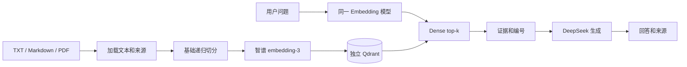
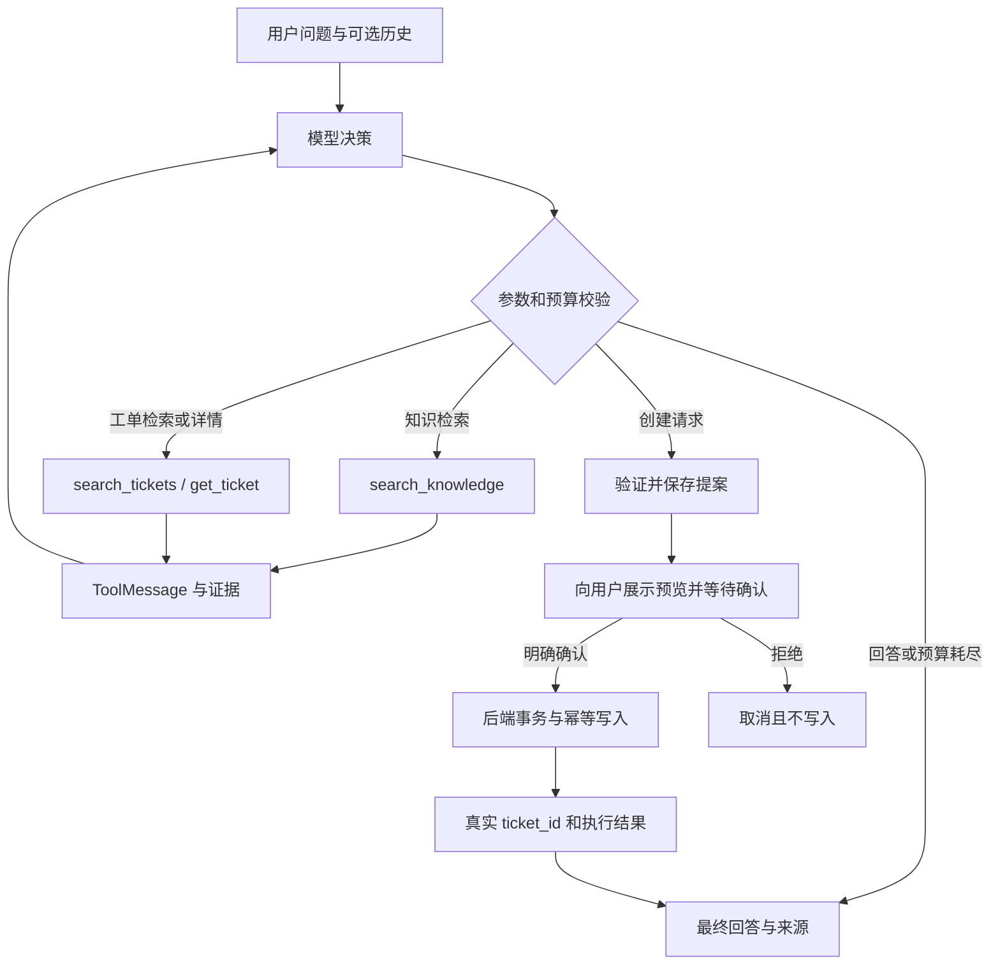

# Project Copilot：开发与学习计划

编写日期：2026-10-09。项目：**基于 RAG 与 LangGraph 的研发知识及工单协作智能体**。

本计划遵循用户的 V4 总指令，并根据并行系统学习与面试准备的安排于2026-10-09修订：34个主任务日＋1个可前移弹性日，每日项目投入1.5～2.5小时。已完成审计单列为前置成果。按 [三方协作规则](COLLABORATION_RULES.md)，D1–D5阶段A/B均完成，D3收尾及Prompt/Agent/MCP计划微调已由用户推送f50abd4，35日结构不变。D4于2026-10-13实施，代码提交4349c10于次日由用户推送；2026-10-14用户8项手测通过并确认学习理解。D5代码e01ad7d已推送，2026-10-15用户完成10个手测环节并确认学习理解。实际进度见第10节及 [开发日志](DEVELOPMENT_LOG.md)。参考证据、阶段0 Git状态与测试边界见 [REFERENCE_AUDIT.md](REFERENCE_AUDIT.md)。原仓库中的旧计划保留为历史资料，后续新项目以本文件为准。

## 1. 工作区现状与开发边界

下表保留2026-10-09阶段0审计快照；其Git限制和应用状态不是最新进度。2026-10-10的D1进展见表后说明及第10节，不覆盖历史测试结论。

| 项目 | 阶段0核实结果 |
| --- | --- |
| 原项目 | `/home/yanye/conversational-agent-langchain` 可读取，只作为技术参考；当前有 9 个已修改文件及未追踪文档 |
| 新项目 | `/home/yanye/project-copilot` 可读取，本轮文档写入成功；应用代码基本为空 |
| Git | 原项目有有效 Git 历史；新项目虽然存在 `.git` 目录，但 `git status` 返回 `not a git repository`，该目录在当前工作区为只读，尚不能正常初始化 |
| 环境 | 原项目有独立 `.venv`，指向 Python 3.13；系统 `python3` 为 3.12.3，`python` 命令不可用；存在 uv 与 Docker CLI，未验证 Docker daemon 可用 |
| 本轮产物 | 仅本计划和参考审计文档；未创建应用、Compose、评测集或整套空目录 |

阶段0曾需要解决新项目 `.git` 写权限，不能把“目录存在”当成“Git初始化成功”。D1在新项目范围内通过环境审核后成功执行 `git init --initial-branch=main`；Git顶层为新项目，已建立独立 `.venv` 与最小健康入口。原仓库的未提交状态保持不变。

所有新代码、配置、测试、实验与学习记录都落在新项目。D1已创建独立Python包和虚拟环境；不直接 import 原项目模块，不将原项目加入 `PYTHONPATH`，不复制旧 `.env`、数据库目录或未提交历史。原项目模块存在导入时连接数据库、构建模型和加载配置的副作用。

## 2. 业务目标与核心版本范围

核心场景是：“上传文档报错，查研发资料与类似工单；如果没有合适工单，整理内容让我确认创建。”

最终需要完成七项可演示能力：上传中文研发资料；知识问答与证据引用；查询真实工单；Agent 综合知识和工单；预览并确认后创建工单；查看对应 Trace；展示真实的 RAG 优化对照结果。

核心版本面向单用户、本地演示、单后端实例。FastAPI 文档界面与 curl 足够完成早期交互；复杂前端、完整账户系统、多 Agent、队列、微服务和模型训练暂不安排。模型只采用 DeepSeek 对话/工具调用、智谱 `embedding-3`，以及经本项目中文用例验证后选择的 Rerank 方案。

工单状态来自 PostgreSQL，证据片段来自 Qdrant。模型提出工具请求，后端负责参数验证、查询范围、确认校验和事务写入；模型生成的“已创建”文字不能替代真实数据库结果。

## 3. 先理解这些术语

| 术语 | 本项目中的含义 |
| --- | --- |
| RAG | 先检索资料，再让模型基于证据回答 |
| Chunk / Metadata | 文档片段 / 随片段保存的文件名、页码、标题和标识 |
| Embedding / Dense | 把文本编码为向量 / 用向量相似度检索 |
| BM25 / Hybrid | 按词项及其统计信息检索 / 将词项检索与向量检索结合 |
| RRF | 根据两路结果的排名融合，不直接相加不同尺度的原始分数 |
| Rerank | 对已经召回的候选片段进一步评分并排序 |
| Baseline | 优化前冻结配置和结果的基础版本 |
| State / Node / Edge | 图流程共享的数据 / 执行步骤 / 步骤间连接与条件路由 |
| Tool Calling | 模型给出函数名和参数，应用执行并回传结果 |
| Trace / Checkpointer | 一次执行的追踪记录 / 用于保存和恢复图状态的组件 |
| 幂等 | 对同一操作的重复请求只产生一次业务写入效果 |

## 4. 复用策略：基础设施适配，核心逻辑逐步完成

下面的路径相对原项目根目录，详细行号及调用链见参考审计。后文引用中的 `nodes/` 指 `src/agent/backend/nodes/`，服务文件指 `src/agent/backend/services/`。

| 能力 | 参考位置 | 新项目采用方式 |
| --- | --- | --- |
| FastAPI、校验、日志 | `src/agent/api.py`、`src/agent/routes/`、`src/agent/data_model/` | 参考应用与路由分层；配置、客户端放在应用生命周期管理，不搬全部兼容接口 |
| Pydantic Settings | `src/agent/utils/config.py` | 保留配置模式，精简至实际供应商，显式指定新项目环境文件；密钥不写进日志 |
| DeepSeek | `src/agent/backend/graph.py`、`src/agent/backend/nodes/grading.py` | 参考已修改的参数处理；工厂显式接收 key、model、timeout、retry；基线不启用相关性评分或查询改写 |
| 智谱 Embedding | `src/agent/utils/embeddings.py` | 参考原文本输入、float 输出等适配；显式校验输出维度和请求/响应，移除闲置供应商分支 |
| Qdrant | `src/agent/utils/vdb.py`、`src/agent/utils/retriever.py` | 参考客户端、集合和 Document 映射；先使用 `DENSE`，稀疏模型到 Hybrid 阶段才初始化 |
| 文档读取 | `src/agent/backend/services/embedding_management.py`、`src/agent/routes/embeddings.py` | 参考 Text/PDF loader；因社区包停止维护，以UTF-8标准库和同款PDFium解析器薄适配，新写加载→切分→索引编排；上传处理须适配 |
| 引用 | `src/agent/utils/utility.py`、`src/agent/backend/prompts.py` | 参考片段编号；新响应保留稳定标识和原文，验证引用编号能映射到本次证据 |
| Hybrid 与 Rerank | `src/agent/utils/vdb.py`、`src/agent/utils/reranker.py`、`src/agent/backend/nodes/retrieval.py` | 用来学习接口和两阶段检索；新项目实现中文 BM25、可解释 RRF 和对照评测，不提前带入基线 |
| LangGraph | `src/agent/backend/graph.py`、`src/agent/backend/state.py` | 参考 State 与条件边；另建业务图，模型自主选择知识/工单工具，避免复制旧固定 RAG 流程充当业务 Agent |
| Phoenix | `src/agent/api.py`、`docker-compose.yml` | 参考批量导出和 OpenInference；独立项目名、开关、地址，按所选版本核验可用性 |
| Docker 与测试思路 | Dockerfiles、Compose、`tests/` | 参考构建、依赖就绪和分层测试；重新选择最小依赖与独立卷，测试按新增行为设计 |

直接移植实质代码时，保留上游 MIT 许可与版权说明，记录来源和改动。个人贡献主要来自新项目的核心实现、实质适配、实验与验证。

## 5. 推荐目录与模块职责

以下是逐步形成的目标结构，**不是本轮创建清单**。文件到对应小任务时再新增；初期一个模块保持一个文件，确有增长才拆分。

```text
project-copilot/
├── src/project_copilot/
│   ├── main.py                 # FastAPI 入口、lifespan、路由注册
│   ├── config.py               # 配置与参数校验
│   ├── api/
│   │   ├── documents.py        # 文档读取/上传接口
│   │   ├── rag.py              # 问答接口
│   │   ├── tickets.py          # 普通工单 API
│   │   └── agent.py            # 业务 Agent 与确认接口
│   ├── schemas/
│   │   ├── documents.py        # 文档与片段契约
│   │   ├── rag.py              # 问题、答案、引用契约
│   │   ├── tickets.py          # 工单输入/输出
│   │   └── agent.py            # Agent 状态响应、提案与确认输入
│   ├── infrastructure/
│   │   ├── models.py           # DeepSeek 与智谱客户端工厂
│   │   ├── qdrant.py           # 集合、索引、检索与维度检查
│   │   └── tracing.py          # Phoenix 开关与资源关闭
│   ├── rag/
│   │   ├── loaders.py          # TXT/MD/PDF → Document
│   │   ├── splitters.py        # 基线切分与实验策略
│   │   ├── ingestion.py        # 文档身份、片段生成、索引编排
│   │   ├── retrieval.py        # Dense 检索，后续 Hybrid 编排
│   │   ├── bm25.py             # 中文分词与词项索引，阶段3新增
│   │   ├── fusion.py           # RRF，阶段3新增
│   │   ├── rerank.py           # 候选重排，阶段3新增
│   │   └── answering.py        # 证据格式、提示词、回答与引用
│   ├── db/
│   │   ├── session.py          # Engine、Session 生命周期
│   │   └── models.py           # tickets，后续 pending_actions
│   ├── services/
│   │   ├── tickets.py          # 确定性查询、创建与事务
│   │   └── approvals.py        # 提案验证、确认状态、幂等执行
│   └── agent/
│       ├── state.py            # messages、证据、工具预算等
│       ├── tools.py            # 工具 Schema 与执行器
│       └── graph.py            # 模型决策、条件路由、终止
├── tests/                      # 无外网测试与隔离存储集成测试
├── evals/
│   ├── datasets/               # 来源清单、开发/保留用例、证据标注
│   ├── configs/                # 实验配置与索引清单
│   ├── results/                # 原始逐题结果与统计
│   ├── reports/                # 成功/失败对照分析
│   └── run.py                  # 检索评测，回答评测显式启用
├── docs/
│   ├── DEVELOPMENT_PLAN.md     # 路线和验收
│   ├── REFERENCE_AUDIT.md      # 本轮源码审计、学习与验证记录
│   ├── DEVELOPMENT_LOG.md      # 后续每个小任务的实际记录
│   ├── STUDY_NOTES.md          # 概念、调用链与代码理解
│   ├── INTERVIEW_NOTES.md      # 问题和证据驱动的回答
│   └── ARCHITECTURE.md         # 随实现更新的架构图
├── migrations/                 # 阶段5需要时添加
├── docker-compose.yml          # 阶段1先仅 Qdrant；其他服务逐步加入
├── Dockerfile                  # 按部署任务新增
├── pyproject.toml
├── uv.lock
├── .env.example
├── .gitignore
└── README.md
```

主要职责边界：API 校验请求并调用服务；RAG 模块负责证据链；infrastructure 管理外部客户端；tickets 服务管理真实业务；Agent 只通过受控工具访问这些服务。知识工具返回检索片段，避免每次工具调用内部再套一整轮评分和生成。

### 5.1 Dense 基线的数据流



原文件身份与解析后的证据位置分开记录。建议 metadata 至少有 `document_id`、`content_hash`、`source_name`、`chunk_id`、`chunk_index`、`index_version`；TXT/MD 的 `page` 可为空，PDF 保存真实页索引；标题和字符位置可逐步补充。稳定 chunk ID 由文档身份、切分配置指纹和片段位置生成。来源不能只靠文件名区分。

### 5.2 后续业务 Agent 的数据流



模型可以提出 `create_ticket(title, description)`，通用工具执行器必须拦截写操作，仅进入提案流程。实际写入函数只由验证了确认状态的后端路径调用。

## 6. 环境与数据隔离方案

端口是候选配置；实施当天只读检查占用后再确定，不能声称目前空闲。

| 资源 | 原项目现状 | 新项目设计 |
| --- | --- | --- |
| Python | 包名 `agent`、旧 `.venv` | 包名 `project_copilot`、新 `.venv`；优先 Python 3.13，独立依赖和锁文件 |
| 环境配置 | 旧 `.env`，含闲置供应商项 | 新 `.env` 与脱敏 `.env.example`；显式路径，不读取旧密钥文件 |
| Compose / 网络 | 旧 Compose；Qdrant 固定容器名 `qdrant` | project name 为 `project-copilot`；不配置固定 `container_name`，使用专属网络 |
| API | 宿主 8001 | `127.0.0.1:8002` |
| Qdrant HTTP | 宿主 6333 | `127.0.0.1:6433:6333`；容器内部仍 `http://qdrant:6333` |
| Qdrant gRPC | 宿主 6334 | 需要时才映射 `127.0.0.1:6434:6334` |
| Phoenix UI | 宿主 6006 | `127.0.0.1:6007:6006`；独立 tracing project `project-copilot` |
| Phoenix collector | 原项目映射 4317/4318 | 容器间使用核验后的内部地址；本地后端需要时映射 4417/4418，模板与代码地址一致 |
| PostgreSQL | 原项目未接业务数据库 | 独立服务与 `project_copilot` 数据库；宿主需要时映射 `127.0.0.1:5433:5432` |
| 前端 | 宿主 8501 | 核心版本不必有独立前端；需要 Streamlit 时使用 8502 |
| 持久化 | 旧 `vector_db/`、`phoenix_data/` 等相对目录 | Compose 项目专属 named volumes；不用 `external: true` 或固定的公共卷名 |
| Collection | 旧项目使用自己的集合 | `pc_knowledge_dense_v0` 起步，各切分实验独立版本；测试采用 `pc_test_*` |
| 测试存储 | 旧服务不作测试靶标 | 独立测试 PostgreSQL 数据库/实例与测试集合，只允许清理对应测试资源 |

Qdrant 向量维度、距离类型、向量字段名与模型配置必须一致。历史记录中的智谱实测为 2048 维；新项目通过最小 smoke 获取实际长度并校验。更改模型、维度或切分配置时建立新实验集合并重新索引，不能悄悄写进旧集合。

新 Compose 逐步加入服务，固定经验证的镜像版本，使用自己的构建上下文与 `.dockerignore`。不用原项目的 `latest` 和全部宽泛依赖作为新项目的版本保证。

## 7. 调整后的阶段与逐日计划：34个主任务日＋1个弹性日

### 7.1 为什么拆分原20日计划

原计划按集中开发安排，尚未给每日项目工时设上限。现在项目需要与React、Dify、RAG、MCP系统学习、计算机基础/Agent面试题、Hot 100和SQL练习并行，不能继续把联调、实现、标注与复盘挤在同一天。

| 原开发日 | 任务负荷与拆分原因 | 新安排 |
| --- | --- | --- |
| 原D2 | Git/环境、健康接口、模型与Qdrant联调同时推进，任一环境问题都可能消耗整段时间 | 新D1工程入口、D2智谱契约、D4独立向量库、D5对话模型分开验证 |
| 原D3–D4 | 加载/切分/入库/检索/生成之外，还要人工标注30–50题、实现评测器并冻结基线 | 新D3–D6完成Dense；D7–D8只整理标注；D9评测器；D10实际基线 |
| 原D5 | 切分设计、重新索引、证据标签映射和质量比较属于不同工作 | 新D11实现一个候选策略，D12运行受控对照 |
| 原D6 | 中文分词、BM25索引、chunk身份对齐、RRF实现与三路比较集中 | 新D13建立BM25最小版本，D14实现RRF并借助已有评测器比较 |
| 原D7–D8 | Rerank选型/资源/模型接入与实验、最终方案选择相互叠加 | 新D15最小适配，D16实验，D17冻结方案与模块复盘 |
| 原D9 | 入库失败/重传与无证据/引用问题涉及不同数据流 | 新D18入库可靠性，D19回答可靠性与回归 |
| 原D10–D12 | PostgreSQL环境、模型、API、事务测试需要独立理解 | 新D20连接与Session、D21模型迁移、D22业务API、D23真实事务验收 |
| 原D13–D16 | 工具循环、工具扩展、证据/历史、预算和三类路径证明互相交织 | 新D24–D28分别形成最小循环、工具集合、组合结果、预算、行为验收 |
| 原D17–D18 | 提案预览、确认状态机、事务/唯一约束、重复与并发确认一次完成，难以定位错误 | 新D29受控提案、D30事务幂等、D31并发与业务安全验证；必要时前移弹性日 |
| 原D19–D20 | 首次容器/Trace联调、完整验收、报告与面试材料同时收尾 | 过程持续记录与预接追踪；新D32部署、D33Trace/集成、D34材料与面试复盘 |

本次增加的是实现、验证与理解所需的时间，没有新增业务功能。阶段2不再与Dense开发共用开发日，关键测试与实验也不再默认由课余时间补做。

### 7.2 日数、工时与并行学习节奏

**预计34个主任务日，预留1个可前移弹性日，共35个学习与开发日。** 已完成的阶段0审计单列为前置成果，不占这35日；新D1从独立环境与最小API开始。主任务未阻塞可在34日完成，已有任务提前达到验收也可合并少量复习日；不为凑35日新增功能。

每天的项目投入为90–150分钟，开发、参考代码阅读、ChatGPT学习、自动/手动测试和记录都包括在内，可分时间段完成。34个主任务日约51–85小时；若使用全部弹性日，共约52.5–87.5小时。这是工作量估计，不能保证第一次模型联调、标注或并发调试一定在35日内完成。

| 当日环节 | 参考时间 | 完成方式 |
| --- | --- | --- |
| 原理与参考源码 | 20–25分钟 | Codex核对实现来源并简述方案；用户开发后通过ChatGPT学习相关原理和源码 |
| 一个主要目标 | 40–70分钟 | Codex完成一个可运行增量；实验/复盘日以结果分析代替新增代码 |
| 有效验证 | 20–30分钟 | Codex先自动验证；用户学习后主动开启手动测试，分别记录结果 |
| 学习反馈与记录 | 10–25分钟 | Codex更新日志/8项报告并指导Git；用户亲自提交推送、理解调用链/反馈测试 |

一旦达到约2.5小时，记录当前状态、失败证据和下一步后停止，把未完成部分移至弹性日或顺延；不默认晚上继续补代码。实验等待和排错也计入项目投入。当天达到验收即可结束，无需把时间凑满。

建议每周安排3–4个项目日，保留1–2个完整自然日缓冲或休息，其余时间根据精力安排系统学习和题目练习；休息日不默认承担项目补课。按3–4个项目日/周，35日约需9–12周，遇考试等可再放宽，不设置硬性自然日截止日期。只有实际用于项目的缓冲日才记入项目进度。

React、Dify、MCP学习不成为本项目的新交付要求；RAG/LangGraph系统学习可与当天项目源码互相印证。算法、SQL和八股在各自学习时段推进，不把它们挤进项目的90–150分钟。每周只用当日记录中的少量时间核对“已验收、未完成、实际耗时”，调整下一周任务顺序，不额外布置一套周报。

### 7.3 完整阶段安排与依赖

| 阶段 | 新开发日 | 日数 | 交付与进入下一阶段的条件 |
| --- | --- | ---: | --- |
| 0 审计与规划 | 已完成，保留原审计记录 | 不重复计日 | 参考源码地图、隔离设计、阶段0 Git限制和本计划；该阶段未实施应用代码 |
| 1 Dense最小链路 | D1–D6 | 6 | 工程入口、智谱、加载切分、真实Dense索引、DeepSeek回答/引用、薄上传接口与模块验收 |
| 2 评测集与基线 | D7–D10 | 4 | 30–50条证据标注、开发/保留划分、指标验证、开发集V0原始结果；完成后才优化 |
| 3 渐进优化 | D11–D17 | 7 | V1切分、V2 BM25/RRF、V3 Rerank的真实对照；开发集选方案后在保留集比较冻结V0与最终版本 |
| 4 RAG可靠性 | D18–D19 | 2 | 入库/重试、拒答/引用/异常回归；对修复后的行为补验证，不用保留集继续选参数 |
| 5 工单后端 | D20–D23 | 4 | 独立PostgreSQL、模型迁移、确定性API、真实事务/持久化测试；先通过再接Agent |
| 6 业务Agent | D24–D28 | 5 | 模型自主选择工具、多步证据、错误/预算、三类实际路径证明；写入仍被拦截 |
| 7 确认与幂等 | D29–D31 | 3 | 受控预览、确认/拒绝、事务幂等、并发与参数绑定验证；通过后才能演示Agent写入 |
| 8 工程化与复盘 | D32–D34 | 3 | 独立部署、Phoenix/集成、七项完整演示与报告、README、架构和面试材料 |
| 跨阶段弹性 | D35，可前移 | 1 | 为未通过验收的实际问题补联调/标注/实验/测试；不用时提前完成 |
| 合计 | D1–D35 | 35 | 34个主任务日＋1个弹性日，已完成审计不在其中 |

日号是任务顺序，不是自然日期。D35可以插在任一未验收任务之后，例如D2、D6、D10、D16、D28、D31或D33，随后继续剩余编号；同一个弹性日只能使用一次，不能在每阶段都重复计算。真实问题超过预留时间时更新剩余工作估计并顺延，不删除评测、并发测试或最终验收。

### 7.4 逐日计划

本节新应用文件的简写相对于 `src/project_copilot/`；`tests/`、`evals/`、`docs/`、Compose等路径相对于新项目根目录。标为“原”的应用路径相对于原项目 `src/agent/`，完整参考关系见第4节。下列新文件与测试名称是实施建议，不要求现在创建；实现时依职责确定，不按表批量生成空文件。每天均按7.2节形成开发、学习、测试与复盘闭环。表中自主练习属于交给ChatGPT的学习目标或学习后的用户操作，不要求Codex系统逐行教学，也不授权默认开启手动带练；自动技术验收仍完整执行。

#### 阶段1：Dense最小链路，D1–D6

| 日 | 主要目标、学习与参考源码 | 涉及文件 | 开发与学习关注点 | 当天测试与验收 |
| --- | --- | --- | --- | --- |
| D1 | 独立工程入口；复习包结构/Settings/lifespan；读原 `api.py`、`utils/config.py` | `main.py`、`config.py`、`pyproject.toml`、`.gitignore`、`.env.example`、README | 处理新Git权限，初始化独立仓库/环境，只提供 `/health`；自己修改一个配置并解释读取顺序 | curl健康接口200；Git顶层为新目录；无旧项目导入或模型/数据库启动副作用 |
| D2 | 智谱Embedding最小契约；理解文本输入、float输出、batch与维度；读原 `utils/embeddings.py:32` | `infrastructure/models.py`、`config.py`、模型请求契约测试 | 精简智谱客户端，显式key/model/URL/timeout；先验证请求契约，再最小真实Embedding smoke；自己解释两个chunk_size的区别 | 离线核对请求/错误结构，真实向量长度有记录；缺key与非法配置反馈明确，未声称Qdrant链路已通 |
| D3 | 可检查的文档片段；理解loader/递归切分/metadata；读原 `backend/services/embedding_management.py` | `rag/loaders.py`、`splitters.py`、`schemas/documents.py`、加载切分测试 | 参考原loader，直接使用PDFium并严格读取UTF-8 TXT/MD；加入字符回退与稳定文档/片段身份；自己用无空格中文检查边界 | 三种小文件的原文/来源可核对，TXT/MD page可空、PDF页信息真实；长中文不超过当前字符上限，空文档有明确结果 |
| D4 | 单文件真实进入Dense索引；理解向量空间与top-k；读原 `utils/vdb.py`、`utils/retriever.py` | `infrastructure/qdrant.py`、`rag/ingestion.py`、`retrieval.py`、最小Qdrant Compose和成功清单 | 先从后端读取一个受控文件完成顺序入库与一次检索，保存仅成功文档的简单manifest；自己核对一个chunk ID及来源，当天不接上传API | 真Qdrant保存/检索原文；维度/距离/字段匹配；模式为DENSE，未初始化BM25；成功清单与实际片段可核对 |
| D5 | 基于证据生成回答与引用；学习System/User消息、Zero-shot/Few-shot、Prompt Template变量及结构化回答；读原 `backend/graph.py:33`、`nodes/generation.py`、`utils/utility.py:106` | `infrastructure/models.py`、`rag/answering.py`、`schemas/rag.py`、`api/rag.py`、消息/回答契约测试 | 增加显式参数的DeepSeek客户端和问答接口；优先实现消息模板、带编号/来源的上下文组织、JSON解析及Pydantic回答/引用契约；变量仅作为数据注入，自己沿一个引用编号找到片段 | 最小真实问答返回已知事实与原文，引用映射本次证据；角色/变量/编号可核对，Schema不符可被拒绝；未启用评分、改写或重排，Few-shot效果实验留D19 |
| D6 | 薄上传接口接入与Dense验收；复习文件→向量→证据→答案；读原上传路由和 `api.py:27` | `api/documents.py`、上传契约/本阶段测试、tracing开关/run_id约定、学习记录 | 上传仅调用已验收的单文件入库服务，采用服务端临时名、类型/大小校验和清理；用户讲完整链路；tracing只留最小约定，不初始化Phoenix导出 | 上传不支持文件不误报成功、失败清理有效；已知资料问答与引用能核对；保存Dense-only运行记录，未实际导出Trace标待验证；不追加Hybrid或评测标注 |

D5学习结合实际消息构造、上下文包装与回答Schema：System消息规定角色/约束，User消息承载问题与检索数据；Prompt Template只对固定模板绑定变量，检索内容不提升为系统指令。先理解Zero-shot不提供任务示例、Few-shot提供少量输入/输出示例；默认先形成Zero-shot基线，Few-shot只读一个模板对照，效果实验留D19。D5预计超过150分钟时，优先保留消息模板、上下文和最小回答契约，将示例讲解放D6已有模块复盘、失败处理与对照放D19，不新增开发日或挤掉上传验收。

结构化回答以本地JSON解析和Pydantic校验为基础，JSON Schema说明字段/类型契约；[DeepSeek JSON Output](https://api-docs.deepseek.com/guides/json_mode/)的实际支持与参数到D5核验。有效JSON不代表符合Schema、引用有效或事实受证据支持；D5不增加自动修复循环或提示词平台。

Dense初值保持原设计：750字符、150 overlap、段落/换行/空格/最终字符回退，`top_k=5`，评测观察k=1/3/5/10；都作为待评测起点。Embedding工厂的batch64与文档切分长度不同，实际批量和输出维度须核验。D4先有最小成功清单，D13可据此对齐两套索引，D18再完善部分失败/重试过滤。安全临时名和基本校验在D6首次开放上传时就具备，稳定ID和字符回退从D3具备，不等阶段4才补安全边界。D6若联调超时只先完成薄接口与必要验证，模块复盘可前移弹性日或顺延。

#### 阶段2：评测集与基线，D7–D10

| 日 | 主要目标、学习与参考源码 | 涉及文件 | 开发与学习关注点 | 当天测试与验收 |
| --- | --- | --- | --- | --- |
| D7 | 语料来源与第一批gold；学习问题分类/证据单元；看原检索与引用payload | `evals/datasets/`来源清单、问题与标签文件 | 整理真实排障和可用公开材料，人工标注约15–20题；自己给一题找原文证据 | 每题有来源类型、doc版本、gold原文/定位或明确无答案；优先质量，未完成记待补 |
| D8 | 完成标签与开发/保留划分；理解问题族泄漏；复核原Document metadata | 同一数据集、split manifest、数据说明 | 总量完成30–50题，建议40；同义题/同追问链同侧，冻结约30开发/10保留；自己检查一条跨段标注 | 八类题覆盖，gold不绑定当前chunk_id；无答案/追问字段明确；冻结指纹，保留集不用于调参 |
| D9 | 评测器最小版本；学习Recall/MRR与证据覆盖；参考原 `tests/fakes/` 的隔离思路 | `evals/run.py`、`configs/`、指标与映射测试 | 实现逐题排名/耗时/错误保存与指标汇总；自己手算多gold、无命中和重复证据样例 | 固定排名算例与程序一致；无答案不进召回分母；文档/证据口径、跨段映射符合第8节 |
| D10 | 运行并冻结V0；理解Bad Case、人工引用支持及Prompt版本 | `evals/results/`、基线报告、日志/学习笔记 | 按费用规则运行开发集Dense基线及分层小样本答案核验；冻结Prompt版本/哈希、消息模板/示例、上下文规则、回答Schema与生成参数，写入实验配置；留联调时间 | 语料/标签/配置/逐题真实结果与原始回答可追溯；后续检索对照复用冻结Prompt配置；保留集等D17最终比较，未验收不得优化 |

建议40题分配仍为：知识问答8、术语5、错误码/API名5、同义表达5、中文长文4、跨段证据4、无答案5、上下文追问4。30–50题核心要求不变；若标注超时先使用弹性时间，不降低标签质量或悄悄省去题型。答案评测是独立开关，按分层小样本记录样本数，不能把检索全量运行等同全量答案已验证。

追问保存固定历史与人工独立问题：检索实验使用独立问题以隔离查询理解影响；单轮Dense的端到端追问仍标暂不支持，到Agent阶段用原始历史/追问验收。保留集在D8冻结，D17比较冻结V0与最终版本，不把其结果用于继续选参数。

#### 阶段3：渐进优化，D11–D17

| 日 | 主要目标、学习与参考源码 | 涉及文件 | 开发与学习关注点 | 当天测试与验收 |
| --- | --- | --- | --- | --- |
| D11 | 一个切分优化假设；学习size/overlap、中文标点和Markdown结构；读原splitter | `rag/splitters.py`、候选配置、切分边界测试 | 从V0真实Bad Case选择一个主要因素并实现最小候选；自己改变参数观察证据边界 | 长中文、标题/段落边界样例可检查；假设、变量、代价先记录；不同时修改检索算法 |
| D12 | V1切分对照；学习索引重建与稳定gold映射 | `evals/configs/`、results、切分实验报告、必要的映射逻辑 | 先比较1–2个有假设的配置，按授权重索引，用原文gold映射新chunk；自己核验一条改善/恶化 | 同语料/模型/问题向量；标签映射经检查；Recall/MRR/延迟和失败原文保存，不跑完整参数笛卡尔积 |
| D13 | 中文BM25最小检索；理解词项/IDF与分词；读原 `utils/vdb.py:13`和安装tokenizer | `rag/bm25.py`、本地词项索引清单、tokenizer/ID对齐测试 | 用成熟BM25库，中文与错误码/API名称采用一致tokenizer；自己修一个词项边界用例 | 索引/查询预处理一致；精确术语样例可检索；与当前Qdrant使用同chunk ID和完成清单 |
| D14 | RRF与V2三路比较；读原Qdrant HYBRID及安装依赖融合实现 | `rag/fusion.py`、`retrieval.py`、RRF测试、V2结果 | 实现/实质改造RRF并借已有评测器比较Dense/BM25/Hybrid；自己手算两路排名的融合 | 同切分、最终k与公开候选预算；去重/缺一路/并列顺序有测试；保存逐题效果与延迟，不能原始分数直接相加 |
| D15 | Rerank最小适配；学习Bi-Encoder/Cross-Encoder；读原 `utils/reranker.py` | `rag/rerank.py`、模型/截断配置、重排契约测试 | 先核对硬件与可接受等待，接一个中文候选做少量query-passage验证；自己跟踪重排后文档身份 | 原文/metadata不丢失，截断和冷启动有记录；中文效果尚待对照；加载失败先排错而不当天堆第二供应商 |
| D16 | V3重排效果实验；学习排序与候选数/延迟取舍 | V3配置、候选快照、逐题结果、重排分析 | 同一批Hybrid候选比较不重排/重排，先小规模再开发集；自己分析一个重排恶化或不变case | 固定final k及候选集，原始得分/排名/耗时真实保存；无改善如实记录，不能声称找到候选外证据 |
| D17 | 冻结最终方案与RAG优化复盘；不新增算法 | 最终配置、保留集结果、`evals/reports/`、面试/学习笔记 | 依开发集选择方案，在保留集比较冻结V0与最终版本；若启用回答评测，沿用D10冻结Prompt/Schema/生成参数；留时间整理失败实验，用户解释完整实验链 | V0/V1/V2/V3和最终选择均可追溯，成本/分类变化明确；不能看保留集再调参或提示词；模块核心问题能结合run_id回答 |

V1仍研究size、overlap、中文标点、Markdown标题结构，但每次只改变一个主要因素，先验证少量有依据的配置，不为覆盖参数机械新增实验。V2采用本地中文词项索引，保存语料/切分指纹并支持重建；RRF仍为 `score(d)=Σ 1/(c+rank_i(d))`，rank从1开始、初始c=60为实验参数，按chunk ID去重、并列顺序固定。服务端默认与应用层实现不能混淆，参考[Qdrant混合查询文档](https://qdrant.tech/documentation/search/hybrid-queries/)。

V3继续将 `BAAI/bge-reranker-v2-m3`作为中文/多语言候选之一，语言和用法参考其[官方模型卡](https://huggingface.co/BAAI/bge-reranker-v2-m3)，本项目硬件与效果仍待实际验证；不把旧FlashRank默认模型自动当成中文优选。候选数可从10或20中的一项起步，有Bad Case依据再扩展；资源或效果不合适可以不设为最终默认，合理的小规模Rerank实验必须保留。

#### 阶段4：RAG可靠性，D18–D19

| 日 | 主要目标、学习与参考源码 | 涉及文件 | 开发与学习关注点 | 当天测试与验收 |
| --- | --- | --- | --- | --- |
| D18 | 入库失败与可重试；读原上传、临时文件和add_texts调用 | `rag/ingestion.py`、`api/documents.py`、完成清单、入库失败测试 | 在已有成功清单上完善部分失败过滤、重复/同名不同内容、临时清理与同ID重试；用户触发一次失败再重试 | 重传不增加重复点；同名异内容可分；失败不误报成功；只有完成文档进入Dense/BM25可检索清单 |
| D19 | 回答可靠性与回归；补Prompt小对照、拒答、注入与结构化失败；读原 `routes/search.py:29`、`nodes/grading.py:39`及引用格式 | `rag/answering.py`、相关schemas/错误处理、可靠性回归、Bad Case/独立Prompt实验记录 | 保留空证据/API异常/缺page/错引用回归；补弱证据拒答、检索文档内注入指令、坏JSON/Schema校验失败；固定检索证据，对冻结Prompt与一个候选做少量开发/可靠性样例对照 | 空证据确定反馈，有效编号不冒充事实支持；代表性无答案和中文边界通过，弱证据/注入/JSON与Schema失败有记录；V0/最终冻结回归保留，新Prompt独立run，不用保留集选词或覆写旧结果 |

D19默认只对照冻结Prompt与一个候选（共2版），使用少量开发集或新编可靠性样例，固定同题的检索片段、模型、生成参数和回答Schema，只改变模板或示例。离线覆盖无证据、弱证据、文档要求忽略规则/伪造引用、非法JSON及Schema失败；线上效果核验按第8.3节先说明调用数/费用，不要求全量重生成。上下文隔离、引用/Schema校验与后端权限共同约束，不能声称单靠System提示词消除了注入。新的Prompt开发实验有独立版本/run_id，评的是回答、拒答和引用表现，不将其解释为Recall/MRR提升；原V0与D17冻结结果不覆盖，保留集不用于挑提示词或阈值。

文档相同内容按content hash识别，稳定ID让部分失败后同批重试不产生重复。初期完成清单与本地词项索引保持简单，不扩成企业文档管理或跨库事务。有检索结果不等于有答案，不能靠一个固定分数宣称通用置信度。阈值与拒答提示词等策略选择如需要，在D17前仅用开发集确定；D18–D19主要修故障并对冻结配置回归。实测必须变更策略时保存新的开发版本与报告边界，D17结果只归属原冻结版本，不能用于新版本选参或冒充新版本效果；后续保留集仅作回归，不据其继续调参。

#### 阶段5：PostgreSQL工单，D20–D23

| 日 | 主要目标、学习与参考源码 | 涉及文件 | 开发与学习关注点 | 当天测试与验收 |
| --- | --- | --- | --- | --- |
| D20 | 独立PG与Session生命周期；借原配置/Compose理解工程接入 | `db/session.py`、`config.py`、PG Compose配置、连接集成检查 | 接独立业务/测试库，管理Engine/Session关闭；用户解释请求如何获取并释放Session | 真测试PG可连接；不触旧存储；资源能关闭，配置脱敏；当日不同时做完整工单API |
| D21 | 工单模型/契约/迁移；工单在原仓库不存在，属于自主设计 | `db/models.py`、`schemas/tickets.py`、`migrations/`、约束测试 | 定义ID/title/description/status/timestamps与限制，建立最小迁移；用户修改一个非法输入例子 | 空库迁移可用，状态/长度/非空约束有效；数据库模型与API输入职责能解释 |
| D22 | 确定性工单服务与API；参考原FastAPI分层 | `services/tickets.py`、`api/tickets.py`、API集成测试 | 实现创建/列表/详情与状态/词项筛选；用户跟踪一张工单从请求到实际ID | 三个接口返回真实状态/时间/ID；查询参数化，不由模型生成SQL；普通API可独立使用 |
| D23 | 事务与持久化验收、模块复盘 | 工单集成/回滚测试、来源明确的演示数据、架构/学习笔记 | 真PG验证回滚和重启保留，补联调问题；用户故意触发失败并画API→Session→commit链 | 创建失败不留半张工单；正常查询/筛选/持久化有实际记录；测试数据隔离，能够说明原项目没有此业务能力 |

相似工单先使用标题/描述词项和状态筛选，不新增业务向量库。前N条未命中仅说明当前范围未找到，不能宣称数据库绝对不存在。普通创建API与Agent受控写入路径分开，Agent无通用HTTP/SQL工具绕过确认。

#### 阶段6：LangGraph业务Agent，D24–D28

| 日 | 主要目标、学习与参考源码 | 涉及文件 | 开发与学习关注点 | 当天测试与验收 |
| --- | --- | --- | --- | --- |
| D24 | 一个只读工具的最小闭环；学习LLM生成`AIMessage.tool_calls`、State/Node/条件边；读原graph/state | `agent/state.py`、`tools.py`、`graph.py`、受控模型图测试 | 先接get_ticket：模型提出工具名/参数→后端验证Schema/权限并执行→以tool_call_id配对ToolMessage→更新State和路由再决策；用户沿一个ID讲流程 | 受控模型驱动真实编译图和真实工单服务；工具请求/结果一一配对，错误有反馈；没有创建工单路径放行 |
| D25 | 扩充只读工具集合；理解工具Schema、后端上下文及Tool Calling与普通API调用区别 | `agent/tools.py`、工具参数测试、服务调用span | 加入search_tickets与search_knowledge，复用已验收服务；模型提出结构化调用、后端实际执行；在已有span记工具ID/结果/耗时，用户修改参数约束 | 错参数被后端拒绝，知识返回原文证据、工单返回实际数据；工具可被选择，未把旧完整RAG图嵌入每次工具调用；结果记录可供D33复用 |
| D26 | 多步组合证据与历史输入；学习LangGraph状态更新、条件路由与执行循环；读原检索/生成节点 | `agent/graph.py`、`state.py`、`schemas/agent.py`、`api/agent.py`、多步行为测试 | 支持ToolMessage入State后继续选工具、综合知识/工单引用和限长历史；用户手画状态→条件边→下一工具/终止的组合路径 | 原始历史/追问可验证，知识引用与真实工单信息可核对；消息与tool_call_id可追溯；不声称已实现服务端持久会话 |
| D27 | 错误与执行预算；学习循环的确定性终止 | 工具执行器/图路由、budget配置、失败与终止测试 | 处理坏JSON/未知工具/参数错/超时，限制模型决策与工具次数；分类记录校验拒绝、预算拒绝和执行失败；用户制造循环请求并观察路由终止 | 每个tool_call有结果或错误；预算耗尽/失败有明确终态；模型不能改后端权限或确认状态 |
| D28 | 三类路径验收与Agent复盘、状态调试缓冲；补MCP Client/Server/Tools架构知识 | Agent行为/存储集成测试、路径记录/run_id、Trace说明、面试笔记 | 原仅知识/仅工单/组合查询及最小线上smoke不变；复盘Tool Calling与API区别，约10–15分钟对照MCP架构与现有工具调用链；用户解释路径及失败case | 实际编译图调用真实服务的工具序列有证据；线上与受控测试分开，不能只看最终答对；Trace未导出留D33核验，MCP不作为核心验收前置 |

Agent学习沿现有调用链展开：LLM根据可用工具Schema生成AIMessage中的tool_calls；后端验证工具名、参数与权限，执行真实服务，ToolMessage通过tool_call_id与请求配对；LangGraph管理State更新、条件路由和继续/终止循环。普通API由调用方确定调用接口，Tool Calling由模型提出结构化调用，实际执行与权限仍在后端；复盘参考[LangGraph Graph API](https://docs.langchain.com/oss/python/langgraph/graph-api)，不重复新建工具系统。

D28的MCP知识补充以[官方架构说明](https://modelcontextprotocol.io/docs/learn/architecture)和现有工具链对照：Host管理Client，Client向Server发现/访问Tools；MCP规定应用访问工具的协议，Tool Calling描述模型生成调用请求，两者可以配合。默认约10–15分钟知识复盘；仅在有明确业务价值、仍满足当天预算及原验收时，可选复用一个已有只读工具做最小实践，不引入新业务工具或核心MCP服务依赖，不要求独立部署，不替代三类路径/预算测试。

初始预算仍建议每轮最多4次模型决策、6次工具执行，显式外部timeout，实际实测后确定。消息、证据、计数和运行状态留在State；权限/确认由后端注入，不能采信模型自报。具体DeepSeek工具参数、model别名、thinking与依赖兼容按[官方Tool Calls文档](https://api-docs.deepseek.com/guides/tool_calls/)及实施时最小请求核验。到确认阶段前，create_ticket只能禁写或准备草稿。

#### 阶段7：人工确认、事务与幂等，D29–D31

| 日 | 主要目标、学习与参考源码 | 涉及文件 | 开发与学习关注点 | 当天测试与验收 |
| --- | --- | --- | --- | --- |
| D29 | 受控提案与确认状态；参考新工单Schema，原仓库无此实现 | `services/approvals.py`、pending_actions模型/迁移、`schemas/agent.py`、提案测试 | 后端生成随机action_id，绑定上下文、不可变payload/指纹/有效期，Agent返回预览；用户修改草稿并重新预览 | 未确认不能创建；模型confirmed=true和文档指令无效；修改内容必须新提案，普通执行器不直接写工单 |
| D30 | 确认/拒绝与事务幂等；学习行锁、唯一键、回滚 | approvals服务、确认API、tickets创建键、真PG顺序/重复测试 | 验证确认上下文与状态，用action派生唯一键，同事务创建并回写ticket_id；用户重复确认并查数量 | 未确认/拒绝0写入；正常确认1张实际工单；重复返回同ID；失败rollback，不把模型回答当业务结果 |
| D31 | 并发与业务安全验收、模块复盘 | 真PG并发/状态/有效期测试、失败记录、面试笔记 | 验证并发确认、确认/拒绝竞争、过期/内容或上下文不匹配及失败重试；用户触发一组竞争并解释终态 | 同action只1张工单；confirm/reject/expire共用行锁或条件更新，只有pending能转终态；所有写入失败和冲突反馈与真实PG一致 |

确认事务锁定提案行、核对状态和有效期，使用服务端唯一创建键，创建工单与回写结果一起提交；completed/cancelled/expired为终态。确认与拒绝并发以先成功的合法转移为准，后到返回实际终态；不宣称取消已提交工单，也不声称跨action语义去重。D31留给测试和调试，不再安排新工具、前端或新状态持久化能力；事务/并发失败优先使用D35。

核心版本允许Agent返回预览后结束，由确定性确认API完成写入闭环；pending_actions持久化不等于聊天或图执行恢复。interrupt/resume教学、InMemorySaver、PostgreSQL checkpointer与重启恢复继续为可选扩展，参考[LangGraph官方Interrupts文档](https://docs.langchain.com/oss/python/langgraph/interrupts)：恢复节点会重跑，副作用仍须幂等。不纳入35日核心必做项。

#### 阶段8：工程化与最终复盘，D32–D34

| 日 | 主要目标、学习与参考源码 | 涉及文件 | 开发与学习关注点 | 当天测试与验收 |
| --- | --- | --- | --- | --- |
| D32 | 完整独立部署；读原Dockerfiles/Compose，复习网络与健康检查 | Dockerfile、Compose、`.dockerignore`、配置模板与README运行段 | 在已有Qdrant/PG Compose基础上容器化API，核对固定版本/资源关闭；用户定位一个地址或就绪问题 | 新项目完整启动，端口/网络/卷隔离；真实存储保持数据；依赖就绪不只靠启动顺序，密钥未入构建上下文 |
| D33 | Phoenix、七项集成演示与执行指标复盘；读原 `api.py:27`及已有工具span | `infrastructure/tracing.py`、工具span、关键接口回归、演示/Trace/指标记录 | 保留成功/失败Trace核验和七项演示；复用run_id、工具事件、usage与阶段计时，汇总工具/Agent成功率、失败分类、Token、延迟及API成本；用户分析一个成功与失败Trace；导出阻塞即前移D35或顺延 | 七项核心能力有演示证据，知识/工单工具路径可追踪；测试/线上smoke/人工演示分开，Trace不能静默标成功；指标写样本/口径，缺失标未采集，估算与实际分开 |
| D34 | 项目材料验收与面试复盘；不从零编写全部文档 | README、ARCHITECTURE、已有实验报告/日志、INTERVIEW_NOTES | 汇总过程记录与真实Git历史，核对代码/实验/文档一致；用户完整讲一个优化和一个业务闭环 | 每项成果有文件/测试/run_id/commit证据；真实失败与成本保留，代表性演示/回归无未解决项；核心未过则不能宣称项目完成 |

源码学习、日志、架构草图、实验分析与2–3个模块面试问题随前面任务累积；D34只汇总和查缺，不能隐含“一天补齐全部材料”。追踪开关在D6预接，工具执行信息/span在D25起逐步增加，D33核验实际导出和全链关联；此前未验证的部分明确记待办。

D33复用已有Trace、run_id、工具事件和评测结果汇总下列口径，不新建监控平台；D25–D28在已有记录中逐步保留结果/失败类型/耗时，可用的模型usage随实际调用保留，D33不集中补造历史数据：

| 指标/分析 | 复用来源与判断口径 | 缺失或局限如何记录 |
| --- | --- | --- |
| 工具调用成功率与失败分类 | 记录工具请求总数/成功数；成功为后端校验通过并返回合法实际结果，合法空结果可算工具成功；未知工具、参数/权限/预算拒绝、超时、执行失败分别计数 | 公布样本量与分母、受控测试/线上来源；不把HTTP200或模型成功文字当依据 |
| Agent完整执行成功率 | 按场景预先验收目标统计任务数/成功数，结合引用与真实工单结果；等待人工确认的提案与完成写入分开 | 工具成功不等于任务成功；中止、失败与未完成确认分别说明，不把提案当已创建 |
| LLM输入/输出Token用量 | 从实际响应usage关联模型与run_id；缓存/推理细项仅有真实字段时记录 | 缺usage记null/未采集，不能填0；本地估算独立标注 |
| 请求延迟与阶段耗时 | 复用单调时钟和已有span：模型、工具、检索/生成及请求总耗时；报告样本量与可用统计 | 缺阶段数据标未采集；嵌套/并行span不可直接相加冒充总耗时 |
| API成本 | 有usage及当时官方模型计价时估算并注明价格日期/币种；真实账单来源另标 | 估算不冒充实付；无usage/价格标未采集，部分请求费用不冒充全量成本 |
| 成功/失败Trace分析 | 各选至少一个实际Trace，关联输入、工具序列、状态/终止、失败span与已有验收结果 | 实际导出未验证仍标待办；不以受控日志冒充已导出的线上Trace |

新增知识融入原学习/复盘时间，D5不强制多版Prompt实调，D19仅一个候选与少量样例，D28优先理论，D33优先复用。若仍超出150分钟，按7.2节顺延或使用现有D35，不削减基线/实验、工具调用、事务并发及最终验收。

#### 弹性日D35：按真实阻塞前移

当天只选一个尚未验收的主要目标：模型/Embedding/Qdrant联调、未完成的人工标注、切分或重排实验、Agent状态/call_id问题、真PG事务/并发、Docker/Phoenix集成中的一项。涉及文件和测试沿用对应任务，不新增功能；结束时记录失败原因、处理办法和实际验收结果。没有阻塞就不必使用。

除这个完整弹性日，D10、D17、D23、D28、D31主要用于验收/分析，主目标顺利时可在当天150分钟内留约30–45分钟补当前模块问题；D6上传接入、D33首次真实导出仍有不确定性，不默认它们一定富余。不能同时假定所有项目都用满，又把缓冲加到晚上。每周休息时间与D35不是同一资源，也不重复计算。

### 7.5 模块理解与面试验收

以下练习与问题交给ChatGPT用于代码/架构学习，在对应任务或验收日内完成，不追加为晚间作业。每模块留下2–3条有实际文件/测试/实验依据的回答思路；用户学习并完成主动开启的手动验收后确认整体数据流，按A/B标准决定后续进度。完整模块完成时可新开对应名称的ChatGPT学习窗口复习。

| 模块与验收日 | 用户应能独立解释或完成 | 高频问题与回答要点 |
| --- | --- | --- |
| Dense，D6 | 文件→metadata/chunk ID→向量→top-k→System/User模板→引用；改一段中文边界例子 | 为何先Dense：建立可对照基础；向量维度不匹配怎么办：核验模型和schema，不能混写；batch与切分长度为何不同 |
| 基线，D10 | gold原文→chunk映射→排名→指标；手算Recall/MRR并找到冻结Prompt配置 | 为何gold不绑定chunk：切分实验需可比；无答案为何单独评；引用编号有效为何不等于证据支持 |
| 优化，D17 | 一条Bad Case从假设到对照和选择；手算RRF并分析恶化case | BM25/Dense如何互补；Rerank为何可能无效且不能补漏召回；如何固定候选、final k和冷热耗时 |
| 可靠性，D19 | 重传/半失败重试与完成清单；定位错引用、坏JSON或注入样例；解释独立Prompt对照 | 稳定ID如何防重复；有结果为何仍可能无答案；错误清理与回归怎么验证 |
| 工单，D23 | API→service→Session→commit/rollback；自己触发失败 | PG与Qdrant为何承担不同数据；Session如何释放；真实事务测试与mock有何区别 |
| Agent，D28 | AIMessage.tool_calls→后端校验/执行→配对ToolMessage→State/条件路由→下一决策；解释三类路径及MCP Client/Server/Tools关系 | 图流程为何不自动算业务Agent；call_id怎么配对；预算/错误如何确定终止 |
| 确认，D31 | 提案→pending→确认/拒绝→事务→真实ID；重复和竞争验证 | 为何模型不能确认自己；行锁和唯一键分别保护什么；同action幂等与跨action相似请求区别 |
| 工程与项目表达，D34 | 复现启动、沿run_id分析成功/失败、讲真实优化与业务闭环，解释D33指标与未采集项 | Trace能证明什么；实验是否公平和有局限；哪些成熟代码复用，哪些由自己设计、修改、验证 |

34个主任务日只有达成各自验收才算完成，不因时间用满而勾选。Rerank没有改善可以不启用，失败实验仍是交付；基线、保留集、业务安全与最终七项验收不能裁剪。


## 8. 评测口径与实验记录规范

### 8.1 标签在切分变化时仍保持可比

可回答问题标注 `document_id`、文档版本、原始证据原文及页码/段落或规范化文本位置，不仅标注当前chunk_id。每个切分版本依据同一证据映射出相关片段，并人工检查跨段映射；归一化文本规则和标签版本也保存。

同时报告文档级和证据级结果。k统一表示返回的chunk数量；文档级Recall对前k个chunk中的同一document_id去重计数，MRR采用首次相关chunk的原始排名，不因去重压缩排名。证据级按独立的gold evidence unit计算覆盖，重叠chunk命中同一证据只计一次，不能靠切更多片段增加分母或虚增提升。匹配标准要求片段内容足以支持相应证据，不能仅凭字符位置重叠判定命中。多个片段拼接才覆盖完整证据时记录组合规则；跨段题另外报告是否覆盖全部必需证据。

### 8.2 指标与排除规则

| 指标 | 计算与用途 |
| --- | --- |
| Recall@k | 每题前k覆盖的相关文档/独立证据数除以该题gold总数；分别报告层级，汇总可回答题的宏平均 |
| MRR@k | 前k第一条相关结果排名的倒数，未命中为0；对可回答题取平均。单条部分证据命中不表示跨段问题已可回答 |
| 检索延迟 | 使用单调时钟，分别记录问题Embedding、检索、融合、重排与总计；保存逐题耗时、样本数、中位数与p95 |
| 引用编号有效率 | 编号是否确实指向本次返回证据；可自动核验，不能等同于事实正确 |
| 回答引用支持率 | 人工将需证据的事实拆为声明，统计由有效引用内容支持的声明占比；缺引用的事实也记未支持，避免只统计“写了引用”的声明 |
| Bad Cases | 按未召回、排名靠后、切分丢证据、生成错误、引用不支持、应拒答未拒答、工具/业务失败记录ID和原文 |

无答案题的gold为空，不进入Recall/MRR分母；单独报告拒答正确率、错误断言及空证据行为。没有需证据声明的纯拒答，引用支持率记N/A；可回答题被错误拒答须计入失败，不能因N/A躲过质量统计。

### 8.3 公平比较与成本控制

冻结语料版本、标签、Embedding模型/维度、生成model参数与提示词；比较切分时只变切分，比较Hybrid/Rerank时保持切分相同。D10的Prompt配置记录prompt_id/version及模板哈希、完整System/User模板与示例（若有）、上下文编号/排序/截断规则、变量绑定方式、回答Schema及其指纹，与生成参数共同进入run配置；D11–D17检索优化沿用这些冻结规则，检索到的实际证据随算法变化但组织规则不隐式变化。统一最终k，公开两路候选数；分别计时，避免将增加候选带来的成本隐藏起来。模型别名可能对应服务更新，报告记录运行日期与实际返回的模型信息，不能保证云端模型永久不变。

第一次真实建立基线后，保存问题Embedding并让后续检索对照复用相同向量；索引按模型+文本指纹缓存Embedding，避免对相同文本重复收费。切分变更产生的新文本仍需重新嵌入。注明命中缓存和不命中缓存的耗时，不混成一个端到端延迟。

检索评测默认不调用聊天模型；用开发集先少量验证链路再跑全量。首次批量收费索引、问题Embedding、单版本或多版本批量答案生成、收费Rerank及明显新增费用，在运行前说明预计调用数/费用并征求用户确认；使用已保存向量的纯本地检索对照无需重复征求收费确认。精确额度以当时官方价格与账号为准，本计划不编造成本。

每个实验保存：run_id、代码commit/dirty状态、语料与标签指纹、开发/保留划分、完整配置（含Prompt版本/模板、Schema指纹和生成参数）、索引manifest、模型与依赖版本、硬件、缓存/预热条件、逐题排名/分数/片段/耗时/错误、聚合指标和Bad Case清单。建议命名 `evals/results/<run_id>/{config.json,retrieval.jsonl,summary.json}`，实际执行时再创建。小样本按成对变化报告改善/恶化/不变题数，必要时重复计时，不能据微小差异声称统计显著。D19的Prompt实验使用独立开发run，明确数据划分、固定证据及唯一变更因素；不使用保留集选择Prompt，不改写V0或D17归属，不把受控测试当成线上Prompt效果。

## 9. 每个小任务的协作、测试与Git记录

长期规范以 [COLLABORATION_RULES.md](COLLABORATION_RULES.md) 为准，仓库根 [AGENTS.md](../AGENTS.md) 提供后续Codex任务入口。此前Codex全量逐段带读约定由新分工替代，已有教学材料作为ChatGPT参考保留，不改写历史实施记录。

Codex每次先核对计划、代码、进度与Git，简述当天目标、文件、依赖和设计原因；完成当天小增量、自动验证、修复及diff审核后，提供固定【Day N 开发报告】8项草稿，Git部分注明待用户提交/推送。Codex逐步指导用户亲自暂存、commit和push，核实实际结果后补全报告，不默认代执行Git写操作。ChatGPT负责代码、语法、整体运行链与设计分析。用户学习后主动要求“开始今天的手动测试”，Codex才进入单步带练，等实际结果后继续；不提前安排或代做用户手测。

每日时间预算按第7.2节执行，用户Git操作也计入预算，实验与复习日可不新增业务代码。阶段A为Codex开发/自动验证、用户亲自提交推送及报告补全，阶段B为用户学习与手动验证；只有二者完成，且用户要求继续，才进入下一Day。Git交接指导与学习后主动开启的功能手测分别进行；不因Codex技术验收、一次用户请求或达到工时上限自动勾选学习完成。

验证分三层：无外网的自动化/请求契约测试；真实隔离Qdrant或PG的存储集成；少量实际模型API与人工演示。每次记录测试命令、目标、预期、实际结果和失败原因。Mock证明代码协作与约束，实际API证明本次供应商契约，人工演示证明指定场景；三者不能混写。

后续日志保留：任务与A/B状态；新增/复用内容；关键文件；Bug与处理；命令、执行者、环境及原始结果；实验run_id；Git提交与推送；未验证内容；学习提示/面试问题。每日开发报告按协作规范固定8项交接，完整教学主要由ChatGPT承担。阶段0记录仍在参考审计中，未运行不写通过、无commit写待提交、未push写待推送。

Git独立初始化成功后，用户只提交Codex审核过的文件，排除 `.env`、上传资料中的私密数据、持久卷、缓存与模型权重。初期可提交非敏感逐题JSONL结果，较大产物明确归档规则。提交对应真实完成的功能，例如：

```text
chore(project): initialize isolated project skeleton
feat(rag): implement dense retrieval baseline
test(rag): add labeled retrieval evaluation
feat(rag): add chinese bm25 and rrf fusion
feat(rag): evaluate reranking pipeline
feat(api): implement ticket management
feat(agent): implement bounded business tool workflow
feat(agent): require approval for idempotent ticket creation
```

这些是建议，不是已存在的历史。原仓库不整理或提交；新项目由用户在Codex指导下亲自提交、推送约定GitHub仓库/分支，失败如实报告，不强推或重写历史。未配置远端时先记录待同步并获取实际地址，不猜测仓库。每个完整模块验收后可交给ChatGPT新开学习窗口，如“Project Copilot · Dense RAG”“Project Copilot · 检索评测与优化”“Project Copilot · LangGraph与工单确认”。

## 10. 当前开发进度：D11，单因素切分候选与边界检查

**D1已完成：** 工程、自动验收、ChatGPT学习和用户手测完成；2026-10-12只读核实用户提交的 `4c04a29` 已同步GitHub，A/B均完成，见 [D1报告](reports/DAY_1.md)。用户已明确开启D2。

**D2阶段A/B均完成；用户三项手测通过，并确认已完成ChatGPT学习、能说明主要调用链。** 新增智谱客户端、可选密钥/模型配置、单条smoke脚本及请求契约测试；使用独立安装的OpenAI兼容SDK，参考原适配的原文本、float、batch64参数，自行实现响应校验和资源关闭。全量68项离线测试通过，含无key的健康接口回归。用户在新项目.env保存密钥后，Codex单次调用embedding-3返回1条2048维向量；包含float参数的请求和数值/index/维度校验成功。该实调与后续用户亲自运行的成功请求分别记录，均未验证完整Qdrant链路。用户提交 `e63d310` 已推送main；手测的开关保护、单条真实请求和空白密钥拒绝均符合预期，见 [D2报告](reports/DAY_2.md)。

**D3阶段A/B均完成。** 开始时本地main与origin/main同步在D2补记提交`1602f5f`，工作区干净。实现三格式单文件读取、按页750/150递归切分、内容哈希与稳定UUID、空结果/错误处理及离线查看脚本。全量101项测试通过；PDF真实三页和中文长度有离线证据。因原`langchain-community`已[停止维护](https://github.com/langchain-ai/langchain-community/issues/674)，读取采用标准库与同款PDFium薄适配，切分保留独立成熟组件；参考来源、实际版本和边界见 [D3报告](reports/DAY_3.md)。D3开发提交`45e74c02eef257f85e4360c2e14213fd82a8237d`已由用户推送，2026-10-13核实GitHub main与本地一致。同日用户亲自完成TXT/MD/PDF、稳定标识、15/3参数、空文件及15/15非法配置七项手测，Codex读取输出核对；用户确认已完成ChatGPT学习，能解释调用链、PDF页码及标识变化。本日没有调用收费模型或索引文件；本次微调仅更新文档，不重新实施D1–D3。

**D4阶段A/B均完成。** 新增官方Qdrant SDK薄适配、完整Dense配置指纹、单文件入库/检索服务、成功清单与CLI；沿用D2/D3实现，不初始化BM25。开发期165项离线测试通过，真实Docker Qdrant1.19.2的HTTP存储测试另通过1项，2次授权Embedding请求完成最小索引/检索。用户已推送4349c106030649eeeeee92fc747b04664ecb8bd0；2026-10-14亲自完成保护开关、容器/就绪、集合配置、真实入库、精确计数、检索及清单配置冲突拒绝8个环节，并确认已完成ChatGPT学习、能解释调用链与两类HTTP服务。用户手测的2次模型请求独立于开发期2次，实际结果和边界见 [D4报告](reports/DAY_4.md)。

**D5阶段A/B均完成。** 用户于2026-10-14明确开启D5；开始时核实D4收尾提交`061864bea22a54026f001c038cd272e2e8ca6da1`已同步main，工作区干净。新增显式DeepSeek客户端、固定Zero-shot消息、编号上下文、JSON/Pydantic契约、后端引用映射、`POST /rag/ask`及单条live脚本；开发期358项离线测试通过，1项外部Qdrant测试默认跳过。用户配置新项目密钥并恢复Docker后，一次授权真实HTTP问答（1次Embedding＋1次DeepSeek）通过，已知事实与PDF页0原文/元数据匹配；当时精确count仍2，临时后端已关闭。用户已提交并推送`e01ad7d0209d6db61a0b150070afe4a63163204e`，2026-10-15再次核实GitHub main与本地一致。同日用户完成10个手测环节，包含另一次真实问答、422/503与本地Schema练习，并明确确认已通过ChatGPT学完、能解释主链及密钥拒绝原因。自动与手动记录分别保留；本次仅补记文档，见 [D5报告](reports/DAY_5.md)。

历史Codex验收（2026-10-10）：9组离线配置/生命周期检查通过；默认及修改配置后的真实健康请求均HTTP200；OpenAPI业务路径只有 `/health`；锁定环境检查无需改动。失败的离线安装与沙箱监听尝试也记录在 [开发日志](DEVELOPMENT_LOG.md)，本轮未重跑这些检查。

用户手测（2026-10-11）：默认、修改服务名、恢复配置后的健康请求均HTTP200，访问日志与字段符合预期；三个空格名称及staging环境在启动时被拒绝；已观察正常关闭，最终PID140765由用户停止。用户明确确认已完成ChatGPT学习、能解释相关流程，B阶段据此完成。各场景的输入、结果与覆盖边界见开发日志。

以下保留D1复现参考，不是当前操作指令。用户先通过ChatGPT学习，主动要求手动测试后由Codex一次指导一个环节；Git已初始化，无需再次执行init：

```bash
cd /home/yanye/project-copilot
uv sync --locked
uv run --frozen uvicorn project_copilot.main:app --host 127.0.0.1 --port 8002
# 另一个终端
curl --fail http://127.0.0.1:8002/health
git rev-parse --show-toplevel
git status --short
```

默认返回 `{"status":"ok","service":"Project Copilot","environment":"development"}`。D1命令保留为历史复现参考。D5验收补记cf5e373已由用户推送；用户已明确开启D6，35日逐日安排保持不变。

**D6阶段A/B均完成。** 从干净的main/cf5e373开始，新增单文件multipart上传、受限复制/随机临时文件与清理、原来源名保留、进程内忙碌保护、run_id和框架body上限；复用D3–D5链路。全量408项离线测试通过、1项外部测试默认跳过；开发期授权的2次Embedding＋1次DeepSeek完成上传/问答、原文引用与点数2核验，记录见 [D6自动验收](evidence/D6_DENSE_SMOKE.json)。用户已提交并推送`a7ec08b616d31bcc8801f2fc0bf550210eb8f4c2`，2026-10-16核实本地HEAD/origin/main一致。同日用户亲自完成类型/空文件/超限拒绝、请求关联、清理及另一次真实上传/问答，精确点数仍2，后端已正常关闭；手测另用本轮授权的2次Embedding＋1次DeepSeek，见 [D6报告](reports/DAY_6.md)。用户明确确认已通过ChatGPT学习、能解释主调用链及来源名/临时路径、run_id/Phoenix区别。multipart0.0.32为新增依赖，Starlette≥1.7只是约束现有包；Phoenix实际导出与完整效果评测仍待对应阶段。收尾提交3f3159965b94655095acca599333e318dc5287b7已由用户同步，随后开启D7。

**D7阶段A/B均完成。** 从干净的main/3f31599开始，整理5份带来源的中文语料、20题问题/证据草稿和复核视图；18题可回答、2题无答案，覆盖八类题型。D7检查器及D3加载回归共58项通过，用户已提交并推送`acd87cd3f0287cdbe7ba7b3131500ab1db904add`。2026-10-17本人验证普通检查退出0、未复核时严格模式退出1；实际核对后明确确认001–020全部通过，人工confirmed20/pending0，再次严格检查退出0、ready_for_baseline=true。用户确认已通过ChatGPT学习，能解释结构检查与人工gold、文档版本/原文位置与chunk_id的区别；收尾记录92513a74bddc5bc07fb78ade3b8e26863a23ce3f已由用户推送，核实本地main/origin/main一致、工作区干净。D7时未划分/冻结或运行指标及收费基线，见 [D7报告](reports/DAY_7.md)；用户随后明确开启D8。

**D8阶段A/B均完成。** 开发提交`d5c782ec656ff7a5cf81ccb0de00b97bebd45f12`已由用户推送，核实main/origin/main一致、工作区干净。原5份语料、D7的20题及复核记录保留，扩充后40题/35可答/5无答案、23族、30开发/10保留，八类均覆盖；D7/D8及D3相关93项离线回归通过。2026-10-18用户预检退出0，pending20时冻结被正确拒绝；明确确认021–040全部通过后登记confirmed40/pending0，本人正式冻结及复算均退出0、同指纹。测试副本仅改一条合法答案，复算按预期退出1，正式9份输入仍与清单匹配；用户确认已通过ChatGPT学习，能解释同族防泄漏、预检/冻结/verify及合法内容变更为何使冻结失效，见 [D8报告](reports/DAY_8.md)及 [冻结清单](../evals/datasets/copilot_v0/frozen_manifest.json)。收尾056eff8fbab6506915875144827fd8dd2ffea539已由用户推送，核实main/origin/main一致、工作区干净，随后明确开启D9；保留集仍只供D17冻结方案比较，35日任务表不变。

**D9阶段A/B均完成。** 新增原文唯一位置映射、文档/证据Recall与MRR、完整gold覆盖及离线排名运行器；相关155项离线回归通过。开发提交`0aeadef3bd84e66649d72a4358c10cbe62f9f7fe`已由用户推送main，核实HEAD/origin/main一致。2026-10-19用户亲自完成4题synthetic_fixture重放、013的文档/证据指标核算，并确认已完成ChatGPT学习、理解主流程；其余汇总核算、连续片段完整覆盖及缺失失败题/保留集/输出防覆盖三项门禁，按用户“你直接验证吧”的明确委托由Codex补验通过，执行者分别记录。证据Recall@3为2/3、MRR@3为1/3，模拟失败留在3题可答分母，无答案单列。D8全部10份冻结相关文件及用户原重放结果未改，没有真实模型、Qdrant或保留集效果实验；见 [D9报告](reports/DAY_9.md)。收尾提交91eea87624778ec88ff71ee65c0e129b1dc8de22已由用户同步，随后明确开启D10；35日任务表及业务源码/依赖不变。

**D10阶段A/B均完成。** 开发提交`12226d7b2c52b14e1d853288f508a8aff35cc2f6`已由用户推送，开始手动验证时main/origin/main一致、工作区干净。新增评测侧向量缓存、完整Prompt/Schema/模型合同及真实采集/核验，相关269项离线测试通过；真实dev30题（26可答/4无答案），独立集合16点，3次Embedding＋8次回答、无自动重试，证据Recall@5=1.0/MRR@5=0.836538。2026-10-20用户亲自通过完整基线verify、公开排名离线重评分、30向量缓存逐值复用和修改Prompt副本拒绝；手动验证新增模型调用0。随后明确确认六条有效回答事实/引用支持、017拒答正确、003保留结构失败：八题端到端7/8，有效回答声明24/24受支持（含1条合理推论），拒答仅抽检1题；用户确认已通过ChatGPT学习并能解释主链与失败分母。原始排名/回答/Prompt及机器快照保留，人工状态见独立review；见 [D10报告](reports/DAY_10.md)和 [V0报告](../evals/reports/DENSE_V0.md)。收尾提交`1b69fbefd83c0998dfaf0976b91f44a7f484d274`已由用户推送，开启D11时main/origin/main一致、工作区干净。

**D11阶段A/B均完成。** 开发提交`d53fe15fc0101e893076fe8dc8595d7a091eb605`已由用户推送，开始手动验证时main/origin/main一致、工作区干净。以003/012/034/039四道V0真实dev检索Bad Case为依据，仅将候选chunk_size从750改为500，保留overlap150与分隔符；复用现有参数化splitter，未修改业务默认。新增候选配置、只读边界检查器、中文/Markdown与输入合同测试及离线快照，开发期相关294项测试通过。片段16→27，四题六段原文gold仍各自单块包含，承载片段缩短；未采集候选排名，不能宣称Recall/MRR或回答改善。2026-10-21用户亲自完成离线运行、003原文边界观察、三段300字的实际overlap实验及双因素副本拒绝四个环节，并明确确认已通过ChatGPT学习、能够解释主流程和边界局限。D8冻结数据、D10机器产物及Prompt、D11正式候选与快照、依赖保持原样；手动验证无模型或Qdrant调用、未使用保留集调参。见 [D11报告](reports/DAY_11.md)及 [候选报告](../evals/reports/CHUNK_SIZE500_PREFLIGHT.md)。本次学习/手动验证收尾文档待用户提交；D12等用户明确开启，再按费用规则进行真实切分对照，35日安排不变。

## 11. 最终验收和可选裁剪

最终交付必须包括：可运行Dense基线；30–50条有证据标签的冻结评测集；切分/Hybrid/Rerank的实际对照与选择；基本可靠性；真实工单API；三个工具路径不同的业务Agent；未确认不写入且重复确认不重建；完整演示与Trace；持续日志、学习笔记、README、架构图和真实Git历史。

可延后：复杂前端、账户/租户、文档版本管理、服务端聊天持久化、PostgreSQL图checkpointer、重启恢复和额外模型供应商。Rerank必须完成合理的小规模实验；若效果不佳或资源成本不合适，可以不作为最终默认策略。禁止为赶日程省略基线、伪造优化数字、用固定工具序列替代自主选择或跳过确认测试。

35日安排于2026-10-09修订，D1于2026-10-10按第10节实施；2026-10-13仅补强Prompt学习、Agent/MCP概念与观测口径，仍为34个主任务日＋1个可前移弹性日。后续按逐日目标继续小步开发和记录，不在计划维护时提前批量实现业务。
