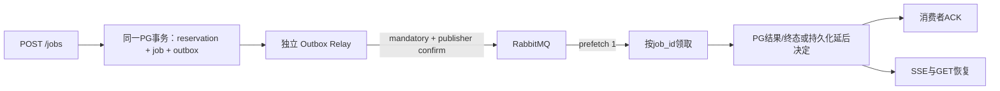

# RabbitMQ 与任务恢复升级

本升级分三批交付：可靠投递、执行恢复、Agent 检查点。各批独立 PR，不自动合并、部署、重新授权或迁移真实演示库。起点为 main `bbbfb2c`，依赖尚未合并的 PR #24（`5730c37`）中的资源生命周期与队列背压修复。

## 第一批：专用 broker 与事务 Outbox

- `message_queue_enabled` 默认 false；原 PG Worker 路径保留。启用后旧轮询不允许任意领取，必须按消息中的任务身份领取。
- API 只有创建新任务时添加 Outbox；幂等复用不增加任务、额度或投递事件。MQ 未启动不使已提交任务丢失，但积压仍受 PG 背压控制。
- Relay 用短 PG 租约领取一条事件，提交后才进行 AMQP 网络操作；确认并成功路由后，使用租约 token 标记 sent。确认丢失允许同一 `event_id` 重发。
- 消息只有 `event_id/job_id/dispatch_generation/schema_version`，最大 512 字节；问题、附件、授权 token、Cookie 和密钥不进入消息。
- Inbox 只证明投递处理；租约失效不能证明模型执行已结束。重复消息查 PG，运行中任务只安排稍后核查，不回到 reserved。
- 消费完成必须先持久化结果/unknown/failed 或延后安排；不能先 ACK 再执行。业务 Future 与 broker I/O 分线程，I/O 继续心跳；断开和退出均先等待物理业务工作结束。
- RabbitMQ 是单节点独立卷部署，队列持久化、手动确认、拒绝溢出；不宣称高可用或外部模型 exactly-once。
- broker 重连与 Outbox 重发不触发新的模型执行。当前 unknown 默认保留；后续批次增加有证据、有预算的恢复。

### 配置与部署边界

新增依赖 `pika`，镜像必须重新构建依赖层，不能用只复制源码的旧镜像声称已安装。

| 配置 | 默认/用途 |
| --- | --- |
| `PROJECT_COPILOT_MESSAGE_QUEUE_ENABLED` | false，显式选择 broker 分发 |
| `PROJECT_COPILOT_RABBITMQ_URL` | 后端私有 AMQP/AMQPS URL，含独立账号/vhost；不进入前端或日志 |
| `PROJECT_COPILOT_RABBITMQ_EXCHANGE/QUEUE/ROUTING_KEY` | `pc.jobs.v1` / `pc.jobs.v1` / `job` |
| `PROJECT_COPILOT_RABBITMQ_QUEUE_MAX_LENGTH` | 10000，满时拒绝发布，由 Outbox 保留 |
| `PROJECT_COPILOT_RABBITMQ_DELIVERY_LIMIT` | 20，有界 broker 投递，耗尽进入死信 |
| `PROJECT_COPILOT_RABBITMQ_HEARTBEAT_SECONDS` | 30，业务执行期间也持续服务心跳 |
| `PROJECT_COPILOT_RABBITMQ_SOCKET_TIMEOUT_SECONDS` | 5，连接超时 |
| `PROJECT_COPILOT_RABBITMQ_BLOCKED_TIMEOUT_SECONDS` | 10，broker阻塞超时 |
| `PROJECT_COPILOT_OUTBOX_RELAY_BATCH_SIZE` | 100，每批有界，停止信号逐条检查 |
| `PROJECT_COPILOT_OUTBOX_LEASE_SECONDS` | 60，只用于发布所有权 |
| `PROJECT_COPILOT_OUTBOX_RETRY_BASE_SECONDS/MAX_SECONDS` | 5/300，失败发布退避；无模型自动重试 |
| `PROJECT_COPILOT_RABBITMQ_PASSWORD/ERLANG_COOKIE` | 仅 Compose 私有配置，独立随机值，公开环境预检要求至少32字符 |

`docker-compose.rabbitmq.yml` 是本机可选覆盖；`deploy/public-demo.rabbitmq.yml` 是独立演示覆盖。后者只使用新增的 `pc-public-v2-rabbitmq` 卷，不复用 PG/Qdrant/Manifest 的卷，不开放主机端口。`public_resources --with-rabbitmq` 在显式操作时检查/初始化这一个额外卷；默认四个业务卷和备份角色保持原样。Broker 只在 backend 网络；Relay 无业务卷、宿主机挂载和外网网络。

升级操作应在审核合并后进行：CLOSED → 等待物理执行结束 → 停止旧 Worker/Relay → 构建包含新依赖的镜像 → 在专用数据库执行 Alembic → 审核资源预检 → 管理员重新授权 → 开启 Relay/Worker。授权沿用现有管理员交互流程。此次开发不执行这些部署步骤。

备份应停止 Relay 与 Worker 后使用现有 PG/索引一致性流程。RabbitMQ 不是业务账本；恢复 PG 或丢失 broker 卷后，不能直接假设 sent 事件仍在 broker，必须在 CLOSED 下核对并显式重建非终态任务投递。本批不提供任意历史任务的一键重放。

### 自动验收及学习入口

隔离服务定义 `docker-compose.messaging-lab.yml`；真实数据库测试使用现有 `owned_test_database`，每例创建新的随机空库。真实 broker 测试只接受明确提供的 loopback:15672 测试 URL，并使用随机队列名。模型全部使用替身，不连接演示库或调用付费供应商。

核心源码：`services/messaging.py`、`infrastructure/rabbitmq.py`、`services/mq_worker.py`、`scripts/outbox_relay.py`、`scripts/ai_worker.py`、`db/messaging.py`、迁移 `0017_messaging`。真实执行结果见各批验证报告和 PR，不把测试配置当作正式发布证据。

## 第二批：有限恢复与业务幂等

新增迁移 `0018_job_recovery`。`PROJECT_COPILOT_JOB_RECOVERY_ENABLED=false` 默认保留原行为，启用必须同时开启消息队列。只登记其后新建的 PERSONAL_DEMO RAG/Agent，不修改历史unknown或上传附件协议。

- `JOB_RECOVERY_MAX_ATTEMPTS` 默认2、最高2；只创建一次额度reservation，不退款、不清零provider计数。
- `JOB_RECOVERY_ALLOW_MODEL_REPEAT=false`：已发生供应商操作但缺少结果时不自动重复调用。显式开启会改变发布配置指纹，需管理员按原规则授权；不能覆盖provider_open/provider_uncertain或本地活跃工作。
- `JOB_RECOVERY_RETRY_DELAY_SECONDS=5`：可恢复后通过下一代Outbox延后投递，不立即NACK循环。
- `JOB_RECOVERY_CHECKPOINT_MAX_BYTES=262144`：每条标准化内容上限；另有每job256条和4MiB整体上限。
- 保留原24次模型、80次工具、160次供应商和900秒个人任务上限，恢复共享原时限和预算。配置更低时仍取冻结的初始上限。
- `failed` 维持确定性终态，不进行笼统自动重试。`running/unknown` 也必须先证明旧执行终止；历史缺证、人工终结、内容已清理或授权变更均不能自动恢复。
- 完整旧执行证据和业务映射不可更新/删除；只轮换经过归档的当前证明。提案的身份属于logical job，重试不能生成第二个action。
- 管理员显式CLOSED清理沿用7天已结算内容策略；未释放槽、unknown/running及人工调查证据不清理。普通后台不自动删除工单或提案。

当前供应商HTTP响应与本地收据提交仍存在不可原子化窗口。因此只承诺至少一次消息投递、业务幂等及有界证据恢复，不承诺模型只计费一次，也不把unknown改称成功。
