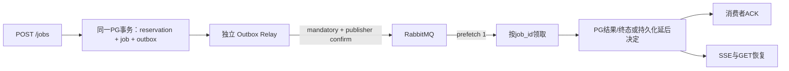

# RabbitMQ 与任务恢复升级

本升级分三批交付：可靠投递、执行恢复、Agent 检查点。各批独立 PR，不自动合并、部署、重新授权或迁移真实演示库。起点为 main `bbbfb2c`，依赖尚未合并的 PR #24（`5730c37`）中的资源生命周期与队列背压修复。

## 第一批：专用 broker 与事务 Outbox



- `message_queue_enabled` 默认 false；原 PG Worker 路径保留。启用后旧轮询不允许任意领取，必须按消息中的任务身份领取。
- API 只有创建新任务时添加 Outbox；幂等复用不增加任务、额度或投递事件。MQ 未启动不使已提交任务丢失，但积压仍受 PG 背压控制。
- Relay 用短 PG 租约领取一条事件，提交后才进行 AMQP 网络操作；确认并成功路由后，使用租约 token 标记 sent。确认丢失允许同一 `event_id` 重发。
- 消息只有 `event_id/job_id/dispatch_generation/schema_version`，最大 512 字节；问题、附件、授权 token、Cookie 和密钥不进入消息。
- Inbox 只证明投递处理；租约失效不能证明模型执行已结束。重复消息查 PG，运行中任务只安排稍后核查，不回到 reserved。
- 消费完成必须先持久化结果/unknown/failed 或延后安排；不能先 ACK 再执行。业务 Future 与 broker I/O 分线程，I/O 继续心跳；断开和退出均先等待物理业务工作结束。
- RabbitMQ 是单节点独立卷部署，队列持久化、手动确认、拒绝溢出；不宣称高可用或外部模型 exactly-once。
- broker 重连与 Outbox 重发本身不授权重新执行模型，是否执行由 PG 当前任务和恢复证明决定。当前 unknown 默认保留；只有显式登记的新任务可以进入下述有限恢复。

### 配置与部署边界

新增依赖 `pika`，镜像必须重新构建依赖层，不能用只复制源码的旧镜像声称已安装。

| 配置 | 默认/用途 |
| --- | --- |
| `PROJECT_COPILOT_MESSAGE_QUEUE_ENABLED` | false，显式选择 broker 分发 |
| `PROJECT_COPILOT_RABBITMQ_URL` | 后端私有 AMQP/AMQPS URL，含独立账号/vhost；不进入前端或日志 |
| `PROJECT_COPILOT_RABBITMQ_EXCHANGE/QUEUE/ROUTING_KEY` | `pc.jobs.v1` / `pc.jobs.v1` / `job` |
| `PROJECT_COPILOT_RABBITMQ_QUEUE_MAX_LENGTH` | 10000，满时拒绝发布，由 Outbox 保留 |
| `PROJECT_COPILOT_RABBITMQ_DELIVERY_LIMIT` | 20，有界 broker 投递，耗尽进入死信 |
| `PROJECT_COPILOT_RABBITMQ_HEARTBEAT_SECONDS` | 30，业务执行期间也持续服务心跳 |
| `PROJECT_COPILOT_RABBITMQ_SOCKET_TIMEOUT_SECONDS` | 5，连接超时 |
| `PROJECT_COPILOT_RABBITMQ_BLOCKED_TIMEOUT_SECONDS` | 10，broker阻塞超时 |
| `PROJECT_COPILOT_OUTBOX_RELAY_BATCH_SIZE` | 100，每批有界，停止信号逐条检查 |
| `PROJECT_COPILOT_OUTBOX_LEASE_SECONDS` | 60，只用于发布所有权 |
| `PROJECT_COPILOT_OUTBOX_RETRY_BASE_SECONDS/MAX_SECONDS` | 5/300，失败发布退避；无模型自动重试 |
| `PROJECT_COPILOT_RABBITMQ_PASSWORD/ERLANG_COOKIE` | 仅 Compose 私有配置，独立随机值，公开环境预检要求至少32字符 |

`docker-compose.rabbitmq.yml` 是本机可选覆盖；`deploy/public-demo.rabbitmq.yml` 是独立演示覆盖。后者只使用新增的 `pc-public-v2-rabbitmq` 卷，不复用 PG/Qdrant/Manifest 的卷，不开放主机端口。`public_resources --with-rabbitmq` 在显式操作时检查/初始化这一个额外卷；默认四个业务卷和备份角色保持原样。Broker 只在 backend 网络；Relay 无业务卷、宿主机挂载和外网网络。

升级操作应在审核合并后进行：CLOSED → 等待物理执行结束 → 停止旧 Worker/Relay → 构建包含新依赖的镜像 → 在专用数据库执行 Alembic → 审核资源预检 → 管理员重新授权 → 开启 Relay/Worker。授权沿用现有管理员交互流程。此次开发不执行这些部署步骤。

备份应停止 Relay 与 Worker 后使用现有 PG/索引一致性流程。RabbitMQ 不是业务账本；恢复 PG 或丢失 broker 卷后，不能直接假设 sent 事件仍在 broker，必须在 CLOSED 下核对并显式重建非终态任务投递。本批不提供任意历史任务的一键重放。

### 自动验收及学习入口

隔离服务定义 `docker-compose.messaging-lab.yml`；真实数据库测试使用现有 `owned_test_database`，每例创建新的随机空库。真实 broker 测试只接受明确提供的 loopback:15672 测试 URL，并使用随机队列名。模型全部使用替身，不连接演示库或调用付费供应商。

核心源码：`services/messaging.py`、`infrastructure/rabbitmq.py`、`services/mq_worker.py`、`scripts/outbox_relay.py`、`scripts/ai_worker.py`、`db/messaging.py`、迁移 `0017_messaging`。真实执行结果见各批验证报告和 PR，不把测试配置当作正式发布证据。

## 第二批：有限恢复与业务幂等

新增迁移 `0018_job_recovery`。`PROJECT_COPILOT_JOB_RECOVERY_ENABLED=false` 默认保留原行为，启用必须同时开启消息队列。只登记其后新建的 PERSONAL_DEMO RAG/Agent，不修改历史unknown或上传附件协议。

- `JOB_RECOVERY_MAX_ATTEMPTS` 默认2、最高2；只创建一次额度reservation，不退款、不清零provider计数。
- `JOB_RECOVERY_ALLOW_MODEL_REPEAT=false`：已发生供应商操作但缺少结果时不自动重复调用。显式开启会改变发布配置指纹，需管理员按原规则授权；不能覆盖provider_open/provider_uncertain或本地活跃工作。
- `JOB_RECOVERY_RETRY_DELAY_SECONDS=5`：可恢复后通过下一代Outbox延后投递，不立即NACK循环。
- `JOB_RECOVERY_CHECKPOINT_MAX_BYTES=262144`：每条标准化内容上限；另有每job256条和4MiB整体上限。
- 保留原24次模型、80次工具、160次供应商和900秒个人任务上限，恢复共享原时限和预算。累计调用不能越过首次冻结的上限，当前配置更严格时也不能绕过当前限制；提高配置不能扩大一个旧任务的冻结预算。
- `failed` 维持确定性终态，不进行笼统自动重试。`running/unknown` 也必须先证明旧执行终止；历史缺证、人工终结、内容已清理或授权变更均不能自动恢复。
- 完整旧执行证据和业务映射不可更新/删除；只轮换经过归档的当前证明。提案的身份属于logical job，重试不能生成第二个action。
- 管理员显式CLOSED清理沿用7天已结算内容策略；未释放槽、unknown/running及人工调查证据不清理。普通后台不自动删除工单或提案。

当前供应商HTTP响应与本地收据提交仍存在不可原子化窗口。因此只承诺至少一次消息投递、业务幂等及有界证据恢复，不承诺模型只计费一次，也不把unknown改称成功。

## 第三批：实际 Agent/RAG 步骤恢复

`infrastructure/recovery_runtime.py` 将当前执行绑定到 PG 步骤日志；它使用原始设置做授权核查，使用个人运行设置执行任务。网络/索引检查不在 PG 行锁内等待。检查点包含必要的普通业务内容，只在后端数据库保存，不进入 AMQP 或浏览器本地恢复索引。

Agent 仍运行原编译图。恢复从入口开始：模型步骤按原 messages/tool Schema 指纹复用标准化 AIMessage，工具按原模型步骤和批次序号复用 ToolMessage 及来源。保留 `tool_call_id` 和原 JSON 观察文本，不依赖临时生成的 message ID。新的调用仍由模型自主决定，继续受循环检测、累计预算及剩余时间限制。最终 `AgentFinal`、source_ids 和来源权限校验不跳过。

RAG 保存真实检索选择的证据和生成响应。复用前验证完成清单、BM25、真实 Qdrant 完成片段及固定重排模型可用性；原文或权限变化会拒绝恢复。缓存模型返回仍重新经过 JSON/Schema/引用编号校验，不能把中途草稿当作答案。真实生成仍可发送 delta；缓存重放不伪造 token 流。

已成功保存的工单提案通过不可变 job→action 映射恢复原 action 和当前状态。它不等于已创建工单，也不会重新赋予已过期 Context 权限。确认继续使用独立用户接口、行锁、唯一约束及幂等规则。

### 自动恢复与保留 unknown 的边界

| 情况 | 行为 |
| --- | --- |
| 原任务 succeeded/failed、内容已清理、历史未登记任务或上传 | 不自动重放 |
| 本地执行仍活跃、OS 锁/inode 缺失、provider_open/uncertain | 阻断，保留调查/人工入口 |
| 本地执行已证明结束，所有已发起步骤均有完整匹配收据 | 验证当前授权后安排第2次 attempt，复用收据 |
| 提案已提交但工具结果收据丢失，业务映射及归属完整 | 回读原提案，不生成第二份 |
| 已发起付费调用但缺少可复用结果 | 默认阻断；显式允许重复模型策略仍需已知供应商终态、物理停止证明及剩余预算 |
| 只读工具意图未完成 | 只有原 attempt 的授权归档与只读重试策略均匹配才可重做；写工具不能按此规则重试 |
| 任务原 deadline 已过 | 可核查已有结果并完成本地最终校验，不能新增模型或工具发起 |
| 当前身份、Session、Context、配置、索引或来源不匹配 | 拒绝恢复，不将缓存视为授权 |

当前 OS 证明依赖同一共享 POSIX 文件系统上的锁文件及 inode；不是任意多节点故障转移。不能删除锁目录后用超时推断旧进程已死。最多两次 attempt，保留费用、幂等和额度；所有步骤预算跨 attempt 累计。

### SSE 与状态协议

GET `/jobs/{job_id}` 仅对登记的任务增加 `execution`：`attempt_no`、`event_floor`、`recovery_status`、安全的 `blocked_reason`、`deadline_at`、累计 `model_calls/tool_calls`、`can_resume_waiting`。不返回租约 token、inode、模型原始参数或私有配置。旧任务保持原响应。

GET `/jobs/{job_id}/events?after=N` 和 `Last-Event-ID` 继续认证并检查所有者。每次连接最长20秒；5秒 heartbeat只保活、不编造进度。事件序号在同一job内递增，不在恢复时清零。

| 事件 | 内容及客户端行为 |
| --- | --- |
| `snapshot` | 当前状态及可选 execution；不含最终答案/提案 |
| `reset` | attempt或保留窗口变化；清除旧草稿，以新 `event_floor` 为排他下界续读 |
| `progress` | 真实执行阶段；缓存复用显示 checkpoint，避免误报新模型调用 |
| `delta` | 真实RAG生成草稿；不能标为最终成功 |
| `diagnostic` / `terminal` | 安全失败类型/状态；旧attempt的事件不会终止新attempt等待 |
| `reconnect` | GET续读提示，不发起新业务请求 |

断线、刷新、停止等待和恢复只读取原 job；最终结果仍通过 canonical GET 取得并走既有 Markdown/引用/审批展示。50分钟等待上限、短 SSE 重连和 HTTP 轮询降级均保留。恢复任务不重复 POST，不退款。费用汇总只在范围可证实时累加；缺少某次付费用量时保持 unknown，缓存的历史 token 不作为新请求收费或追踪。

## 审核合并后的升级顺序（本轮未执行）

先按 PR #24 → #25 → #26 → 第三批 PR 的依赖顺序审核合并，再安排以下操作。这里不重新授权、停止服务或提交真实模型任务。

1. 保持当前镜像可用，用现有管理员交互命令切 CLOSED，禁用新领取；只读核对所有执行/供应商/工具已结束。关闭发布不能撤销已发起工作；存在活跃或不确定执行时停止升级，不能以 `docker stop` 超时代替证明。
2. 在受审私有 `.env.public-demo` 中追加示例所列 RabbitMQ 独立账号/vhost URL、密码及cookie；不要覆盖现有密钥。显式选择 `MESSAGE_QUEUE_ENABLED=true` 和 `JOB_RECOVERY_ENABLED=true`，初期 `JOB_RECOVERY_ALLOW_MODEL_REPEAT=false`。这些配置改变授权指纹，旧授权不能直接沿用。
3. 停止已排空的旧 Worker/Relay，仅构建和替换应用镜像。必须用正常 `Dockerfile` 安装新的锁定 Pika 依赖；旧 `Dockerfile.personal-demo` 只复制源文件，不能单独完成本轮依赖升级。
4. 使用 `public_resources --with-rabbitmq` 检查并只初始化新增独立broker卷。执行迁移到head，核对0016（上游）→0017→0018；不删除或重建业务卷。
5. 在 CLOSED 下先启动新 API，预期业务健康闸仍503，不使用 `up --wait api` 误判失败。管理员核对配置并重新授权 PERSONAL_DEMO、单独 worker-enable 后，再启动 Relay/Worker。默认不开Tunnel、不改变EdgeOne。保留旧镜像/备份用于调查；旧代码不一定兼容新迁移，不能把镜像回退等同数据库降级。

以下命令是审核后 WSL 的操作模板。私有配置须已完整且唯一，不复制示例密码，不通过命令输出 AMQP URL。若当前还使用 Redis 覆盖，所有 Compose 命令应同时保留 `-f deploy/public-demo.redis.yml`，预检增加 `--with-redis`，不能在升级中意外拆除它。

```bash
cd /home/yanye/project-copilot
git switch main
git pull --ff-only origin main

# 当前旧容器中关闭授权；脚本交互验证管理员身份。
docker exec -it project-copilot-public-demo-api-1 python -m scripts.release_control CLOSED
# 在原inspect-job/执行诊断中确认物理排空后才继续。

pc_mq_compose=(docker compose --env-file .env.public-demo -f docker-compose.public-demo.yml -f deploy/public-demo.rabbitmq.yml)
"${pc_mq_compose[@]}" stop worker
# 只有此前已存在 Relay 时才停止它；首次升级没有该服务容器。
"${pc_mq_compose[@]}" stop outbox-relay

.venv/bin/python -m scripts.public_resources initialize --env-file .env.public-demo --with-rabbitmq
.venv/bin/python -m scripts.public_resources check --env-file .env.public-demo --with-rabbitmq
"${pc_mq_compose[@]}" build api
"${pc_mq_compose[@]}" up -d --wait postgres qdrant phoenix rabbitmq
"${pc_mq_compose[@]}" run --rm --no-deps migrate
"${pc_mq_compose[@]}" run --rm --no-deps migrate python -c 'from project_copilot.config import load_settings; from project_copilot.db.session import Database; from sqlalchemy import text; s=load_settings(); d=Database(s.database_url.get_secret_value()); c=d.engine.connect(); print(c.scalar(text("SELECT version_num FROM alembic_version"))); c.close(); d.close()'
"${pc_mq_compose[@]}" up -d --no-deps api
"${pc_mq_compose[@]}" exec -it api python -m scripts.release_control inspect
# 显式重新授权，替换为已有测试账号；密码仅在终端输入。
"${pc_mq_compose[@]}" exec -it api python -m scripts.release_control PERSONAL_DEMO --user EXISTING_TEST_USER --minutes 1440
"${pc_mq_compose[@]}" exec -it api python -m scripts.release_control worker-enable
"${pc_mq_compose[@]}" up -d outbox-relay worker
```

若私有配置用 `PROJECT_COPILOT_PUBLIC_API_IMAGE` 选择镜像，请让API/Worker/migrate/Relay选择同一个新依赖镜像，不能混入旧 `deploy/personal-demo.image.yml` 指向的旧源码镜像。Broker 端口只在容器backend网络可达，禁止公开5672/管理端口。正常 `start.sh` 不会自动启用MQ或恢复。资源预检失败应检查标签/挂载/镜像和网络，不能删除现有卷绕过。

现有 `scripts/start_public_demo.sh` / `scripts/stop_public_demo.sh` 尚未整合可选MQ；后者硬编码360秒Worker停止期限且不包含Relay。启用MQ后应使用上述完整覆盖组合操作，不用旧停止脚本替代物理排空和1260秒宽限。

本机可选组合为 `docker-compose.yml` + `docker-compose.deploy.yml` + `docker-compose.rabbitmq.yml`。若使用已有GPU部署，组合依次为base、deploy、`docker-compose.gpu.yml`、rabbitmq、`docker-compose.rabbitmq.gpu.yml`，最后一个文件对齐API/Worker/migrate的GPU镜像和重排配置；模型缓存、UID及共享Manifest仍沿用现有设置。不要把本机覆盖文件与独立public-demo组合混用。本轮只做合成环境下的实际Compose配置解析，没有验证当前宿主GPU容器启动。

## 仅三项学习后验证

以下为未来手测入口，本轮不自动带练、不触发模型费用。合成服务必须使用测试端口/专用随机库；不要把测试变量指向演示数据库。

1. **投递和提交顺序**：按 [VERIFICATION.md](VERIFICATION.md) 准备消息测试PG/broker及补充Redis/Qdrant，运行 `npm run verify -- --services` 或针对 `tests/test_rabbitmq_native.py` 的原生测试，观察 publisher confirm、丢失ACK后的同event重投及PG仅一次业务写入。失败先查测试broker连通/固定vhost与Outbox/Inbox断言；不重放用户旧任务。
2. **恢复与业务幂等**：在同一隔离环境运行 `tests/test_agent_checkpoints_postgres.py`、`tests/test_rag_checkpoint_postgres.py` 和 `tests/test_checkpoint_recovery_postgres.py`，观察原model/tool收据、第二attempt、旧token拒绝及原提案action_id。供应商替身计数应保持无额外调用；权限或索引变化测试应拒绝。失败先查原deadline、绑定摘要和完整停止证明，不能通过放宽规则使其通过。
3. **浏览器恢复边界**：`npm run verify -- --frontend` 在模拟API的真实Chromium中演示attempt切换清旧草稿、停止等待、GET恢复、历史/提案独立确认。确认没有额外POST，桌面/手机不回归。真实公网SSE和模型质量需另行授权验收；这里的模拟响应不能证明公网已部署。

真实结果及限制见[第一批](MESSAGING_PHASE1_REPORT.md)、[第二批](MESSAGING_PHASE2_REPORT.md)、[第三批](MESSAGING_PHASE3_REPORT.md)报告与对应PR检查。
