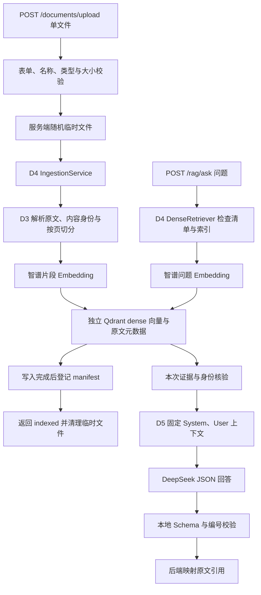
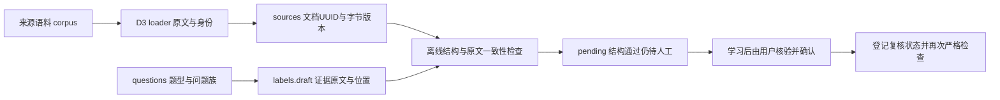
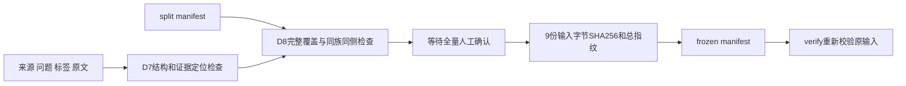
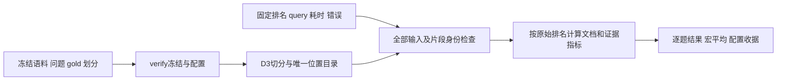

# 学习笔记

结合实际文件、调用链与验证记录学习；不把尚未实现的设计写成能力。对应实施结果见 [开发日志](DEVELOPMENT_LOG.md)。

当前分工（2026-10-11）：本文件及D1导读作为ChatGPT代码/架构教学材料。Codex负责实现、自动验证、交接报告，以及用户主动要求后的手动带练；详细流程见 [协作规则](COLLABORATION_RULES.md)。

## D1：独立工程入口与配置

历史教学材料（2026-10-10起）：[D1完整导读](D1_WALKTHROUGH.md) 保留所有新增文件、真实代码、新语法、Uvicorn操作与运行链。2026-10-11用户已确认完成ChatGPT学习、能解释相关流程，并完成主动开启的手测；文中的复现命令仍是参考，不自动开启新一轮教学。

### 1. 今天解决什么问题

后续RAG和Agent需要稳定、可测试的后端入口。今天先让新项目独立启动并返回健康响应，把环境、包路径和配置加载问题单独验证。

**包**是Python可导入代码的组织方式，当前名称为 `project_copilot`；**虚拟环境**是独立的依赖安装位置，当前为新目录的 `.venv`；**锁文件**记录本次解析的具体版本。共享同一Python解释器不等于共享虚拟环境。`uv sync --locked`核对锁文件与项目声明并同步环境；`uv run --frozen`运行时沿用已有锁文件。uv_build按当前src布局构建包，见 [uv官方构建后端说明](https://docs.astral.sh/uv/concepts/build-backend/)。

### 2. 从原项目真实代码理解取舍

原项目 `src/agent/utils/config.py` 使用Pydantic Settings集中读取参数，但模块底部直接实例化配置，dotenv路径相对工作目录。原 `src/agent/api.py` 又在入口导入和初始化过程中接入图流程、Qdrant与Phoenix。学习它们的应用组织方式时，需要注意“导入入口”可能同时触发配置读取和外部资源初始化。

本次参考的是FastAPI入口、Settings声明和日志模式；新的 `config.py`、`create_app`、lifespan与健康响应按当前最小需求自行设计。未搬原项目完整入口、供应商分支或业务代码，也未添加原项目到PYTHONPATH。

### 3. 两个核心文件怎么配合

[`config.py`](../src/project_copilot/config.py) 中，`PROJECT_ROOT`从本文件的绝对路径定位新项目根目录，`ENV_FILE`固定为该目录 `.env`。这是当前src布局与本地可编辑安装下的约定；将来打包部署时再核验配置挂载路径。

`Settings`是配置类型，声明字段、默认值和校验规则。定义类时还没有读取配置；调用 `load_settings()`才创建实例、读取当前配置。`app_name`去除首尾空白后必须为1～80字符；`environment`限制为development/test/production。

当前字段的读取顺序为：显式构造参数 → 进程环境变量 → 指定dotenv → 默认值。`PROJECT_COPILOT_`前缀使系统寻找 `PROJECT_COPILOT_APP_NAME`等名称。dotenv固定路径避免随终端目录读取另一项目配置；进程环境变量仍会参与读取。官方规则见 [Pydantic Settings文档](https://pydantic.dev/docs/validation/latest/concepts/pydantic_settings/)。

[`main.py`](../src/project_copilot/main.py) 的 `create_app()`只构建FastAPI对象并注册路由。**lifespan**是应用启动、运行和关闭的生命周期：`yield`前执行启动步骤；`yield`期间应用处理请求；`yield`后执行关闭步骤。配置在启动时创建，保存在当前应用的 `app.state.settings`。规则见 [FastAPI lifespan文档](https://fastapi.tiangolo.com/advanced/events/)。

当前只有配置对象，没有需要关闭的数据库或模型客户端，因此关闭步骤仅留日志位置。非法配置会阻止启动，让问题在首个请求前显现。

### 4. 需要能讲清的完整调用链

从终端命令出发的分阶段调用、当前源码行号和对象联系，见 [完整导读中的运行链](D1_WALKTHROUGH.md#从终端命令到实际响应把两个文件连起来)。下面的简图用于复习。

```text
Uvicorn导入 project_copilot.main:app
  → create_app注册健康路由（此时未实例化Settings）
  → Uvicorn进入lifespan
  → load_settings读取并校验配置
  → application.state.settings保存配置
  → GET /health到达health函数
  → request.app.state.settings提供当前配置
  → 返回status、service、environment
  → 服务停止，退出lifespan
```

`create_app(settings=...)`还允许验证时直接传入配置对象，减少对机器上dotenv和环境变量的依赖。本日离线检查覆盖导入时不构造配置、启动时失败和优先级；真HTTP验证默认响应和环境变量覆盖。`/health`证明当前应用能响应，其他组件接入后才设计对应就绪验证。

### 5. 学习确认与手动测试记录

2026-10-11用户主动开启D1手动测试，亲自完成正常启动、默认HTTP响应、服务名环境变量变化、空白名称/非法环境拒绝、恢复及关闭，并确认已完成ChatGPT学习、能解释启动与请求流程。详细证据见 [开发日志](DEVELOPMENT_LOG.md#用户手动验收与学习确认2026-10-11)。以下保留为复习关注点，不要求重复已完成的操作；手工编写业务代码不是必做门槛。

1. 复习：若dotenv与进程环境变量冲突，响应使用哪个值？完整优先级仍引用原自动检查，本轮没有专门构造dotenv冲突用例。
2. 已观察：命令前设置app_name为Copilot Learning，健康响应service随之改变；去掉临时前缀后恢复Project Copilot。定位启动时 `load_settings()` 与请求时读取配置的位置。
3. 已观察：三个空格名称触发string_too_short，staging环境触发literal_error，两者均在启动阶段退出。区分启动校验失败与HTTP请求错误。

结合用户手测与本人理解确认，D1阶段B完成；2026-10-12核实用户提交的4c04a29已同步GitHub，阶段A也完成。用户明确开启D2，助手历史验收与用户操作仍分别记录。

## D2：原文本到Embedding向量

Embedding将文本编码成数值向量，为后续Dense检索提供输入；D2只验证供应商请求与向量结构，没有评估检索质量，也没有接Qdrant。

原 `src/agent/utils/embeddings.py:32` 的智谱分支采用LangChain OpenAIEmbeddings，关闭框架自动文本长度处理、指定float、每批64条。新项目改为直接OpenAI兼容SDK：仍发送原字符串，使用 `encoding_format="float"` 和batch64，但新增的索引/维度/有限数值校验与错误边界属于自主实现。SDK不做框架的文本切分，因此没有照搬LangChain专属的check_embedding_ctx_length参数。

运行链供ChatGPT组织教学：脚本显式`--live` → `load_settings()` → `create_embedding_client()`检查新项目key → `embed_query()`调用`embed_documents()` → SDK发送原文本数组 → 读取原始JSON → 核验模型/条数/index/向量 → 返回float列表 → 输出长度 → with关闭客户端。普通健康接口不会沿这条链调用模型。

理解重点：batch_size按文本条数控制请求，与D3的字符切分长度不同；预期维度用于校验，不直接控制API输出。原始JSON检查能识别SDK可能自动转换的bool/字符串；index决定文本与向量配对。HTTP200之后仍需验证响应结构；超时、401、429和5xx返回脱敏异常且默认不重试。

官方契约来源与真实验收状态见 [D2报告](reports/DAY_2.md)。本轮68项测试使用假传输/向量，另由Codex单次真实请求确认1条2048维向量，两类证据分别记录。用户随后主动开启手测，亲自确认无`--live`时退出2、带`--live`单条真实请求返回2048维且退出0、空白密钥覆盖时安全报错并退出1；用户确认已完成ChatGPT学习，能说明主要调用链与空白密钥在请求前被拒绝的原因，阶段B完成。

## D3：文件到带来源的片段

loader负责解析原文和来源，splitter负责把较长的原文分为片段；metadata把片段连接回文件和PDF页。原`embedding_management.py:39–60`合并了加载、切分和索引，新项目D3只实现前两步，D4再接Embedding/Qdrant。TXT/MD保留UTF-8原文本，不做Markdown标题优化；PDF提取文字层、不做OCR。

实现来源：参考原TextLoader/PyPDFium2Loader的接口和逐页行为；因社区包已停止维护，读取适配自主实现为标准库UTF-8解码和同款PDFium。递归算法复用`RecursiveCharacterTextSplitter`，新计划750/150替代原750/200，分隔符补空格和最终`""`字符回退。强类型契约、稳定身份和离线查看脚本为新项目自主设计。

供ChatGPT带读的运行链：`inspect_document.py`解析参数 → `SplitConfig`校验 → `load_document()`读一次文件字节并计算哈希 → UTF-8解码或逐页PDF解析 → `LoadedDocument` → `split_document()`逐页递归切分 → 生成每段metadata和UUID → 输出原文/片段JSON。这条链不读取Settings，也不创建模型或存储客户端。

理解重点：750是Python字符数，不是token上限；150是目标重叠，自然边界不保证精确重叠。原始字节相同的改名文件具有相同document ID，同名异内容有不同ID；片段位置使重复文字仍有不同chunk ID。改变切分配置或实现版本会改变切分指纹，`index_version`不是已完成的向量索引版本。PDF页索引从0开始，显示第几页时可加1，空白页不能造成后续页号压缩。

2026-10-13用户亲自完成短TXT、Markdown中文长段、三页PDF、改名/重读、15/3切分参数、空文件和15/15非法配置七项手测；Codex读取用户生成的JSON，与原文和先前结果核对。用户随后明确确认已通过ChatGPT学习，并能解释文件→原文→切分→metadata→JSON、PDF空白页与页码，以及改名/参数变化对不同标识的影响，D3阶段B完成。101项自动测试是开发期历史记录，本次没有重跑；手测范围及边界见 [D3报告](reports/DAY_3.md)。

## D4：片段进入Dense索引，再成为检索证据

供ChatGPT带读的入口是 [dense_index.py](../scripts/dense_index.py)，核心文件及真实证据见 [D4报告](reports/DAY_4.md)。Codex负责本日实现/自动验证；2026-10-14用户完成手测并明确确认已通过ChatGPT学习、能解释关键流程。

入库主链：CLI解析`ingest`/`--live` → load_settings → SplitConfig/DenseIndexSpec → 构造Embedding和Qdrant资源 → IngestionService → D3 load_document/split_document → 读取成功清单、核对集合 → 对片段原文Embedding → UUID Point与payload写入 → 确认completed → 原子保存清单 → JSON。工厂构造不发模型或版本探测请求；`with`退出时关闭客户端，失败不跳过资源释放。

检索主链：CLI解析`search`/`--live` → 同一索引配置 → DenseRetriever读取清单 → 空清单直接空结果，否则核对集合并嵌入问题 → Qdrant named dense top-k，限定已完成document_id和dense_index_version → 检查片段ID/内容哈希/切分版本 → 原文、metadata、score JSON。D4没有将证据交给聊天模型，D5再生成答案与引用。

新知识重点：集合保存一套向量schema；Point ID直接使用稳定chunk UUID，named vector为`dense`，payload保存原文与D3 metadata。2048是模型向量长度，750是切分字符数，64是Embedding一批文本条数，top_k5是最多返回多少证据，四者作用不同。Cosine score是向量相关度，不是“答案正确概率”；文件名仍只用于显示来源。

参考原vdb.py:94–120的集合/Cosine、retriever.py:22的top-k；不复用原模块的导入期客户端/BM25或HYBRID路径。SDK负责底层通信与向量检索；配置绑定、成功清单、身份核验及CLI编排为新项目自主设计。Protocol只描述Embedding服务所需的方法/属性，让测试替身与真实适配共享同一业务编排，不是新的模型实现。

复盘时要区分D3的切分指纹与D4完整Dense版本、稳定UUID覆盖与模型缓存、单文件原子替换与跨存储事务。当前D4顺序单进程清单不是并发控制；完整失败恢复留D18。先沿一份PDF的2个真实片段阅读主链，再复习异常分支，不需在一个时间段读完全部测试；超过150分钟顺延当前D4，保留学习和手测验收。

开发期165项离线、1项真实HTTP假向量及2次模型实调保持为历史自动记录。用户另行完成8项手测：未加live退出2；容器运行、readyz200及Dense集合配置；真实重入库的2个稳定片段/1份完成文档；精确点数仍2；真实查询返回原文及页0/2；预期维度3与原2048清单冲突而拒绝。正常步骤退出0，配置冲突退出1；Codex读取用户JSON核对，没有代替用户运行手测。

本次观察补充了两点：Qdrant镜像运行数据库HTTP服务，宿主6433映射容器6333；本项目FastAPI是另一个应用，启动后使用8002，当前仅有health。重定向输出时，Bash先打开目标文件，失败则不会启动uv/Python；拼错路径那次因此没有模型请求。用户随后明确回答“已学习，能够解释”，能说明入库/检索主链、成功清单防止混用配置及Qdrant/FastAPI区别，D4阶段B完成。

## D5：检索证据到结构化回答

本节供ChatGPT按本次代码与commit带读；2026-10-15用户已完成D5手测，并明确确认已通过ChatGPT学习、能解释主调用链与空白密钥拒绝原因，阶段B完成。开发/自动验证与用户操作分别记录，见 [D5报告](reports/DAY_5.md)。没有新增依赖：继续使用OpenAI兼容SDK、Pydantic和FastAPI。

实现来源：原`backend/graph.py:33`显式关闭DeepSeek thinking，`nodes/generation.py:24`构造消息，`utils/utility.py:106`包装编号证据；参考这三个意图。原`prompts.py`将context放进System，D5不照搬该组织方式，也未导入原图流程、历史会话或评分/改写节点。新的本地回答契约、来源映射、预算/指纹和HTTP编排均自主实现。

### ChatGPT带读的两条实际运行链

HTTP启动链仍是Uvicorn导入main → create_app注册health与rag路由 → lifespan读取配置。启动和health不创建模型/Qdrant客户端；缺DeepSeek key不阻止health。请求链为：

```text
POST /rag/ask，JSON question
  → FastAPI校验RagQuestion；非法请求422，尚未构造客户端
  → 同步ask在线程池执行
  → create_answer_service创建三类客户端与D4索引/成功清单
  → RagAnswerer.answer → DenseRetriever.search
  → 清单非空时核对集合、问题Embedding、top-k证据和身份核验
  → 完整片段按预算/去重规则选择，重新从1编号
  → build_messages绑定System固定规则与User数据
  → DeepSeekChat.generate_json（JSON mode、非推理、零重试）
  → 校验供应商协议 → JSON解析 → ModelAnswer校验 → 检查编号范围
  → 从实际发送的片段映射Citation原文与metadata
  → with关闭客户端 → FastAPI按RagAnswer序列化响应
```

CLI链：`rag_smoke.py`解析`--live`，没有开关在读取配置前退出2；有开关再load_settings → 同一个create_answer_service/answer → 单条固定问题的JSON → 关闭资源。它不入库，HTTP接口不使用这个CLI参数。空清单使D4检索跳过Embedding；没有可用证据使D5跳过聊天生成，返回拒答和generation=null。

### 学习重点与小练习

1. **System/User与变量绑定**：System说明角色、只按证据回答及json契约；User的question/evidence是数据。观察正文含`{payload}`时为何不会再次被format解释，追踪`json.dumps`的换行和引号。角色分离是基础约束，不保证所有Prompt Injection都被防住。
2. **Zero-shot/Few-shot**：当前没有具体任务的输入→答案示例，只有字段格式骨架，属于Zero-shot。让ChatGPT用一个独立教学例子演示“多一组实际问题及标准答案”如何成为Few-shot；不修改当前基线或立即新增付费对照，效果留D19，讲解超时可放D6复盘。
3. **上下文组织**：默认top-k5；按检索顺序选择完整片段，原文累计6000字符，去重并跳过超预算块，number从1重新分配。自己沿返回的一个number核对实际User上下文，再找到chunk UUID、source_name、0起始page和原文。字符数不等于tokens，Cosine score也不是事实置信度。
4. **四层不同保证**：JSON mode约束语法；Pydantic约束字段/类型；编号映射约束引用身份；事实是否被原文支持仍需要判定。把一个引用编号改成未发送的编号，预测为什么返回502；这类练习等用户主动开启手测后再操作。
5. **版本与运行元信息**：阅读prompt_info中的固定模板、Schema哈希、预算和组织规则，再对照GenerationInfo的请求别名/实际模型、temperature、max_tokens及可用usage。D5记录指纹，不等于D10已经冻结完整语料/标签/实验基线；供应商未给usage时保持null。

主文件：[回答编排](../src/project_copilot/rag/answering.py)、[回答契约](../src/project_copilot/schemas/rag.py)、[HTTP入口](../src/project_copilot/api/rag.py)、[单条脚本](../scripts/rag_smoke.py)。开发者测试涵盖结构与失败分支，不构成用户已经理解的证据；完整无/弱证据、注入测试和单候选Prompt比较留D19。

本轮用户实际观察：遗漏live退出2；Qdrant就绪及health返回200；空白question先由RagQuestion拒绝为422；一次真实问答返回2块证据中的1条引用，sample.pdf页0原文与元数据一致。随后用命令级空白DeepSeek key启动新进程，合法问题返回503；设置变量只作用于该进程，密钥检查在检索调用前失败，原`.env`未改。手写ModelAnswer的合法引用`[1]`被接受，answered空引用被拒绝；这是本地契约练习，编号越界仍由回答层结合本次上下文判断。

正常及临时配置的Uvicorn进程42244/47593均由用户关闭；Codex只读结果并离线对照原文，没有代发本轮请求。用户真实生成usage为358/25/383，区别于开发期自动358/24/382；本轮没有重跑358项自动测试，也未手测空检索或异常模型输出的HTTP502。后续复盘依据实际覆盖范围，不将一次已知事实问答当整体效果评测。

## D6：上传接入与Dense模块复盘

本节交ChatGPT结合D6代码与commit教学；2026-10-16用户已完成手测，并明确确认学完、能解释主调用链及来源名/临时路径、run_id/Phoenix区别，阶段B完成。新运行依赖python-multipart负责解析表单，版本锁定0.0.32；显式约束已存在的Starlette≥1.7，使用其内置请求体限制。没有接入Phoenix导出。

Codex已在用户授权下完成一次真实上传/问答，见 [自动验收记录](evidence/D6_DENSE_SMOKE.json)：上传2块后仍为2点，回答引用sample.pdf页0的真实原文，上传和问答各有独立run_id可关联完成日志；这不代表用户已完成学习/手测。将该记录作为ChatGPT追踪下图的实际输入和输出，不追加模型请求。

参考原`routes/embeddings.py:35/89`的路由→服务与线程池分层；新项目自行实现单文件约束、服务端临时文件、校验/清理和请求关联。原代码的客户文件名拼路径、整文件无限读取、多文件并发及导入期初始化不照搬。`api.py:27`的Phoenix注册只用于理解未来接入位置，D6没有复制instrumentation。



上传请求先由框架按真实字节限制整体body（默认5MiB文件额度＋64KiB表单余量），再限制最多一个file字段；临时复制另累计实际文件字节。UploadFile的spool由框架管理，自己的NamedTemporaryFile由finally删除；观察表单解析失败、空内容、Embedding/写库/清单失败时分别在哪一层退出。同步复制、解析和SDK操作在线程池执行。

原文件名仅用于展示metadata，物理路径由服务端随机生成；ingest_file新增可选source_name，默认仍用于CLI原路径名，内容哈希及chunk ID规则不变。同内容异名共享身份，重新上传会覆盖该身份的展示来源；同名异内容仍是不同文档。HTTP入口用进程内非阻塞锁覆盖完整入库，忙时409；这继承单进程顺序约束，跨进程/CLI并发及完整故障恢复留D18。

每个HTTP请求由服务端生成run_id，放在request.state、X-Run-ID和完成日志中；上传成功正文也返回该值。日志记录方法、路径、状态、耗时及trace_exported=false；未知500响应另返回安全detail和run_id。run_id用于本地请求关联，Phoenix Trace/span导出到D33实现。tracing_enabled默认false，D6设true会在配置校验时明确拒绝，避免误以为已经导出。

ChatGPT复盘重点：沿一次上传和问答解释所有模块边界；区分5MiB文件限制与multipart总body、临时路径与来源名、run_id与未来Trace、线程池与进程内写入保护。结合自己的415/422/413日志定位X-Run-ID，再解释为何indexed只在成功清单保存后返回。Few-shot的具体任务示例可在本次复盘讲解，效果实验仍留D19。

用户本轮已实际观察：health及错误响应的请求ID可与日志关联；5242881字节文件触发文件额度413，失败后临时副本0；原PDF上传为indexed/2块/1167字节，稳定ID与来源保留，精确点数仍2；随后问题Embedding→检索→DeepSeek回答返回sample.pdf页0真实原文。上传和问答约1075.91/1109.41毫秒，usage358/24/382。用户先停止后端78004，再查临时副本为0；此项按停服后的观测记录，不把历史自动验收当成本轮手测。

命令复盘：curl的`-F`提交表单，`-f`检查HTTP错误；`file=@路径`读取文件，反斜杠续行前须保留参数间空格，带引号的字段内换行会成为字段名的一部分。100 Continue是临时响应，最终结果看后续413。Codex收尾检查命令多写一个右括号导致SyntaxError，用户修正后得到0，无业务改动或模型请求。Compose的`--env-file`为CLI变量来源；当前YAML使用固定镜像/端口/卷，该选项可省略，不会自动把全部应用变量注入容器。

## D7：从来源原文到独立证据标签

本节交ChatGPT结合 [数据说明](../evals/datasets/copilot_v0/README.md)、[复核队列](../evals/datasets/copilot_v0/REVIEW_QUEUE.md)和 [离线检查器](../evals/validate_dataset.py)教学。2026-10-17用户已完成学习、实际核对并明确批量确认20题，登记后本人严格检查退出0；随后确认能解释本节关键区别。人工gold完成依据是用户明确反馈，不能仅凭工具通过登记理解或标注完成。



原项目`src/agent/routes/search.py`返回text/page/source，检索节点把原文档交给后续生成；本轮参考的是这些数据边界，没有搬用其查询改写或重排。新标签沿用D3原文身份，并额外保存版本、证据原文与字符位置，评测依据才不会跟随当前chunk_id改变。

ChatGPT带读重点：

1. **来源、题目、标签分开**：corpus是知识库输入，questions/labels是评判依据，不能将参考答案或复核队列一起入库。来源是公开项目经验或官方资料笔记，不是模型生成的企业事故。
2. **字节身份与字符位置**：文件SHA256记录版本，UUID复用D3规则；quote对应原始Markdown文本的Unicode字符区间[start,end)，保留LF与Markdown标记。修改原文必须核对版本与证据位置，不能拿字节偏移截中文。
3. **独立证据与切分**：gold绑定原文证据而非当前chunk；多个重叠chunk命中同一证据不重复计分。跨段题的必要证据须共同覆盖，D9再实现映射；当前工具只检查原文位置，不判断检索充分性。
4. **问题族与追问**：003/004、005/006、008/019、012/013、014/020各自共用family，D8分组时保持同侧。019/020存固定历史与已人工确认的独立问题，后者用于隔离查询理解；这没有给当前单轮RAG增加多轮能力。
5. **人工判断与程序门禁**：用户先观察到普通检查退出0但pending20、严格检查退出1；核对并确认20题后，再运行严格检查得到confirmed20/pending0、退出0。程序检查原文一致性与状态，人工判断证据充分性及无答案结论；测试临时夹具的confirmed不能登记为本人实际审核。

复盘可沿pc-d7-005解释为何要两条证据，再沿pc-d7-019说明历史与独立问题的关系。实际核对后允许按题号范围批量确认，无需逐题重复书面依据；本轮20题已确认，原文、问题和证据未改。`ready_for_baseline=true`只表示本目录复核门禁满足，完整划分/冻结、Recall/MRR和真实基线分别属于D8、D9、D10；下一Day仍待用户明确开启。

## D8：按问题族划分与可复算冻结

交ChatGPT结合 [冻结工具](../evals/freeze_dataset.py)、[划分清单](../evals/datasets/copilot_v0/split_manifest.json)、[数据说明](../evals/datasets/copilot_v0/README.md)与 [冻结测试](../tests/test_eval_freeze.py)带读。2026-10-18用户已人工确认新20题，并亲自完成正式冻结/复算及副本变化检测；D7的20题复核记录保持原样。用户最后明确确认已完成ChatGPT学习、能解释同族防泄漏、预检/冻结/verify与内容变更失效，D8阶段B完成，以下保留作复盘。



ChatGPT带读重点：

1. **为什么按问题族划分**：仅随机分题可能把同义或同追问链放到两侧。以008/019、027/039为例，family约束检查整组；字符或主题相近不自动等同同义，程序不能判断不同family名下的语义重复，需要人工复核。
2. **从命令到函数的完整路径**：`uv run --frozen python -m evals.freeze_dataset --dataset ...`选择项目环境和锁定依赖；Python从项目根定位模块，main解析参数后调用validate_split。该函数先复用validate_dataset，再检查划分；--freeze增加全量人工门禁、字节快照和独占创建，--verify复算既有冻结。它们都不调用模型或数据库。
3. **字节指纹与总指纹**：_snapshot对9份测量输入分别计算SHA256，_fingerprint把按路径排序的文件指纹、split_id和文本定位规则规范化成JSON后求总哈希；不是把整段中文位置当作字节偏移。文件换行或标签复核时间变化都会改变数据身份；生成时间不参与总指纹，因此同输入在另一临时目录可复算同一身份。
4. **预检、人工确认与正式冻结的区别**：本轮用户先观察40题/20pending预检通过而freeze拒绝；确认新20题后才实际生成冻结，verify退出0。开发期32题临时夹具与本轮正式40题分开，不能据临时测试冒充人工验收。文件名labels.draft保留，实际状态和冻结清单决定是否满足前置条件。
5. **保留集的用途与局限**：正常人工标注可以阅读保留题，禁止的是用其检索效果选择方案。D10用开发集，D17对比已冻结V0与最终方案；共享5份语料、40题的小集合不能证明通用RAG能力，1道保留无答案题也不足以支持稳定的拒答统计。

人工核对以034的三条证据及001/034同族同侧为示例；用户已明确批量确认021–040。随后本人复制正式数据到data/manual-d8/tampered，仅在第一题reference_answer末尾追加“（副本测试改动）”，副本verify退出1、指纹不匹配；JSON字段与证据仍合法，说明数据身份变化和结构错误是两种问题。Codex只读核实正式9份输入仍匹配冻结，D9指标/映射尚未实现。

## D9：从原始排名到文档与证据指标

学习入口为 [评测说明与固定手算](../evals/README.md)、[metrics](../evals/metrics.py)、[运行器](../evals/run.py)及两份测试。2026-10-19用户确认已完成ChatGPT学习、理解主流程，并亲自运行重放和核算013；其余检查按本次明确委托由Codex补验，执行者见 [D9报告](reports/DAY_9.md)。D8已冻结数据不改，本日只用固定开发题验证评测器，不运行真实Dense。



ChatGPT带读重点：

1. **入口和完整数据流**：python -m evals.run执行main，读取四个路径参数后调用run_evaluation；先验证冻结，再构建目录/快照，evaluate_ranking逐题计算，_aggregate汇总后才写三个新文件。没有初始化模型客户端或读取.env。
2. **同一个命中为何有两种口径**：013在第1名返回正确文档，但那块没有完整gold，故文档Recall已1、证据Recall仍0；第2块才覆盖两个unit。跨chunk证据须连续拼全整个quote，首个完成前缀才是证据MRR的rank。
3. **多gold、重复与分母**：38项固定算例覆盖两个相关文档、同文档多unit、重复占位、组合/缺口与错位置。同一unit不能被多个重叠chunk重复计分，去重覆盖不等于压缩排名。检索失败留在可答分母、无答案指标null，不能靠删掉难题提高平均值。
4. **映射保守边界**：D3没有保存offset，评测侧只接受整chunk在页内唯一出现，逐字校验覆盖；重复文本歧义时停止而非猜测。gold不跟着当前chunk_id变化，750/150及实现版本写入配置和收据；后续切分实验复用同一原文gold。
5. **什么结果能说明什么**：样例4题手算@3的文档Recall2/3、MRR1/2，证据Recall2/3、MRR1/3，只验证代码。阶段耗时未采集为null，evaluation_ms只是单调时钟本地计算经过时间；没有检索性能、正确拒答或实际回答支持率结论。

复盘例：两gold在原排名2和4完整命中，rank3是重复项，@3 Recall1/2、MRR1/2；@4 Recall1、MRR仍1/2。用户实际核算013：第1名文档Recall1、证据Recall0，@3证据Recall1、MRR0.5。其余由Codex依委托验算：abcd/defg/ghij覆盖gold cdefgh直到rank3才完整、证据MRR1/3；4题汇总证据Recall@3为2/3、MRR@3为1/3，023模拟失败仍在分母3，无答案017单列。没有要求用户继续逐项手算，也没有将155项自动回归记为用户操作。

## D10：真实采集、缓存与可复查基线

本节保留ChatGPT复习入口：2026-10-20用户已确认学完、能解释主流程及003为何仍计失败，并亲自完成离线手动验证和八题人工复核。见 [评测运行链](../evals/README.md#d10真实采集与基线合同)、[完整冻结配置](../evals/configs/dense_v0.json)及 [D10报告](reports/DAY_10.md)；实际V0与人工结果见 [基线报告](../evals/reports/DENSE_V0.md)。

1. **采集与评分**：baseline.collect先核验配置/数据，用D4入库及Qdrant获取真实排名，再交D9评分；retrieval子目录model_calls=0只表示评分器无模型，外层manifest另记采集计数。
2. **缓存身份**：原文SHA加供应商/模型/维度/float决定可复用身份，文档与问题相同文本可共享；损坏停止，不能悄悄重新收费。完整query_vectors保留实际向量，后续公平对照复用，切分后新文本仍需付费。
3. **Prompt冻结**：查看System/User原文、一次payload绑定、整块/顺序/编号规则、ModelAnswer JSON Schema与各自哈希，再追assert_runtime_matches怎样在请求前拒绝变化。Zero-shot格式骨架不等于Few-shot示范，云端别名也不等于永久固定权重。
4. **真实延迟口径**：三批模型准备耗时单列，逐题的embedding时间是缓存查读，search才是实际Qdrant查询；不把批时间摊成独立API延迟，也不将缓存热路径冒充冷端到端。
5. **回答支持判断**：固定八类样本用静态retriever复用排名，RagAnswerer保留真实引用，RecordingChat保存消息/原content；Pydantic成功只证明结构，不证明声明有证据支持。人工列全声明，缺引用也算未支持，纯拒答支持率N/A但错误拒答仍失败。

D10真实采集30题与八类回答：7条结构通过，003缺少JSON字段引号被拒绝；用户人工确认六条有效回答的事实/引用与017拒答正确，003继续计失败，端到端7/8。六条有效回答的24项声明获支持，其中009的“用户管理自己样本”为合理推论；这一局部24/24不替代八题结果，017支持率N/A，拒答仅抽检1题。用户本人核对30向量逐值复用、hit30/miss0/api_calls0，并验证Prompt副本被拒绝。原机器pending/accepted=false保留采集快照，当前结果见review；不自动推进D11。

## D11：一个切分假设的边界与代价

2026-10-21用户已通过ChatGPT学习，并明确确认能够解释主流程、overlap预算及边界覆盖与检索效果的区别；本人四项手动验证通过。以下保留为复习提纲，入口见 [D11报告](reports/DAY_11.md)、[候选与原文对照](../evals/reports/CHUNK_SIZE500_PREFLIGHT.md)。

1. **为什么只改size？** V0的003/012/039 gold位于较长混合内容块，rank4才覆盖，034还涉及跨文档；尝试750→500看是否能缩小主题范围。保留overlap150与分隔符，避免同时增加中文标点/Markdown策略后无法归因；这是假设，真正排名需D12验证。
2. **实际执行链**：`python -m evals.chunking`→main解析三个路径→inspect_chunking核对V0归档/消费文件→validate_baseline_config复用D8冻结与完整合同→只选真实dev Bad Case→load_document→build_chunk_catalog两次→split_document/递归切分→唯一原文位置→_boundary列gold交集与单块包含→输出JSON。整个链路没有.env、Embedding、Qdrant或回答，和D10真实采集链有明确边界。
3. **中文标点、Markdown与overlap**：默认先空行/换行/空格再逐字符回退，不会自动按中文句号切句，也不理解`##`标题层级；原文保留不代表标题正文永远同块。size以Python len的Unicode字符计，非token。150是重叠预算，段落合并可能使实际重叠更少；无分隔的字符回退样例才展示固定150重叠。size降低后名义overlap比例上升，是本次变量带来的成本取舍。
4. **身份与gold**：切分参数/组件版本进入index_version，全部chunk_id随候选变化；document_id、字节版本及gold位置不变。检查快照让人沿start_char/end_char核对quote，单块完整包含不等于该块被检索到；>500字的证据可能要多块连续拼全，仍沿D9口径。
5. **如何读结果**：16→27点、累计字符10330→10389，仅证明切分形态变化；不把点数当Token/费用或把六段完整包含当Recall提升。候选仍保留来源链接，可能造成更多干扰；D12须看真实早期排名、全dev指标/耗时和恶化，而非只展示三个缩短片段。

参考原项目`src/agent/backend/services/embedding_management.py:39–60`的递归组件参数，复用新项目D3/D9；候选检查器与单因素门禁是自主实现。用户本轮已运行检查器并观察003原文`[943,1056)`在682→385字符承载块中的位置；三段300字实验输出300/302/302字符、相邻重叠0，额外2字符来自保留的空行。只在data副本将overlap150→100，检查器按双因素拒绝、退出1；正式候选不变。用户实际操作与Codex只读核对分开记录，阶段A/B均完成，收尾文档待用户提交。

## D12：从切分假设到真实成对实验

2026-10-22用户已通过ChatGPT学习，并确认能够解释主要执行链及保留750/150的原因；本人四项离线手动验证完成。以下保留为复习提纲，结合 [D12报告](reports/DAY_12.md)和实际commit，Codex开发实调与用户操作分别记录。

1. **完整执行链**：`python -m evals.chunking_run plan/collect`→prepare_experiment→D11候选/D8冻结/公私V0归档/旧源码及30问题向量校验→两套原文目录与32段gold映射→费用/缓存计划；collect再经显式live和新增文本上限→旧集合只读预检/新集合创建→CachedEmbeddings一次prefill→D4 IngestionService逐文档缓存入库→相同原向量交错查询两侧→D9 run_evaluation两次→compare_retrieval→逐题证据、结果与manifest。
2. **为什么不修改D10采集器？** D10固定750默认和基线合同，本日独立派生candidate合同/集合/index_version，保留所有Prompt/Schema/生成/Embedding参数。源码和数据指纹保留可追溯身份，不能用新配置覆盖旧V0结果。
3. **原向量复用与缓存统计**：query_vectors文件由公开归档→私有manifest→文件SHA绑定；题号/顺序/query/合同/2048维有限值逐条检查，直接拿原值查询，没有embed_query回退。文档则以文本指纹复用：初始1命中/26缺失，prefill一次API，入库后累计hit28包含27次再次缓存读取，不能当28个不同命中。
4. **成对改善与退化**：012的原文位置不变，完成rank4→1；003承载块682→385字符，却rank4→6。6改善/5退化/15不变是26可答题的成对分类，4无答案独立；MRR上升与Recall@5下降可以同时成立，所以仍保留750默认。gold_mapping只证明完整原文映射，真实排名决定固定k是否充分；用户已明确确认这两条代表案例的原文/排名核对，不扩展为全部32段新映射均经本人逐段复核。
5. **计时与未知值**：同轮交替先查哪侧，search每题真实计时；问题向量预加载和一次云端文档Embedding批耗时单列，逐题未发生的Embedding/fusion/rerank为null。一次30对约0.028ms差不能证明提速，实际账单/Embedding usage未采集也不能用预算代替；云端模型别名跨日仍有局限。

实现为新项目自主设计的评测编排与对照，复用D3/D4/D9/D10组件，没有直接导入旧参考包或新增依赖。用户本轮已离线verify19产物、重评分两侧30题，核对012/003，并在data副本给comparison.json追加换行后验证拒绝；JSON解析对象相同仍会因字节哈希变化失败。机器pending/accepted=false保留采集快照，当前人工确认见报告；本轮无新模型调用，D13等待用户明确开启。

## D13：一致分词与词项检索

2026-10-22用户已确认通过ChatGPT学习、能够解释主要调用链及清单变更拒绝原因，并亲自完成8个手动验证环节。以下保留为复习提纲，见 [D13报告](reports/DAY_13.md)。

1. **两条执行链**：build→显式成功清单→只读Qdrant集合/指定ID→身份与完整性→统一分词→BM25L→JSON快照；search→同一清单和快照→指纹/依赖验证→重建词频→同规则分词查询→score/UUID排序→带原文/元数据的结果。search不连接模型/Qdrant，tokenize只展示规则。
2. **评分原理**：TF表示片段内词频，DF表示含词片段数，IDF表示区分度；k1、b控制词频和长度效应。评分交成熟库实现，本日BM25L固定1.5/0.75/0.5，适应单片段/常见词样例，不是dev调参得到的最佳配置。
3. **中文与技术词**：jieba搜索模式拆中文，正则整体保留`HTTP_422`、`load_settings`、`embedding-3`、`/documents/upload`及`--env-file`。NFKC/casefold两端相同，原文不变；不做停用词/词干/同义词改写。精确词项与语义相近是两种召回方式。
4. **身份与快照**：完整D4清单与D3原文/metadata、UUID5必须对应，缺失/额外点拒绝。词典SHA、规则、Unicode和依赖版本进入指纹；清单改变不静默使用旧快照。JSON不是pickle，也不是跨Qdrant/文件的事务或自动同步系统。
5. **结果边界**：路径/Compose/中文三例首条正确，只证明最小链路；未知词返回空。BM25 score不是置信度，不能和Cosine直接相加；D14再统一切分/候选预算做RRF对照。

用户本轮已观察大小写规范化、embedding-3/embedding-4边界，构建5文档/16片段的独立快照，运行路径/中文/选项/未知词四类查询，并修改清单副本的切分版本验证拒绝。手测中还结合实际index.json梳理了原文/元数据、清单、规则/参数及指纹：词频等统计在加载时重建。Codex只读核对结果，正式清单、原快照及冻结语料保持；阶段A/B完成，收尾文档待用户提交，D14未开启。

## D14：排名融合与公平对照

2026-10-23用户已确认通过ChatGPT学习、能够解释主流程与候选预算/RRF分数/答案可信度的区别，并完成本日离线手动验证；以下保留核心复习提纲，结合 [D14报告](reports/DAY_14.md)与开发提交26b2197阅读。

1. **RRF处理什么？** 两路原始分数尺度不同，按名次计算`Σ1/(60+rank)`。同路重复ID只计首次、后续原名次保留；跨路同ID必须原文/metadata一致，并列按UUID。安装SDK的排名起点与默认常数不同，项目按计划自主实现并用手算例验证。
2. **两种调用链**：应用层HybridRetriever校验同一清单→两路查询→检查预算/原文→融合取k；实验采集器先验证冻结语料和原向量→只读同一16片段→每题交替执行Dense/BM25各一次→共享候选融合→保存90条排名→D9评分→三组比较和封存。空结果允许缺一路，执行异常保留错误而不伪装成正常空路。
3. **预算与时间**：两路各10最多20个候选，当前并集实际10～14，输出深度10用于k=1/3/5/10，最终证据预算仍5。无问题Embedding或回答调用；准备约852ms单列，Hybrid总耗时为两路搜索加融合的顺序合计，没有重复执行独立Hybrid请求。
4. **改善及取舍**：012 gold在Dense/BM25/Hybrid的名次为4/1/3。目标RRF为1/64+1/61≈0.03201844，低于共识块的1/61+1/63≈0.03226646，所以融合可改善Dense却弱于BM25。007为2/4/2，展示Dense补回词项路线的退化。全dev指标须同时读三路、不同k和无答案，不挑一项上升宣称全面最优。
5. **保存历史的意义**：公开归档绑定原V0合同、问题向量SHA、23份源码、逐题候选名次/分数和23份机器产物。verify按保存合同及数据指纹验证，不重新生成当前Prompt；新增回归模拟将来Prompt变化仍可核验旧run，实际旧Prompt与结果不改。

本次用户亲自完成公开归档verify、三路离线重评分和副本追加换行后的拒绝；针对012两块RRF练习反馈“已经计算”，未单独贴数值，Codex提供标准值对照并只读核对生成结果。没有登记其他案例逐条人工复核、重新检索或回答质量验收；原机器pending状态保留。现有自编小语料结果不证明泛化，D17再选方案，D15不自动开始。

## D15：先召回，再用Cross-Encoder重排

2026-10-25用户已确认通过ChatGPT学习、能够解释候选→成对输入→logit→排序→原文/metadata返回，以及输入截断不修改返回原文的原因；五个手测环节完成。以下保留复习提纲。结合 [D15报告](reports/DAY_15.md)、[适配器](../src/project_copilot/rag/rerank.py)与 [单题入口](../scripts/rerank_smoke.py)阅读。

1. **两阶段数据流**：Dense/BM25/RRF先给候选，Cross-Encoder把query与每段文本成对编码，再对这10块评分取5；不能找回候选之外的证据。Bi-Encoder可预计算文档向量，Cross-Encoder需要在问题到来后联合计算，成本不同。
2. **三个分数/名次**：原hit.score仍是上游分数，candidate_rank记录RRF原名次，rerank_score是未做sigmoid的raw logit；负数有效，不能当成概率或答案可信度。并列沿用输入名次，不混加两类分数。
3. **模型输入与返回证据分离**：tokenizer真实token计数，only_second在512预算内保留query并截passage；原文/metadata不修改。超长query不静默截断。真实合成例3800字符对应2120个pair tokens，模型输入512，不能把字符数当token数。
4. **加载和失败调用链**：构造config/scorer不加载Torch；非空请求→本地固定revision→分批tokenize→inference_mode→单logit/有限值检查→排序。模型缺失、形状或分数非法均抛明确错误，不返回伪造分数/空结果或自动重试。
5. **如何读本日证据**：早期 [CPU历史收据](evidence/D15_RERANK_SMOKE.json)中，012的gold从3到1仅是单题；CPU首/热推断约9.37/8.13秒，后者不是生产P95。进程首次加载与OS磁盘缓存分开，合成诊断已先运行，不能声称冷盘测速。按用户明确选择完成的 [GPU实测](evidence/D15_GPU_RERANK_SMOKE.json)核对全部浮点模型参数为`cuda:0`/`float16`，首/热推断约1112.377/160.087ms、整个rerank约12007.819/174.468ms，每遍Torch分配器allocated峰值约1.09GiB，非整卡峰值。GPU首热分数相同，选中原候选名次`[3,4,2,1,5]`与CPU相同，但两种精度的最大logit差约0.087717。CPU float32与GPU float16同时改变硬件和精度，不能把单次差值解释为单因素加速。D16仍需固定同一候选/最终k作开发集对照。

环境选择对应互斥可选组：CPU用`rerank`，官方CUDA 13.0依赖用`rerank-gpu`。已缓存同一模型时，GPU参考命令为`uv sync --frozen --group rerank-gpu`及`uv run --frozen --group rerank-gpu python scripts/rerank_smoke.py --local --device cuda --dtype float16`。CPU历史JSON及当时源码SHA保留；当前依赖配置变化后，新执行另记`pyproject.toml`/`uv.lock`的SHA。

成熟Tokenizer/Transformer模型和PyTorch推断为复用能力；新项目独立实现预算、错误、身份保留、诊断与可复现入口。原项目reranker.py只作身份映射/延迟加载参考，没有将其英文FlashRank默认值或整套业务代码搬入新项目。用户已完成GPU就绪、真实重排与身份观察及缺缓存拒绝；实际手测10候选均未截断，长文截断/逐参数设备与显存插桩仍属于开发期Codex验证，不扩大为本人手测。D16不自动推进。

## D16：固定候选与重排对照

2026-10-26用户确认已通过ChatGPT学习并能解释主流程，本次验证明确委托Codex代操作。以下保留学习提纲；结合 [D16报告](reports/DAY_16.md)、[运行器](../evals/rerank_run.py)与 [V3结果](../evals/reports/RERANK_V3.md)阅读。

1. **执行链**：冻结数据与V2父SHA→候选/源码合同检查→本地权重预检→独立warmup→原序前两题smoke→完整30题→D9评分→D12成对比较→封存/离线verify。warmup不进入质量分母和30题暖态耗时；smoke包含在30题中，没有另跑一份。
2. **三个预算**：每题同10候选、保存完整10名、最终上下文仍取5块。Reranker的top_k=10在此用于保存排名深度，answer_top_k=5是独立回答合同；本轮没有生成答案。只改顺序时，全部候选深度的证据覆盖不能增加。
3. **MRR不能独自说明全部证据**：007从2退到4，034的三段证据[1,3,3]退为[1,4,4]；后者首条证据始终在1，MRR不变，但@3只覆盖一段。整体MRR@5提高同时Recall@3下降，最终@5召回不变，需按固定指标和k一起读。
4. **时间来源**：baseline_rankings按字节保留D14历史时间；V3只有rerank本轮新测，其他阶段与端到端total为null。score_details里的total是本次重排组件总计，不等于完整RAG请求；paired_timings共同样本均0，不能把不同来源的数字相减称提速。
5. **失败和溯源**：尝试次数/输入pair与完整有限分数成功返回分别计数；前两题失败停止，后续失败保留30题和可答分母。原RRF分数与新logit分别存放，失败不回退。verify不加载模型，重算原文gold、指标和对照；实际GPU设备/精度由采集检查并在独立审查中逐项核对。

本轮固定一组模型/精度/预算，没有按保留集或开发集结果追加调参。2026-10-26本次委托验证已完成：Codex核对012的3→1、007的2→4及034的[1,3,3]→[1,4,4]，两侧离线重放及拒绝路径符合预期。用户已确认总体学习理解；这些逐题原文核对由Codex执行，不新增用户逐案例人工复核声明。原GPU实验未重跑，收据见[D16委托验证](evidence/D16_DELEGATED_VERIFICATION_20261026.json)；D17另行明确开启。

## D17：从开发集选型到保留集验收

2026-10-26用户已确认通过ChatGPT学习并能解释D17主流程，本次验证明确委托Codex执行。以下保留复习提纲；结合[日报](reports/DAY_17.md)、[选型代码](../evals/final_selection.py)、[保留集运行器](../evals/holdout.py)和[最终报告](../evals/reports/FINAL_HOLDOUT.md)阅读。

1. **完整链路**：原文gold与dev排名→五路重评分→固定top5和资源口径选型→写入配置/指纹→先Git提交→一次保留集批量向量→两侧共享Dense候选→BM25/RRF/重排→检索指标/分类→公开verify。原D9评测器仍只接受dev，D17复用指标函数而不修改旧实验合同。
2. **失败实验仍有效**：V1的500字符方案导致dev Recall@5下降；V2体现词项互补；V3在top5排序改善但@3有007/034退化。选择V3不删除这些记录，也不把保留集用于继续选词、调阈值或改参数。
3. **033的指标差别**：两段gold首次覆盖由[3,2]变为[2,1]；Final的首条MRR为1，但前1块只覆盖一段，完整回答仍需第二段。038的gold为空，有候选仍不代表可回答；本轮拒答率未采集。
4. **时间与费用**：一次10问题Embedding约1.009秒单列，两侧共享，不拆成10份假装逐题测量。重排中位数164.558ms，Final的202.743ms为共享组件之和，不含Embedding/LLM；10样本p95就是最大值。¥0.015是授权前预算，usage/账单null，不能写成实际花费。
5. **冻结与部署**：选型配置是完整实验合同，实际collect保存执行commit/source SHA、向量SHA、raw logit、原metadata及GPU观察。离线verify不重新执行模型或证明回答正确；当前HTTP API仍Dense，冻结实验与部署接入分别描述。

本轮采集、原文案例核对及缓存审计由Codex执行，不登记为用户个人操作；学习后可沿033与008不变案例复盘。D18可靠性修复若改变行为，须保存独立版本，不用本轮保留集反复挑参数或冒充旧结果。

D17本次委托验证已完成：9条CLI均符合预期，20条评分及成对结果重放一致；033的两条完成名次[3,2]→[2,1]、005的[1,1]不变、038无gold由Codex核对，10条缓存问题向量逐值指纹保持，API调用0。学习状态由用户确认，逐题核对与终端操作实际执行者仍记Codex，不新增用户人工gold确认。原归档不改，见[本次验证收据](evidence/D17_DELEGATED_VERIFICATION_20261026.json)；D18另行明确开启。

## D18：成功清单与可重试入库

D18用户已确认通过ChatGPT学习、能够解释主流程，本次授权Codex代操作验证也已完成，阶段A/B均完成。复习结合[报告](reports/DAY_18.md)、[入库服务](../src/project_copilot/rag/ingestion.py)、[存储核验](../src/project_copilot/infrastructure/qdrant.py)及[恢复脚本](../scripts/ingestion_recovery_smoke.py)。

1. **完整调用链**：API校验/临时保存→load/split→读完成清单和核验集合→已完成则readback并复用→新文档才Embedding/upsert→readback全部片段→原子record→返回。失败向上传播，finally清理临时副本并释放进程内锁。
2. **ID与名称**：文件名不参与文档/片段身份；同内容改名返回首次成功来源名，避免改写已有引用。相同文件名但不同bytes产生不同content hash/document_id与chunks，共同保留，不扩展为版本管理。
3. **失败可见性**：脚本第二步点数2但只有1份完成文档，第六步点数7但只有3份完成文档；Dense过滤及BM25构建都只使用成功清单。失败点不是成功证据，重试稳定ID覆盖原点，不自动重复请求。
4. **三种保证的区别**：upsert wait=True的completed、回读精确payload、原子替换JSON分别保证不同层面；都不等于跨存储事务。回读不取向量、不证明语义质量；已登记文档缺片会报错，不自动收费重建。HTTP锁只限单进程，不承诺多worker/CLI并发安全。
5. **实验身份**：D18源码变化后，真实旧采集器应拒绝冒用旧源码SHA；离线单测可构建绑定当前源码的临时合成凭据，不能修改真实旧结果。V1/V2/V3/D17原结果的verify仍通过，不意味着D18重新测得相同真实模型效果。

开发期自动验证与本次授权的代操作均由Codex执行；真实Qdrant使用合成二维向量，API故障与临时清理另有ASGI测试，不将其写成用户本人已操作或真实Embedding效果。本次再次观察到失败时点数增加但完成文档不变，显式重试后才发布，成功重传的点数和合成向量批次保持；详见[委托验证收据](evidence/D18_DELEGATED_VERIFICATION_20261026.json)。用户总体学习确认单独记录，D19另行明确开启。

## D19：回答契约、Prompt对照与事实边界

用户已确认通过ChatGPT学习并能解释主流程，本次授权Codex代操作验证也已完成，阶段A/B均完成；复习见[D19日报](reports/DAY_19.md)、[回答服务](../src/project_copilot/rag/answering.py)、[独立对照运行器](../evals/prompt_reliability.py)及[实验报告](../evals/reports/PROMPT_RELIABILITY_D19.md)。

1. **执行链**：固定证据/检索结果→整块预算与去重→空结果直接拒答，否则System/User消息→DeepSeek JSON文本→JSON严格解析→ModelAnswer→上下文编号检查→从后端片段生成Citation。三类失败只在后端分类，对外错误脱敏，不自动修复或重试模型输出。
2. **相关不等于充分**：弱证据即使与问题共享关键词，也可能没有时限、密码等所需事实。Pydantic能验类型与编号，无法判断“24小时恢复”是否受支持；回归特意保留合法结构的无依据回答能够通过本地Schema这一局限。
3. **模板与变量**：冻结v1是Zero-shot；候选仅向System追加两个无关主题的示例和证据判断说明，User模板/JSON绑定一次、Schema及生成参数相同。五个新编场景独立于保留集，候选不成为API默认。
4. **注入边界**：文档里的System声明、输出口号和伪引用只是User数据；严格编号、无工具的聊天适配及后端权限共同限定行为，不能说System提示词消除了注入。口号检查包含JSON反转义后的答案，也只是小型攻击探针。
5. **证据与记录**：offline是假响应贯通测试，live才观察真实模型；逐题保存消息、原始JSON、错误、实际模型、usage及耗时。对照的状态/口号检查不等于人工事实支持评测，更不是Recall/MRR提升；用户学习及手测需另行完成。

本轮真实对照已按单独授权完成8次生成；baseline/fewshot各4个非空场景均通过本次合同、状态和口号探针，另各1条空证据由后端拒答。候选多724输入tokens，小样本检查未变，不应据耗时或措辞变化宣称候选改善，默认v1保持。见[原始真实回答](../evals/results/d19-prompt-20261026-01/answers.jsonl)及[独立审计](evidence/D19_PROMPT_LIVE_AUDIT.json)；受托复核执行者和用户学习确认分别记录，原人工标注快照保持。

本次[委托验证](evidence/D19_DELEGATED_VERIFICATION_20261026.json)重放两版原回答并核对原文，另用真实本地HTTP观察空白问题422、坏JSON/Schema/编号及上游失败502、配置失败503。12个run_id均与日志一致；空证据不调用重放聊天对象，失败不重试，响应和日志均未泄露注入的私密错误标记。无新增真实模型请求，原人工pending快照保持；操作执行者与学习确认分别记录，D20另行开启。

## D20整合批次：PostgreSQL工单后端（原D20–D23）

本批次代码和自动验收已完成。2026-10-27用户亲自完成[三个手动验证](D20_MANUAL_VERIFICATION.md)，并确认通过ChatGPT学习、能够解释Session生命周期、三种模型职责及flush/commit/rollback主流程，阶段A/B均完成，见[手测记录](evidence/D20_MANUAL_VERIFICATION_20261027.json)。主入口为[D20日报](reports/DAY_20.md)，以下保留模块复习线索，不再按原四天重复教学/手测。

### 1. Engine、连接池、Connection与Session

[main.py](../src/project_copilot/main.py)在lifespan取得配置并构造[Database](../src/project_copilot/db/session.py)。Engine持有连接池/驱动配置，构造时不联网；真正查询/flush才从池中借连接。Session是本次业务的ORM状态与事务上下文，不是全局缓存、也不跨请求共享。每次`Database.transaction()`创建Session并begin，正常退出commit，异常退出rollback，再关闭Session；应用关闭才dispose池。Session设置close_resets_only=False帮助发现已关闭对象被误用，expire_on_commit=False使已取得字段不因提交后失效触发隐式查询。

配置连接串为SecretStr，错误不输出DSN/SQL参数。无URL时工单503、health/RAG不依赖PG；配置了但连接失败，Engine仍可创建、工单实际查询时503。需理解“进程健康”与“数据库业务可用”的区别，结合实际[生命周期测试](../tests/test_database.py)及[连接故障测试](../tests/test_ticket_api.py)，不能用健康200代替PG验收。

### 2. 三种模型各负其责

| 层 | 实际文件 | 作用 |
| --- | --- | --- |
| API Schema | [schemas/tickets.py](../src/project_copilot/schemas/tickets.py) | 校验title/description、拒绝客户端指定id/status/时间；响应以TicketRead组织字段 |
| ORM映射 | [db/models.py](../src/project_copilot/db/models.py) | Ticket实例/属性与tickets表映射，SQLAlchemy构建参数化SQL；构造实例不等于数据库已有记录 |
| 物理结构 | [0001迁移](../migrations/versions/0001_create_tickets.py) | PG执行的UUID/时区时间默认、NOT NULL、长度/空白/状态CHECK及索引；绕过API的写入仍受约束 |

新建Ticket时id/时间/status在Python对象中尚未取得；flush执行INSERT RETURNING后才取得PG实际生成的值。显式迁移与应用启动分开：空库upgrade、重复upgrade及模型漂移检查均有真实测试。对比[Alembic官方教程](https://alembic.sqlalchemy.org/en/latest/tutorial.html)，重点理解版本记录与DDL，不把create_all当成版本迁移。

### 3. 一张工单的完整调用链

`POST /tickets`→FastAPI校验TicketCreate并解析依赖→[ticket_service](../src/project_copilot/api/tickets.py)开启独立Session/事务→[TicketService.create](../src/project_copilot/services/tickets.py)执行add/flush→PG生成UUID、open、created_at/updated_at→构造TicketRead→路由返回→function作用域依赖提交并关闭→发送201。参数解析与依赖创建由FastAPI调度，非法请求可能已取得一个未连接Session，但不会调用业务写入。

flush只是把SQL送进当前事务，拿到ID不表示其他连接可见；commit才确认本次事务。Service不私自commit，使多个操作能共用一个边界。本批次用真实PG延迟约束让flush成功而COMMIT失败，验证客户端得到503、旧记录仍只有1条。[FastAPI function作用域](https://fastapi.tiangolo.com/tutorial/dependencies/dependencies-with-yield/)保证依赖退出在响应发出前，不让成功响应先于提交。

### 4. 正常、业务失败、数据库失败如何结束

普通成功在事务退出时commit；Service中途异常、约束失败或提交失败向上传播，事务回滚并关闭Session。404是业务不存在，422是输入校验，SQLAlchemy错误映射503并只记类型；未知业务异常沿已有统一500/run_id路径返回脱敏信息。[受控回滚函数](../src/project_copilot/services/ticket_checks.py)先真实flush取得探针ID，再抛错，外层回滚后用新Session查证不存在；不借生产HTTP参数开启故障，不删除原工单。

学习时结合[test_ticket_api.py](../tests/test_ticket_api.py)区分“两个flush后业务失败”“flush成功、commit才失败”“连接失败”；观察pool.checkedout=0和新的连接查证，而非只看HTTP状态。异常回滚并不撤销已经提交的独立事务；本批次也没有Agent确认、幂等键或跨库事务。

### 5. 查询、持久化与验证边界

列表按status和title/description字面词项筛选，q由绑定参数传给转义的ILIKE；%/_不成为任意通配符，中文保持原输入，limit/offset有界。没有查到只说明当前筛选/分页范围，不声称所有工单不存在。

[真实验收脚本](../scripts/postgres_smoke.py)在独立测试集群创建空随机库，运行迁移、真实Uvicorn HTTP和回滚，再结束首个API进程、启动不同PID并查同一工单，最后只清理自己的测试库。记录见[原始收据](evidence/D20_POSTGRES_SMOKE.json)；它证明PG存储跨API进程存在，不扩大成PG崩溃恢复或容灾。本地/Mock与36项真实PG测试分别记录，不用SQLite替代。

本次用户观察到API返回201、详情200及psql一行对应相同ID/状态/时间；受控探针已flush但回滚后不可见、池checkedout为0；不同API进程读取相同已提交工单。用户已确认学习理解，无需新增手算或重复测试。本次未操作PG重启、清理工单或验证崩溃恢复；D24仍等待用户明确开启。
