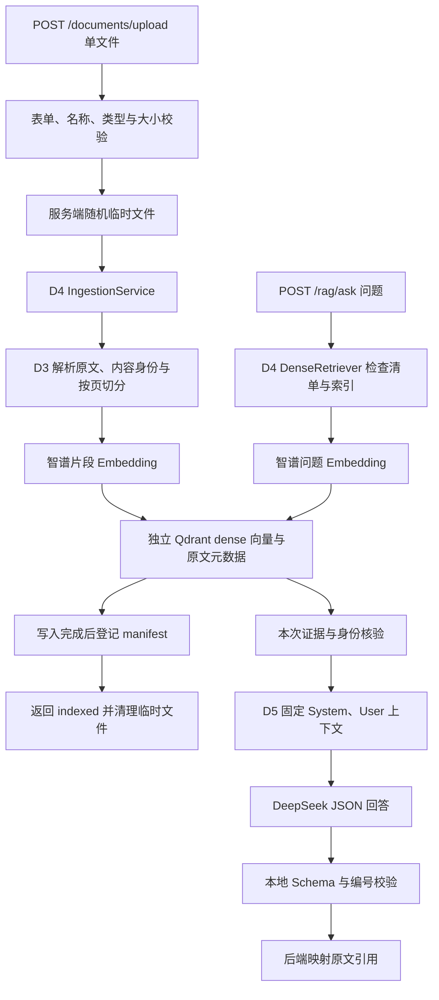
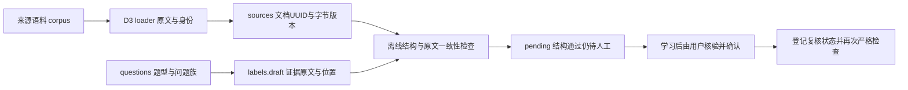
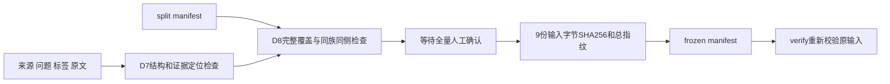

# 学习笔记

结合实际文件、调用链与验证记录学习；不把尚未实现的设计写成能力。对应实施结果见 [开发日志](DEVELOPMENT_LOG.md)。

当前分工（2026-10-11）：本文件及D1导读作为ChatGPT代码/架构教学材料。Codex负责实现、自动验证、交接报告，以及用户主动要求后的手动带练；详细流程见 [协作规则](COLLABORATION_RULES.md)。

## D1：独立工程入口与配置

历史教学材料（2026-10-10起）：[D1完整导读](D1_WALKTHROUGH.md) 保留所有新增文件、真实代码、新语法、Uvicorn操作与运行链。2026-10-11用户已确认完成ChatGPT学习、能解释相关流程，并完成主动开启的手测；文中的复现命令仍是参考，不自动开启新一轮教学。

### 1. 今天解决什么问题

后续RAG和Agent需要稳定、可测试的后端入口。今天先让新项目独立启动并返回健康响应，把环境、包路径和配置加载问题单独验证。

**包**是Python可导入代码的组织方式，当前名称为 `project_copilot`；**虚拟环境**是独立的依赖安装位置，当前为新目录的 `.venv`；**锁文件**记录本次解析的具体版本。共享同一Python解释器不等于共享虚拟环境。`uv sync --locked`核对锁文件与项目声明并同步环境；`uv run --frozen`运行时沿用已有锁文件。uv_build按当前src布局构建包，见 [uv官方构建后端说明](https://docs.astral.sh/uv/concepts/build-backend/)。

### 2. 从原项目真实代码理解取舍

原项目 `src/agent/utils/config.py` 使用Pydantic Settings集中读取参数，但模块底部直接实例化配置，dotenv路径相对工作目录。原 `src/agent/api.py` 又在入口导入和初始化过程中接入图流程、Qdrant与Phoenix。学习它们的应用组织方式时，需要注意“导入入口”可能同时触发配置读取和外部资源初始化。

本次参考的是FastAPI入口、Settings声明和日志模式；新的 `config.py`、`create_app`、lifespan与健康响应按当前最小需求自行设计。未搬原项目完整入口、供应商分支或业务代码，也未添加原项目到PYTHONPATH。

### 3. 两个核心文件怎么配合

[`config.py`](../src/project_copilot/config.py) 中，`PROJECT_ROOT`从本文件的绝对路径定位新项目根目录，`ENV_FILE`固定为该目录 `.env`。这是当前src布局与本地可编辑安装下的约定；将来打包部署时再核验配置挂载路径。

`Settings`是配置类型，声明字段、默认值和校验规则。定义类时还没有读取配置；调用 `load_settings()`才创建实例、读取当前配置。`app_name`去除首尾空白后必须为1～80字符；`environment`限制为development/test/production。

当前字段的读取顺序为：显式构造参数 → 进程环境变量 → 指定dotenv → 默认值。`PROJECT_COPILOT_`前缀使系统寻找 `PROJECT_COPILOT_APP_NAME`等名称。dotenv固定路径避免随终端目录读取另一项目配置；进程环境变量仍会参与读取。官方规则见 [Pydantic Settings文档](https://pydantic.dev/docs/validation/latest/concepts/pydantic_settings/)。

[`main.py`](../src/project_copilot/main.py) 的 `create_app()`只构建FastAPI对象并注册路由。**lifespan**是应用启动、运行和关闭的生命周期：`yield`前执行启动步骤；`yield`期间应用处理请求；`yield`后执行关闭步骤。配置在启动时创建，保存在当前应用的 `app.state.settings`。规则见 [FastAPI lifespan文档](https://fastapi.tiangolo.com/advanced/events/)。

当前只有配置对象，没有需要关闭的数据库或模型客户端，因此关闭步骤仅留日志位置。非法配置会阻止启动，让问题在首个请求前显现。

### 4. 需要能讲清的完整调用链

从终端命令出发的分阶段调用、当前源码行号和对象联系，见 [完整导读中的运行链](D1_WALKTHROUGH.md#从终端命令到实际响应把两个文件连起来)。下面的简图用于复习。

```text
Uvicorn导入 project_copilot.main:app
  → create_app注册健康路由（此时未实例化Settings）
  → Uvicorn进入lifespan
  → load_settings读取并校验配置
  → application.state.settings保存配置
  → GET /health到达health函数
  → request.app.state.settings提供当前配置
  → 返回status、service、environment
  → 服务停止，退出lifespan
```

`create_app(settings=...)`还允许验证时直接传入配置对象，减少对机器上dotenv和环境变量的依赖。本日离线检查覆盖导入时不构造配置、启动时失败和优先级；真HTTP验证默认响应和环境变量覆盖。`/health`证明当前应用能响应，其他组件接入后才设计对应就绪验证。

### 5. 学习确认与手动测试记录

2026-10-11用户主动开启D1手动测试，亲自完成正常启动、默认HTTP响应、服务名环境变量变化、空白名称/非法环境拒绝、恢复及关闭，并确认已完成ChatGPT学习、能解释启动与请求流程。详细证据见 [开发日志](DEVELOPMENT_LOG.md#用户手动验收与学习确认2026-10-11)。以下保留为复习关注点，不要求重复已完成的操作；手工编写业务代码不是必做门槛。

1. 复习：若dotenv与进程环境变量冲突，响应使用哪个值？完整优先级仍引用原自动检查，本轮没有专门构造dotenv冲突用例。
2. 已观察：命令前设置app_name为Copilot Learning，健康响应service随之改变；去掉临时前缀后恢复Project Copilot。定位启动时 `load_settings()` 与请求时读取配置的位置。
3. 已观察：三个空格名称触发string_too_short，staging环境触发literal_error，两者均在启动阶段退出。区分启动校验失败与HTTP请求错误。

结合用户手测与本人理解确认，D1阶段B完成；2026-10-12核实用户提交的4c04a29已同步GitHub，阶段A也完成。用户明确开启D2，助手历史验收与用户操作仍分别记录。

## D2：原文本到Embedding向量

Embedding将文本编码成数值向量，为后续Dense检索提供输入；D2只验证供应商请求与向量结构，没有评估检索质量，也没有接Qdrant。

原 `src/agent/utils/embeddings.py:32` 的智谱分支采用LangChain OpenAIEmbeddings，关闭框架自动文本长度处理、指定float、每批64条。新项目改为直接OpenAI兼容SDK：仍发送原字符串，使用 `encoding_format="float"` 和batch64，但新增的索引/维度/有限数值校验与错误边界属于自主实现。SDK不做框架的文本切分，因此没有照搬LangChain专属的check_embedding_ctx_length参数。

运行链供ChatGPT组织教学：脚本显式`--live` → `load_settings()` → `create_embedding_client()`检查新项目key → `embed_query()`调用`embed_documents()` → SDK发送原文本数组 → 读取原始JSON → 核验模型/条数/index/向量 → 返回float列表 → 输出长度 → with关闭客户端。普通健康接口不会沿这条链调用模型。

理解重点：batch_size按文本条数控制请求，与D3的字符切分长度不同；预期维度用于校验，不直接控制API输出。原始JSON检查能识别SDK可能自动转换的bool/字符串；index决定文本与向量配对。HTTP200之后仍需验证响应结构；超时、401、429和5xx返回脱敏异常且默认不重试。

官方契约来源与真实验收状态见 [D2报告](reports/DAY_2.md)。本轮68项测试使用假传输/向量，另由Codex单次真实请求确认1条2048维向量，两类证据分别记录。用户随后主动开启手测，亲自确认无`--live`时退出2、带`--live`单条真实请求返回2048维且退出0、空白密钥覆盖时安全报错并退出1；用户确认已完成ChatGPT学习，能说明主要调用链与空白密钥在请求前被拒绝的原因，阶段B完成。

## D3：文件到带来源的片段

loader负责解析原文和来源，splitter负责把较长的原文分为片段；metadata把片段连接回文件和PDF页。原`embedding_management.py:39–60`合并了加载、切分和索引，新项目D3只实现前两步，D4再接Embedding/Qdrant。TXT/MD保留UTF-8原文本，不做Markdown标题优化；PDF提取文字层、不做OCR。

实现来源：参考原TextLoader/PyPDFium2Loader的接口和逐页行为；因社区包已停止维护，读取适配自主实现为标准库UTF-8解码和同款PDFium。递归算法复用`RecursiveCharacterTextSplitter`，新计划750/150替代原750/200，分隔符补空格和最终`""`字符回退。强类型契约、稳定身份和离线查看脚本为新项目自主设计。

供ChatGPT带读的运行链：`inspect_document.py`解析参数 → `SplitConfig`校验 → `load_document()`读一次文件字节并计算哈希 → UTF-8解码或逐页PDF解析 → `LoadedDocument` → `split_document()`逐页递归切分 → 生成每段metadata和UUID → 输出原文/片段JSON。这条链不读取Settings，也不创建模型或存储客户端。

理解重点：750是Python字符数，不是token上限；150是目标重叠，自然边界不保证精确重叠。原始字节相同的改名文件具有相同document ID，同名异内容有不同ID；片段位置使重复文字仍有不同chunk ID。改变切分配置或实现版本会改变切分指纹，`index_version`不是已完成的向量索引版本。PDF页索引从0开始，显示第几页时可加1，空白页不能造成后续页号压缩。

2026-10-13用户亲自完成短TXT、Markdown中文长段、三页PDF、改名/重读、15/3切分参数、空文件和15/15非法配置七项手测；Codex读取用户生成的JSON，与原文和先前结果核对。用户随后明确确认已通过ChatGPT学习，并能解释文件→原文→切分→metadata→JSON、PDF空白页与页码，以及改名/参数变化对不同标识的影响，D3阶段B完成。101项自动测试是开发期历史记录，本次没有重跑；手测范围及边界见 [D3报告](reports/DAY_3.md)。

## D4：片段进入Dense索引，再成为检索证据

供ChatGPT带读的入口是 [dense_index.py](../scripts/dense_index.py)，核心文件及真实证据见 [D4报告](reports/DAY_4.md)。Codex负责本日实现/自动验证；2026-10-14用户完成手测并明确确认已通过ChatGPT学习、能解释关键流程。

入库主链：CLI解析`ingest`/`--live` → load_settings → SplitConfig/DenseIndexSpec → 构造Embedding和Qdrant资源 → IngestionService → D3 load_document/split_document → 读取成功清单、核对集合 → 对片段原文Embedding → UUID Point与payload写入 → 确认completed → 原子保存清单 → JSON。工厂构造不发模型或版本探测请求；`with`退出时关闭客户端，失败不跳过资源释放。

检索主链：CLI解析`search`/`--live` → 同一索引配置 → DenseRetriever读取清单 → 空清单直接空结果，否则核对集合并嵌入问题 → Qdrant named dense top-k，限定已完成document_id和dense_index_version → 检查片段ID/内容哈希/切分版本 → 原文、metadata、score JSON。D4没有将证据交给聊天模型，D5再生成答案与引用。

新知识重点：集合保存一套向量schema；Point ID直接使用稳定chunk UUID，named vector为`dense`，payload保存原文与D3 metadata。2048是模型向量长度，750是切分字符数，64是Embedding一批文本条数，top_k5是最多返回多少证据，四者作用不同。Cosine score是向量相关度，不是“答案正确概率”；文件名仍只用于显示来源。

参考原vdb.py:94–120的集合/Cosine、retriever.py:22的top-k；不复用原模块的导入期客户端/BM25或HYBRID路径。SDK负责底层通信与向量检索；配置绑定、成功清单、身份核验及CLI编排为新项目自主设计。Protocol只描述Embedding服务所需的方法/属性，让测试替身与真实适配共享同一业务编排，不是新的模型实现。

复盘时要区分D3的切分指纹与D4完整Dense版本、稳定UUID覆盖与模型缓存、单文件原子替换与跨存储事务。当前D4顺序单进程清单不是并发控制；完整失败恢复留D18。先沿一份PDF的2个真实片段阅读主链，再复习异常分支，不需在一个时间段读完全部测试；超过150分钟顺延当前D4，保留学习和手测验收。

开发期165项离线、1项真实HTTP假向量及2次模型实调保持为历史自动记录。用户另行完成8项手测：未加live退出2；容器运行、readyz200及Dense集合配置；真实重入库的2个稳定片段/1份完成文档；精确点数仍2；真实查询返回原文及页0/2；预期维度3与原2048清单冲突而拒绝。正常步骤退出0，配置冲突退出1；Codex读取用户JSON核对，没有代替用户运行手测。

本次观察补充了两点：Qdrant镜像运行数据库HTTP服务，宿主6433映射容器6333；本项目FastAPI是另一个应用，启动后使用8002，当前仅有health。重定向输出时，Bash先打开目标文件，失败则不会启动uv/Python；拼错路径那次因此没有模型请求。用户随后明确回答“已学习，能够解释”，能说明入库/检索主链、成功清单防止混用配置及Qdrant/FastAPI区别，D4阶段B完成。

## D5：检索证据到结构化回答

本节供ChatGPT按本次代码与commit带读；2026-10-15用户已完成D5手测，并明确确认已通过ChatGPT学习、能解释主调用链与空白密钥拒绝原因，阶段B完成。开发/自动验证与用户操作分别记录，见 [D5报告](reports/DAY_5.md)。没有新增依赖：继续使用OpenAI兼容SDK、Pydantic和FastAPI。

实现来源：原`backend/graph.py:33`显式关闭DeepSeek thinking，`nodes/generation.py:24`构造消息，`utils/utility.py:106`包装编号证据；参考这三个意图。原`prompts.py`将context放进System，D5不照搬该组织方式，也未导入原图流程、历史会话或评分/改写节点。新的本地回答契约、来源映射、预算/指纹和HTTP编排均自主实现。

### ChatGPT带读的两条实际运行链

HTTP启动链仍是Uvicorn导入main → create_app注册health与rag路由 → lifespan读取配置。启动和health不创建模型/Qdrant客户端；缺DeepSeek key不阻止health。请求链为：

```text
POST /rag/ask，JSON question
  → FastAPI校验RagQuestion；非法请求422，尚未构造客户端
  → 同步ask在线程池执行
  → create_answer_service创建三类客户端与D4索引/成功清单
  → RagAnswerer.answer → DenseRetriever.search
  → 清单非空时核对集合、问题Embedding、top-k证据和身份核验
  → 完整片段按预算/去重规则选择，重新从1编号
  → build_messages绑定System固定规则与User数据
  → DeepSeekChat.generate_json（JSON mode、非推理、零重试）
  → 校验供应商协议 → JSON解析 → ModelAnswer校验 → 检查编号范围
  → 从实际发送的片段映射Citation原文与metadata
  → with关闭客户端 → FastAPI按RagAnswer序列化响应
```

CLI链：`rag_smoke.py`解析`--live`，没有开关在读取配置前退出2；有开关再load_settings → 同一个create_answer_service/answer → 单条固定问题的JSON → 关闭资源。它不入库，HTTP接口不使用这个CLI参数。空清单使D4检索跳过Embedding；没有可用证据使D5跳过聊天生成，返回拒答和generation=null。

### 学习重点与小练习

1. **System/User与变量绑定**：System说明角色、只按证据回答及json契约；User的question/evidence是数据。观察正文含`{payload}`时为何不会再次被format解释，追踪`json.dumps`的换行和引号。角色分离是基础约束，不保证所有Prompt Injection都被防住。
2. **Zero-shot/Few-shot**：当前没有具体任务的输入→答案示例，只有字段格式骨架，属于Zero-shot。让ChatGPT用一个独立教学例子演示“多一组实际问题及标准答案”如何成为Few-shot；不修改当前基线或立即新增付费对照，效果留D19，讲解超时可放D6复盘。
3. **上下文组织**：默认top-k5；按检索顺序选择完整片段，原文累计6000字符，去重并跳过超预算块，number从1重新分配。自己沿返回的一个number核对实际User上下文，再找到chunk UUID、source_name、0起始page和原文。字符数不等于tokens，Cosine score也不是事实置信度。
4. **四层不同保证**：JSON mode约束语法；Pydantic约束字段/类型；编号映射约束引用身份；事实是否被原文支持仍需要判定。把一个引用编号改成未发送的编号，预测为什么返回502；这类练习等用户主动开启手测后再操作。
5. **版本与运行元信息**：阅读prompt_info中的固定模板、Schema哈希、预算和组织规则，再对照GenerationInfo的请求别名/实际模型、temperature、max_tokens及可用usage。D5记录指纹，不等于D10已经冻结完整语料/标签/实验基线；供应商未给usage时保持null。

主文件：[回答编排](../src/project_copilot/rag/answering.py)、[回答契约](../src/project_copilot/schemas/rag.py)、[HTTP入口](../src/project_copilot/api/rag.py)、[单条脚本](../scripts/rag_smoke.py)。开发者测试涵盖结构与失败分支，不构成用户已经理解的证据；完整无/弱证据、注入测试和单候选Prompt比较留D19。

本轮用户实际观察：遗漏live退出2；Qdrant就绪及health返回200；空白question先由RagQuestion拒绝为422；一次真实问答返回2块证据中的1条引用，sample.pdf页0原文与元数据一致。随后用命令级空白DeepSeek key启动新进程，合法问题返回503；设置变量只作用于该进程，密钥检查在检索调用前失败，原`.env`未改。手写ModelAnswer的合法引用`[1]`被接受，answered空引用被拒绝；这是本地契约练习，编号越界仍由回答层结合本次上下文判断。

正常及临时配置的Uvicorn进程42244/47593均由用户关闭；Codex只读结果并离线对照原文，没有代发本轮请求。用户真实生成usage为358/25/383，区别于开发期自动358/24/382；本轮没有重跑358项自动测试，也未手测空检索或异常模型输出的HTTP502。后续复盘依据实际覆盖范围，不将一次已知事实问答当整体效果评测。

## D6：上传接入与Dense模块复盘

本节交ChatGPT结合D6代码与commit教学；2026-10-16用户已完成手测，并明确确认学完、能解释主调用链及来源名/临时路径、run_id/Phoenix区别，阶段B完成。新运行依赖python-multipart负责解析表单，版本锁定0.0.32；显式约束已存在的Starlette≥1.7，使用其内置请求体限制。没有接入Phoenix导出。

Codex已在用户授权下完成一次真实上传/问答，见 [自动验收记录](evidence/D6_DENSE_SMOKE.json)：上传2块后仍为2点，回答引用sample.pdf页0的真实原文，上传和问答各有独立run_id可关联完成日志；这不代表用户已完成学习/手测。将该记录作为ChatGPT追踪下图的实际输入和输出，不追加模型请求。

参考原`routes/embeddings.py:35/89`的路由→服务与线程池分层；新项目自行实现单文件约束、服务端临时文件、校验/清理和请求关联。原代码的客户文件名拼路径、整文件无限读取、多文件并发及导入期初始化不照搬。`api.py:27`的Phoenix注册只用于理解未来接入位置，D6没有复制instrumentation。



上传请求先由框架按真实字节限制整体body（默认5MiB文件额度＋64KiB表单余量），再限制最多一个file字段；临时复制另累计实际文件字节。UploadFile的spool由框架管理，自己的NamedTemporaryFile由finally删除；观察表单解析失败、空内容、Embedding/写库/清单失败时分别在哪一层退出。同步复制、解析和SDK操作在线程池执行。

原文件名仅用于展示metadata，物理路径由服务端随机生成；ingest_file新增可选source_name，默认仍用于CLI原路径名，内容哈希及chunk ID规则不变。同内容异名共享身份，重新上传会覆盖该身份的展示来源；同名异内容仍是不同文档。HTTP入口用进程内非阻塞锁覆盖完整入库，忙时409；这继承单进程顺序约束，跨进程/CLI并发及完整故障恢复留D18。

每个HTTP请求由服务端生成run_id，放在request.state、X-Run-ID和完成日志中；上传成功正文也返回该值。日志记录方法、路径、状态、耗时及trace_exported=false；未知500响应另返回安全detail和run_id。run_id用于本地请求关联，Phoenix Trace/span导出到D33实现。tracing_enabled默认false，D6设true会在配置校验时明确拒绝，避免误以为已经导出。

ChatGPT复盘重点：沿一次上传和问答解释所有模块边界；区分5MiB文件限制与multipart总body、临时路径与来源名、run_id与未来Trace、线程池与进程内写入保护。结合自己的415/422/413日志定位X-Run-ID，再解释为何indexed只在成功清单保存后返回。Few-shot的具体任务示例可在本次复盘讲解，效果实验仍留D19。

用户本轮已实际观察：health及错误响应的请求ID可与日志关联；5242881字节文件触发文件额度413，失败后临时副本0；原PDF上传为indexed/2块/1167字节，稳定ID与来源保留，精确点数仍2；随后问题Embedding→检索→DeepSeek回答返回sample.pdf页0真实原文。上传和问答约1075.91/1109.41毫秒，usage358/24/382。用户先停止后端78004，再查临时副本为0；此项按停服后的观测记录，不把历史自动验收当成本轮手测。

命令复盘：curl的`-F`提交表单，`-f`检查HTTP错误；`file=@路径`读取文件，反斜杠续行前须保留参数间空格，带引号的字段内换行会成为字段名的一部分。100 Continue是临时响应，最终结果看后续413。Codex收尾检查命令多写一个右括号导致SyntaxError，用户修正后得到0，无业务改动或模型请求。Compose的`--env-file`为CLI变量来源；当前YAML使用固定镜像/端口/卷，该选项可省略，不会自动把全部应用变量注入容器。

## D7：从来源原文到独立证据标签

本节交ChatGPT结合 [数据说明](../evals/datasets/copilot_v0/README.md)、[复核队列](../evals/datasets/copilot_v0/REVIEW_QUEUE.md)和 [离线检查器](../evals/validate_dataset.py)教学。2026-10-17用户已完成学习、实际核对并明确批量确认20题，登记后本人严格检查退出0；随后确认能解释本节关键区别。人工gold完成依据是用户明确反馈，不能仅凭工具通过登记理解或标注完成。



原项目`src/agent/routes/search.py`返回text/page/source，检索节点把原文档交给后续生成；本轮参考的是这些数据边界，没有搬用其查询改写或重排。新标签沿用D3原文身份，并额外保存版本、证据原文与字符位置，评测依据才不会跟随当前chunk_id改变。

ChatGPT带读重点：

1. **来源、题目、标签分开**：corpus是知识库输入，questions/labels是评判依据，不能将参考答案或复核队列一起入库。来源是公开项目经验或官方资料笔记，不是模型生成的企业事故。
2. **字节身份与字符位置**：文件SHA256记录版本，UUID复用D3规则；quote对应原始Markdown文本的Unicode字符区间[start,end)，保留LF与Markdown标记。修改原文必须核对版本与证据位置，不能拿字节偏移截中文。
3. **独立证据与切分**：gold绑定原文证据而非当前chunk；多个重叠chunk命中同一证据不重复计分。跨段题的必要证据须共同覆盖，D9再实现映射；当前工具只检查原文位置，不判断检索充分性。
4. **问题族与追问**：003/004、005/006、008/019、012/013、014/020各自共用family，D8分组时保持同侧。019/020存固定历史与已人工确认的独立问题，后者用于隔离查询理解；这没有给当前单轮RAG增加多轮能力。
5. **人工判断与程序门禁**：用户先观察到普通检查退出0但pending20、严格检查退出1；核对并确认20题后，再运行严格检查得到confirmed20/pending0、退出0。程序检查原文一致性与状态，人工判断证据充分性及无答案结论；测试临时夹具的confirmed不能登记为本人实际审核。

复盘可沿pc-d7-005解释为何要两条证据，再沿pc-d7-019说明历史与独立问题的关系。实际核对后允许按题号范围批量确认，无需逐题重复书面依据；本轮20题已确认，原文、问题和证据未改。`ready_for_baseline=true`只表示本目录复核门禁满足，完整划分/冻结、Recall/MRR和真实基线分别属于D8、D9、D10；下一Day仍待用户明确开启。

## D8：按问题族划分与可复算冻结

交ChatGPT结合 [冻结工具](../evals/freeze_dataset.py)、[划分清单](../evals/datasets/copilot_v0/split_manifest.json)、[数据说明](../evals/datasets/copilot_v0/README.md)与 [冻结测试](../tests/test_eval_freeze.py)带读。2026-10-18用户已人工确认新20题，并亲自完成正式冻结/复算及副本变化检测；D7的20题复核记录保持原样。用户最后明确确认已完成ChatGPT学习、能解释同族防泄漏、预检/冻结/verify与内容变更失效，D8阶段B完成，以下保留作复盘。



ChatGPT带读重点：

1. **为什么按问题族划分**：仅随机分题可能把同义或同追问链放到两侧。以008/019、027/039为例，family约束检查整组；字符或主题相近不自动等同同义，程序不能判断不同family名下的语义重复，需要人工复核。
2. **从命令到函数的完整路径**：`uv run --frozen python -m evals.freeze_dataset --dataset ...`选择项目环境和锁定依赖；Python从项目根定位模块，main解析参数后调用validate_split。该函数先复用validate_dataset，再检查划分；--freeze增加全量人工门禁、字节快照和独占创建，--verify复算既有冻结。它们都不调用模型或数据库。
3. **字节指纹与总指纹**：_snapshot对9份测量输入分别计算SHA256，_fingerprint把按路径排序的文件指纹、split_id和文本定位规则规范化成JSON后求总哈希；不是把整段中文位置当作字节偏移。文件换行或标签复核时间变化都会改变数据身份；生成时间不参与总指纹，因此同输入在另一临时目录可复算同一身份。
4. **预检、人工确认与正式冻结的区别**：本轮用户先观察40题/20pending预检通过而freeze拒绝；确认新20题后才实际生成冻结，verify退出0。开发期32题临时夹具与本轮正式40题分开，不能据临时测试冒充人工验收。文件名labels.draft保留，实际状态和冻结清单决定是否满足前置条件。
5. **保留集的用途与局限**：正常人工标注可以阅读保留题，禁止的是用其检索效果选择方案。D10用开发集，D17对比已冻结V0与最终方案；共享5份语料、40题的小集合不能证明通用RAG能力，1道保留无答案题也不足以支持稳定的拒答统计。

人工核对以034的三条证据及001/034同族同侧为示例；用户已明确批量确认021–040。随后本人复制正式数据到data/manual-d8/tampered，仅在第一题reference_answer末尾追加“（副本测试改动）”，副本verify退出1、指纹不匹配；JSON字段与证据仍合法，说明数据身份变化和结构错误是两种问题。Codex只读核实正式9份输入仍匹配冻结，D9指标/映射尚未实现。

## D9：从原始排名到文档与证据指标

学习入口为 [评测说明与固定手算](../evals/README.md)、[metrics](../evals/metrics.py)、[运行器](../evals/run.py)及两份测试。2026-10-19用户确认已完成ChatGPT学习、理解主流程，并亲自运行重放和核算013；其余检查按本次明确委托由Codex补验，执行者见 [D9报告](reports/DAY_9.md)。D8已冻结数据不改，本日只用固定开发题验证评测器，不运行真实Dense。


ChatGPT带读重点：

1. **入口和完整数据流**：python -m evals.run执行main，读取四个路径参数后调用run_evaluation；先验证冻结，再构建目录/快照，evaluate_ranking逐题计算，_aggregate汇总后才写三个新文件。没有初始化模型客户端或读取.env。
2. **同一个命中为何有两种口径**：013在第1名返回正确文档，但那块没有完整gold，故文档Recall已1、证据Recall仍0；第2块才覆盖两个unit。跨chunk证据须连续拼全整个quote，首个完成前缀才是证据MRR的rank。
3. **多gold、重复与分母**：38项固定算例覆盖两个相关文档、同文档多unit、重复占位、组合/缺口与错位置。同一unit不能被多个重叠chunk重复计分，去重覆盖不等于压缩排名。检索失败留在可答分母、无答案指标null，不能靠删掉难题提高平均值。
4. **映射保守边界**：D3没有保存offset，评测侧只接受整chunk在页内唯一出现，逐字校验覆盖；重复文本歧义时停止而非猜测。gold不跟着当前chunk_id变化，750/150及实现版本写入配置和收据；后续切分实验复用同一原文gold。
5. **什么结果能说明什么**：样例4题手算@3的文档Recall2/3、MRR1/2，证据Recall2/3、MRR1/3，只验证代码。阶段耗时未采集为null，evaluation_ms只是单调时钟本地计算经过时间；没有检索性能、正确拒答或实际回答支持率结论。

复盘例：两gold在原排名2和4完整命中，rank3是重复项，@3 Recall1/2、MRR1/2；@4 Recall1、MRR仍1/2。用户实际核算013：第1名文档Recall1、证据Recall0，@3证据Recall1、MRR0.5。其余由Codex依委托验算：abcd/defg/ghij覆盖gold cdefgh直到rank3才完整、证据MRR1/3；4题汇总证据Recall@3为2/3、MRR@3为1/3，023模拟失败仍在分母3，无答案017单列。没有要求用户继续逐项手算，也没有将155项自动回归记为用户操作。
