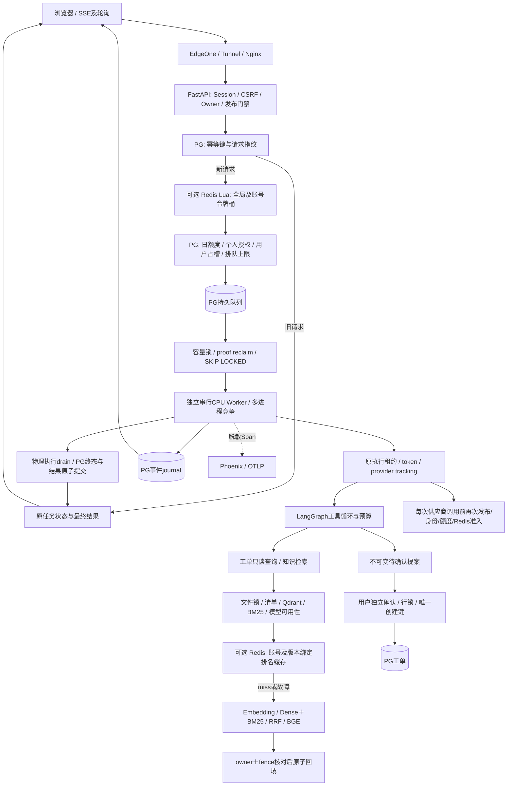

# 第一周后端知识工程化

本批从 `bbbfb2c` 演进，目标是在现有 Agent 业务上补足实际资源控制。PostgreSQL 继续决定任务、额度、审批和工单状态；Redis 默认关闭，负责可选的速率准入与排名缓存。现状审计见 [升级清单](WEEK1_BACKEND_AUDIT.md)。本批不部署、不修改真实任务、不调用付费模型。

## 1. Day 1–7 与真实实现的对应

| 学习内容 | 已有实现 | 本批新增或增强 |
| --- | --- | --- |
| Day 1：GIL、线程、Lock | 模型线程池、ExecutionTracker、索引文件锁 | 稳定 Worker 配置/模型生命周期，最多一个真实重排 Future；CUDA 模型所有者 OS 锁 |
| Day 2：asyncio、线程池、Semaphore | 工具线程卸载、SSE异步读取 | 异步模型记账/回执、认证、进度写入卸载；取消仍等待真实物理边界。没有为了展示 Semaphore 另加重复计数器 |
| Day 3：事务、索引、行锁、唯一键 | 配额事务、SKIP LOCKED、工单唯一创建键 | 原子排队/执行容量；0016 部分索引；可配连接池与 checkout 耗时 |
| Day 4：Redis、缓存、令牌桶 | 原 PG 限流/配额保留 | 真 Redis Lua 双桶、Cache Aside、HMAC/版本隔离、TTL 抖动、空库负缓存 |
| Day 5：MQ、ACK、幂等、背压 | PG 持久队列、一次领取、结果与终态事务 | 全局背压、只读失败列表、双进程/崩溃实验；不引入另一套 MQ |
| Day 6：分布式锁、租约、fencing | PERSONAL 执行 token 与 OS 生存证明 | 缓存随机 owner＋递增 fence、原子条件发布/释放、持有者真实退出测试 |
| Day 7：综合并发 | 单 Worker、日额度、执行预算、Phoenix | 10/50/100 并发、真实服务故障注入、脱敏阶段指标与资源上限 |

## 2. 主要源码与职责

路径均相对 `src/project_copilot/`，辅助实验位于 `scripts/`。

| 源码 | 重点入口 | 实际职责 |
| --- | --- | --- |
| `infrastructure/redis_runtime.py` | `get_redis_runtime`、`close_redis_runtime` | 显式启用后惰性建池；连接/命令超时、有界连接数、关闭所有 socket，禁止写命令自动重试 |
| `services/redis_admission.py` | `admit`、`TOKEN_BUCKET_LUA` | Redis TIME 下原子检查全局/账号桶；任一不足均不扣，计算 Retry-After |
| `services/quotas.py`、`api/jobs.py` | `reserve`、`submit` | 认证及发布检查后，先核对幂等旧请求，再做额外 Redis/队列准入；PG业务配额保持权威 |
| `infrastructure/ranking_cache.py` | `RankingCache.get/acquire/publish/release` | 仅保存片段 UUID 和有限分数；缓存重建租约与写入端 fence 检查 |
| `rag/final_retrieval.py` | `FinalRetriever._search`、`SharedReranker` | 完成清单/Qdrant/BM25/模型检查后才读缓存；保持 Hybrid＋RRF＋BGE；无纯 Dense 降级 |
| `services/queue_control.py` | `check_enqueue`、`can_claim`、`inspect_failures` | 队列背压、保守执行容量、无重放的只读失败视图 |
| `services/ai_worker.py` | `claim_one`、`process_one` | PG领取、独立执行、PERSONAL真实线程drain、终态/结果/事件一起提交 |
| `services/personal_profile.py` | `worker_resource_scope` | 一个串行 Worker 生命周期内稳定复用个人配置；退出分别关闭 base/derived 的检索器与 Redis |
| `infrastructure/resource_limits.py` | `GpuModelOwner.acquire` | 同一共享 manifest 目录下仅一个 CUDA 模型常驻；锁没有 TTL，不用时钟证明推断结束 |
| `infrastructure/execution_tracking.py` | `async_provider_request`、`ExecutionTracker` | 记账提交后才允许外呼；取消与回执均跟踪真实 Future，不把取消 wrapper 当线程结束 |
| `db/session.py` | `Database`、`ObservedQueuePool` | 受限连接池、明确等待超时、实际 checkout 耗时，事务仍提交/回滚/关闭 |
| `scripts/public_maintenance.py` | `list-failures` | 沿用交互式管理员认证的本机只读排查入口；没有公网管理 API 或一键重放 |

## 3. 当前架构



Redis 不处理登录、CSRF或最终业务事务。知识检索不会获得工单确认权限；普通聊天历史不恢复旧 Context。

## 4. 一次请求的完整链路

1. 浏览器只提交一次 `POST /jobs`，携带现有 Cookie、CSRF 和幂等键。Agent 提案还需有效 Context。
2. 后端验证身份、归属、发布授权和规范化请求指纹。相同幂等请求先返回原任务，Redis不可用或队列已满也不能将它变成新执行。
3. 对新任务，Lua 在一次原子执行中检查全局与账号速率；失败返回429和 Retry-After，连接/脚本故障返回503。PG 原日额度、个人500任务授权及并发3槽等机制没有退款或放宽。
4. PG 在同一事务中核对待领取队列上限，保存 reservation 和 job；失败回滚，不留下半条任务。
5. Worker 串行领取。开启执行容量限制时，锁顺序为 release shared → 原quota advisory lock → 已有个人证明回收 → 容量计数 → 候选 reservation `FOR UPDATE SKIP LOCKED`。
6. RAG/Agent 在现有预算内执行。每次付费调用前仍重新验证发布、账号、provider budget及可选Redis准入，PERSONAL执行还核对原fence，再提交发起计数后外呼。Redis拒绝不会增加 provider-open 或触发 HTTP。
7. 检索命中缓存前仍验证当前索引和重排模型。命中只省后续Embedding、Hybrid检索和重排推断；正文从本次校验的片段重建。空清单的负缓存仍先读取当前清单，不掩盖删除恢复journal。
8. 真实进度和RAG草稿批量写PG事件。SSE仅读取原任务，断线/停止等待不取消执行、不重发模型请求。
9. PERSONAL Worker 等待实际线程和模型工作结束；原provider/业务证据决定 failed 或 unknown，任务状态与占槽分开。普通模式仍保守保留不确定状态，但不具有同一套PERSONAL执行证明。终态、结果和terminal事件仍同事务提交。

## 5. 少量真实源码切片

### 双桶必须一起成功

`services/redis_admission.py` 的核心分支：

```lua
if global_tokens < 1 or user_tokens < 1 then
    return {0, math.max(1, retry_ms)}
end
redis.call('HSET', KEYS[1], 'tokens', global_tokens - 1, 'updated_ms', global_updated)
redis.call('HSET', KEYS[2], 'tokens', user_tokens - 1, 'updated_ms', user_updated)
```

真实文件在两次 HSET 后分别设置TTL。两桶检查与扣减全部在同一Lua里；全局有余额、用户没余额时不会误扣全局。TTL与Retry-After同时覆盖Redis时钟回退产生的未来时间差，不能让桶提前过期重置。

### Redis锁的写入端校验

`infrastructure/ranking_cache.py`：

```lua
if redis.call('GET', KEYS[1]) ~= ARGV[1]
   or redis.call('GET', KEYS[2]) ~= ARGV[2] then return 0 end
redis.call('SET', KEYS[3], ARGV[3], 'PX', ARGV[4])
redis.call('DEL', KEYS[1], KEYS[2])
```

owner是随机值，fence在同命名空间递增；写缓存与释放租约必须原子进行。A超时后B接管，A的旧owner/fence不能覆盖B，也不能删除B的锁。该序号属于缓存协调，不替代业务执行token；Redis重启后仍靠随机owner与版本键拒绝旧发布，不宣称跨重启的全局序号持久保证。

### 业务状态和并发占槽分开

`services/queue_control.py` 统计的执行容量：

```python
AiRequestReservation.state != "reserved"
AiRequestReservation.slot_released_at.is_(None)
```

它有意包括仍占槽的unknown和未完成物理执行，不能只数running，也不能因超过900秒就释放。排队中的reserved另算队列长度；个人并发槽原有规则仍包括等待和运行。

### 异步等待与真实执行结束分开

`async_provider_request()` 的记账先经过 `_settle_boundary()`，它用shield等待同一个受跟踪Future，不重复提交。进入阶段取消时，如果记账已提交但尚未允许HTTP，可证明本地没有外呼，写完成回执而不退还发起计数；允许HTTP之后，取消或丢响应仍不能冒充供应商终态。

`progress_async()` 和Agent认证也使用已有 `tracked_to_thread()`，所以慢PG操作不会直接阻塞事件循环；真实Future仍参与Worker的drain。

### 有界资源与生命周期

`SharedReranker` 只允许一个真实pending Future，线程忙时明确拒绝新提交，不制造无限等待队列。CUDA所有者锁在加载模型前获取，贯穿常驻模型；`close()` 先等待真实executor结束并清理模型，再释放锁。

`worker_resource_scope()` 稳定持有base和derived Settings；比较完整Python配置值，包含真实SecretStr相等性，不拿脱敏JSON的星号当凭据身份。

## 6. 四种锁与四种容量

| 机制 | 保护对象 | 不能证明什么 |
| --- | --- | --- |
| PG行锁/事务/唯一约束 | 任务领取、额度、确认与真实工单提交 | 远程模型已经停止 |
| 原OS执行租约与业务token | 同主机真实执行生存、过期执行禁止新操作 | 供应商已经终止或费用已结清 |
| 索引flock | 共享本地文件系统上的清单/快照/检索一致性 | 跨主机索引一致性 |
| Redis owner＋fence租约 | 缓存热点重建及迟到写入 | 工单事务成功、GPU线程结束、业务租约失效 |

| 控制 | 实际限制 |
| --- | --- |
| 令牌桶 | 单位时间的发起速率及突发容量 |
| Semaphore/有界Future | 同一进程内同时在执行或等待的工作数量；本批重排零等待队列 |
| 数据库连接池 | 该进程可以持有的数据库连接数，等待超时明确失败 |
| PG持久执行槽及队列背压 | 跨进程未释放占槽、可领取执行数、未领取积压 |

增加CPU Worker进程数会乘上每进程连接池和模型内存。Worker CLI要求pool_size＋max_overflow至少3，为执行lease、业务事务及记账留空间；不是越大越快。

GPU模型互斥只适用于**同一主机、同一共享 `manifest_dir/.model-resources`** 的协作者，不控制别的项目，也不支持不同锁目录/跨主机共享GPU。GPU普通/个人profile切换时应在任务真实结束后重启Worker释放旧模型；不承诺同进程透明热切换。

## 7. 缓存一致性、重试和队列边界

- Cache Aside先读缓存，miss计算、持有合法租约才回填。正TTL默认300秒、空库负TTL10秒、±10%抖动；均有配置校验。
- HMAC键绑定可信账号、完整完成清单、Qdrant资源、Embedding端点和检索流水线。配置版本号本身不能代表新增/删除后的内容版本。缓存值没有正文、文件名、query、Cookie或Context。
- 文件锁仍覆盖整个检索链。Redis锁竞争不在持flock时等待；走原完整计算且不回填。独立锁实验验证的是租约协议，不证明最终RAG已经支持跨主机Singleflight。
- Redis准入故障闭锁；缓存故障可走原完整检索。两者不能混为“Redis挂了全部放行”。Redis配置使用noeviction，内存满时准入写入失败关闭，缓存回填失败不伪装命中。
- 缓存值存在但校验失败时，业务执行完整检索；获取租约不会覆盖该值，等待TTL自然过期再重建。租约获取脚本也原子检查结果是否已发布，阻止旧miss请求在前一owner发布后再次重建。
- Redis `EVAL/SET`、模型、提案、工单及索引发布均无自动重试。现有前端只读GET保留指数退避＋jitter；恢复不重发POST。本批没有另加业务重试队列。
- Redis AOF并非PG任务或费用账本；崩溃恢复仍可能丢失最近速率状态，不能声称跨故障exactly-once限流。PG持久额度继续限制真实业务。

| 传统MQ概念 | 当前PG对应 | 边界 |
| --- | --- | --- |
| durable message | reservation＋job一起提交 | 没有独立broker |
| competing consumers | SKIP LOCKED＋原子claim | Worker进程内部仍顺序执行 |
| ACK | 结果/终态/terminal事件同事务提交 | 丢失远程结果时保持unknown，不能重新消费 |
| visibility/lease | 真实OS/业务执行证明 | 超时不是允许重投的依据 |
| DLQ | 管理员 `list-failures` 只读列表 | 不提供一键重放 |
| backpressure | 日额度、个人占槽、可选queue/active上限 | 非吞吐或延迟SLA |

现阶段不增加RabbitMQ/Kafka/Celery：当前任务与业务事务紧密绑定，PG队列已满足小规模独立Worker场景。没有broker级分区、广播、优先级、公平调度、跨地域队列和自动redelivery能力。将来只有在明确需求和迁移协议下再考虑。

## 8. 故障恢复与可观测性

| 情况 | 行为 |
| --- | --- |
| 新任务Redis限流/断线 | 429＋Retry-After / 503；PG新reservation和job回滚，不外呼 |
| 同幂等请求遇队列满或Redis故障 | 先校验身份/指纹，返回原任务，不新增发起计数 |
| 缓存坏值/过期/Redis断线 | miss，执行原完整链；不返回错误缓存当成功 |
| 缓存A过期、B接管 | A不能发布/释放B；不停止A底层实际计算 |
| Worker领取前退出 | reserved仍可由另一合法Worker领取 |
| Worker领取后退出 | 不自动重放；有充分既有证明时仅回收槽，不退额度 |
| 最终提交连接丢失 | 不凭响应推断成功，保留只读核查；不重复模型/业务写入 |
| 底层线程/GPU超时仍运行 | Future与物理owner继续持有，不能提前放槽/解锁 |
| DB连接池耗尽 | 有界等待后失败；不会用Redis绕过PG |

新增/强化的Span元数据：`admission_wait_ms`、`rate_limit_rejected`、`cache.status/cache.hit`、缓存锁的 `lock_wait_ms`、`queue_wait_ms`、`worker_execution_ms`、`active_execution_slots`、`retry_attempts=0`、`db_checkout_ms`。

`db_checkout_ms`包含新连接建立和等待，不冒称纯 `db_pool_wait_ms`。`active_execution_slots`表示未释放执行占槽，包含不确定任务，不等于正在计算的GPU数。缓存锁耗时是一次非阻塞获取的实测耗时，不是分布式排队时长。Span不记录查询、DSN、账号凭据、正文或Redis键。

本批Trace验证使用真实OTel对象和受控OTLP接收边界；没有启动新的Phoenix或宣称新增Span已经真实云端收存。历史Phoenix功能保留。

## 9. 配置与可复现运行

默认 `redis_enabled/redis_admission_enabled/redis_cache_enabled=false`，旧单机运行不连接Redis。完整变量模板见根 `.env.example`：连接URL和cache HMAC为SecretStr，仅放私有后端配置；其他速率/TTL/容量为非秘密受控配置。

| 配置组 | 默认与作用 |
| --- | --- |
| `REDIS_*`连接 | 0.5秒socket/connect超时、16连接上限；只在显式启用后建池 |
| `REDIS_ADMISSION_*` | 全局30突发/每秒1，账号5突发/每秒0.2；可配置，PG原配额不变 |
| `REDIS_PROVIDER_*` | 全局80突发/每秒2，账号40突发/每秒1；每次真实供应商边界检查 |
| `REDIS_CACHE_*` | 300秒正缓存、10秒负缓存、0.1抖动、120秒缓存租约；启用需独立≥32字符私有HMAC |
| `QUEUE_MAX_PENDING_JOBS` | 默认0，保留原政策；可选示例100，下文queue实验固定3 |
| `WORKER_MAX_ACTIVE_JOBS` | 默认0，保留原政策；受控CPU双进程示例2，GPU仍唯一模型owner |
| `DATABASE_POOL_SIZE/MAX_OVERFLOW` | 每进程默认5＋5；乘以Worker进程数评估总连接 |

本机可选部署用 `docker-compose.redis.yml`，加在原deploy overlay之后；API保留default网络并加入内部redis_backend。公网的独立可选适配为 `deploy/public-demo.redis.yml`，Redis仅在已有内部backend网络，无host端口。`scripts.public_resources --with-redis`才额外初始化/检查新的`pc-public-v2-redis`外部卷；原四卷、项目名、资源归属校验均保留。

本批没有初始化该公网卷或改真实私有配置。Redis缓存/速率状态不进入既有PG/Qdrant/Manifest/BM25权威备份范围，恢复后不承诺保持短时速率余额；绝不能把Redis备份当作业务恢复凭据。

审核合并后的代码升级需在CLOSED且原执行真实结束后构建新镜像、迁移到`0016_queue_backpressure`、更新API/Worker并按现有管理员流程重新授权。0016只新增两个索引，不改历史迁移/业务记录。本轮不执行这些操作。

本批新增了`redis`运行依赖。原`Dockerfile.personal-demo`仅适合依赖未变化的源码覆盖；升级本批必须先用正常`Dockerfile`按新锁文件构建依赖镜像，不能用旧离线base假装已安装Redis。Redis容器限制128MiB、数据maxmemory64MiB；新增缓存不包含模型权重，CPU Worker数量仍会增加常驻模型和连接池总量。

## 10. 三个有学习价值的本机验证

这些都是**合成实验**。先准备独立测试服务：

```bash
docker compose -p pc-week1-lab -f docker-compose.week1-lab.yml up -d --wait
```

只启动loopback的测试PG 5434和Redis 16379，tmpfs无业务挂载；端口已占用时先核实归属，不停止其他项目。测试记录随该临时测试服务停止丢失。依赖用锁文件dev环境安装，不需要模型密钥；下列三个Python实验命令去掉 `--execute` 都只显示计划，默认不联网。

**① 令牌桶与Cache Aside：**

```bash
.venv/bin/python -m scripts.week1_backend_lab rate --with-cache --execute --redis-url redis://127.0.0.1:16379/15
```

10/50/100并发、每档100次，独立桶容量20：每档应允许20、拒绝80、意外错误0。随后同一100个合成输入分别关闭/启用缓存，核对`results_match`、计算次数、热点仅重建1次和延迟分位数。总500次实验，不调用HTTP模型或真实RAG；缓存快慢以实测为准。

**② 租约竞争与过期旧owner：**

```bash
.venv/bin/python -m scripts.week1_backend_lab locks --execute --redis-url redis://127.0.0.1:16379/15
```

观察A获取、B在TTL内被拒、过期后B取得更大的fence、A的释放/发布都失败、B结果可回读。`checks`均true。它证明实际缓存锁协议；持有者真实进程死亡另由自动集成测试覆盖，不证明业务模型已经终止。

**③ 双Worker与故障边界：**

```bash
.venv/bin/python -m scripts.week1_backend_lab queue --execute
```

脚本只在固定测试集群中新建随机数据库并迁移，两个真实CPU进程各领取不同任务；每个结果/terminal只提交一次。另一个真实子进程在claim后退出，旧running/unknown仍保守占槽，后续领取被阻止，且无provider调用。release、健康与runner明确使用替身；原PERSONAL物理生存证明由专项测试另外验证。脚本结束仅删除自己新建的随机数据库。

实验结束可用相同Compose文件 `stop` 关闭测试服务，不使用 `down -v`。本轮自动执行实验由Codex完成，不登记为用户本人手测。

## 11. 十道面试问题

1. **为什么用了Redis还保留PG配额？** Redis令牌桶控制短时速率，PG保存持久授权、次数和并发证据；Redis丢状态不能退款或重新执行任务。
2. **Lua双桶相比两个INCR有什么好处？** 全局和账号必须一起检查再扣减，一方不足不消耗另一方，也不会被并发插入打断。
3. **缓存命中为什么还读Qdrant？** 缓存只是排名提示，必须证明当前完成清单和实际片段仍一致，防止旧备份或损坏存储被缓存遮蔽。
4. **如何避免跨用户缓存？** scope来自服务端执行账号；HMAC键同时绑定账号、资源、清单和流水线；公开模式无可信账号时禁用缓存。
5. **Redis锁过期后旧任务为什么不能写？** 实际publish脚本原子核对随机owner和fence；仅在Python里先GET后SET有竞争窗口。
6. **为什么不把index_lock换成Redis锁？** 当前索引正确性依赖同主机共享文件系统；Redis TTL不能证明老写入者停止，替换需要完整跨主机发布协议。
7. **如何保证多个Worker不重复领取？** PG候选行使用SKIP LOCKED，状态更新同事务；任务结果/终态/terminal也同事务。外部请求丢响应仍不承诺exactly-once。
8. **取消asyncio任务为什么不等于取消GPU？** 被取消的Future可能仅是等待包装，底层线程/CUDA仍在运行；Tracker、常驻GPU owner和drain保留真实生存边界。
9. **unknown为什么不直接重试？** 可能已发生计费、提案或事务提交；缺乏终态证明时重试可能重复收费/副作用。槽位回收也不会改unknown或退次数。
10. **这次压测证明高并发生产能力了吗？** 只证明已测隔离存储/并发控制与合成工作；不证明真实模型质量、GPU吞吐或公网SLA。轻计算下缓存甚至更慢，必须结合实际资源成本判断。

## 12. 学习顺序与证据入口

推荐顺序：审计表 → `redis_runtime/redis_admission` → `ranking_cache`与`FinalRetriever` → `queue_control/QuotaService/claim_one` → `async_provider_request/ExecutionTracker` → `worker_resource_scope/GpuModelOwner` → Span和三个实验。

全量命令、真实服务版本、通过/跳过项目和原始合成压测结果见 [本批验证报告](WEEK1_BACKEND_VERIFICATION.md)。当前实际采用单主机共享目录、多CPU进程的保守模型；跨主机索引、整机GPU调度、自动业务重试及生产压测没有实现。

参考：[Redis令牌桶与原子脚本](https://redis.io/docs/latest/develop/use-cases/rate-limiter/)、[SET NX PX与安全释放](https://redis.io/docs/latest/develop/clients/patterns/distributed-locks/)、[redis-py超时和重试配置](https://redis.io/docs/latest/develop/clients/redis-py/produsage/)。本项目的锁仅用于单Redis缓存协调，不声明实现Redlock或跨地域容错。
