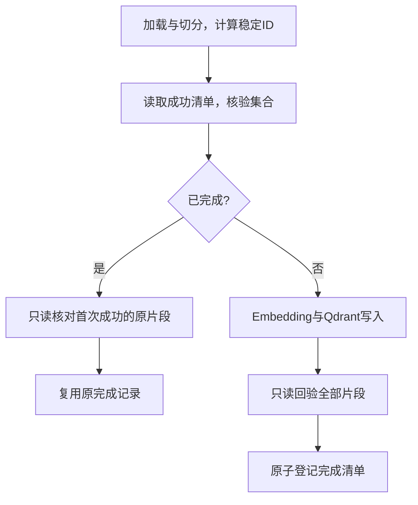

# 【Day 18 开发报告】

日期：2026-10-26。**入库恢复与幂等重传实现、自动回归及真实本地Qdrant故障验收已完成。Git按本次用户授权审核后提交推送，最终结果在会话补全；阶段B待ChatGPT学习与用户主动手动验证，D19未开始。** 无新增收费模型调用，原D17配置和历史实验保持。

## 1. 今日开发目标

补齐同内容重传、同名异内容、部分写入/清单保存失败后的同ID重试。只让完成文档进入Dense/BM25检索，失败不误报成功，旧成功证据保留，上传临时文件清理继续有效。

## 2. 新增和修改的文件

**修改：**

- [infrastructure/qdrant.py](../../src/project_copilot/infrastructure/qdrant.py)：新增`verify_chunks`，分批只读核验精确ID、完整原文/metadata和Dense索引版本，不取向量或自动重试。
- [rag/ingestion.py](../../src/project_copilot/rag/ingestion.py)：已完成文档回读验证后复用；新写入回读通过后才原子登记成功清单。
- `tests/test_dense_pipeline.py`、`tests/test_upload_pipeline.py`：更新重传只调用一次Embedding、改名保留首次成功来源名的预期。
- `tests/test_baseline.py`：FakeStore补齐只读核验协议；`tests/test_chunking_run.py`、`tests/test_hybrid_run.py`、`tests/test_rerank_run.py`的临时合成执行凭据绑定当前源码，正式历史归档不变。
- README、计划第10节、日志、学习/面试笔记及evals说明补充D18行为与版本边界。

**新增：**

- [tests/test_ingestion_recovery.py](../../tests/test_ingestion_recovery.py)：22项D18用例，含部分失败、回读异常、清单冲突、旧快照、HTTP失败/重试/清理与脚本门禁。
- [tests/conftest.py](../../tests/conftest.py)：只用于合成采集器单测的当前源码凭据工厂，不改生产源码门禁。
- [scripts/ingestion_recovery_smoke.py](../../scripts/ingestion_recovery_smoke.py)：显式--local、合成二维向量、真实Qdrant随机隔离集合的恢复验收入口；不读.env，不调用模型，结束清理自己创建的集合。
- [真实恢复收据](../evidence/D18_RECOVERY_SMOKE.json)、[存储保护与历史回归收据](../evidence/D18_STORAGE_AUDIT.json)及本日报。

共20个交付文件，无新增依赖、配置项或API响应字段；D6上传入口的错误映射、临时文件finally和同进程锁继续复用，本次由新增HTTP故障测试验证。

## 3. 核心实现内容

1. 原文加载及切分后读取成功清单，先检查集合契约。若已有相同document_id，必须核对content hash和完整chunk ID序列；冲突明确失败，不重签旧记录。
2. 已完成文档按第一次成功的source_name构造预期片段并只读核验，返回原CompletedDocument，不再发Embedding请求、upsert或改写清单。同内容改名不增加别名、重复点或变更原引用名称。
3. 新文档完成Embedding与wait=True upsert后，按每批最多64个ID、with_vectors=False回读；原文、metadata、索引版本或完整性不符合则抛错，不登记成功。回读不验证语义向量质量。
4. 未登记的残留点不进入清单过滤的Dense查询和BM25构建。修复故障后由调用方重试，稳定ID覆盖原残留点，成功后才新增清单；系统不自动重试。
5. 同名但内容变化形成新document_id/chunk IDs，旧记录保留。完成清单变化后旧BM25快照明确拒绝混用，需显式重建；只有失败残留点、清单未变时旧已完成快照仍有效。

任一步异常向上传播，HTTP入口仍在finally删除上传临时副本、释放锁并关闭客户端。API已有502/503错误映射适用于本次新增失败边界；新增测试实际观察失败后重试200，未扩展API合同。

## 4. 关键设计决策

完成清单仍是可检索文档的唯一入口，不把Qdrant已有部分点视为成功。失败点保留供同ID重试覆盖，不自动删除集合或旧证据；重传复用前必须回读，避免集合/片段已丢失却误报成功。首次成功来源名保持稳定，文件名不是文档身份。

回读验证范围为ID、原文、metadata及Dense版本，不取完整向量或证明模型语义正确。单进程顺序入库与既有HTTP进程内锁保持；原子JSON替换不是跨存储事务或跨进程锁。已登记文档缺片会明确报错，不自动重新收费嵌入或静默删除清单；外部删点恢复须显式处理。

D18改变了运行源码，旧采集器的源码漂移门禁应继续拒绝旧版本执行身份。三套原有采集器单测本来就使用临时副本、fake向量/评分，现只将这些合成凭据绑定当前源码，保留其漂移拒绝用例；新增测试还直接证明正式D16采集入口会拒绝当前改变的源码。不改、重签或覆写真实V0/V1/V2/V3/D17归档，旧结果可回放校验，但不声称是新D18源码重新采集的效果。

## 5. 自动测试结果

执行者均为Codex；本日尚未登记用户学习或手测完成。

| 实际验证命令 | 结果与范围 |
| --- | --- |
| `PROJECT_COPILOT_RUN_QDRANT_INTEGRATION=0 HF_HUB_OFFLINE=1 timeout --signal=INT 180s .venv/bin/python -m pytest -q` | 最终1069 passed、1 skipped，67.13秒；含22项D18新增，使用内存Qdrant/合成向量或mock，ASGI测试在沙箱外执行。唯一默认跳过项为显式启用的真实HTTP集成，不把重复开发运行累加 |
| `PROJECT_COPILOT_RUN_QDRANT_INTEGRATION=1 PROJECT_COPILOT_QDRANT_URL=http://127.0.0.1:6433 HF_HUB_OFFLINE=1 .venv/bin/python -m pytest -q tests/test_qdrant_integration.py` | 单独真实HTTP集成1 passed，0.96秒；独立随机集合＋合成二维向量，结束清理，不调用模型 |
| `.venv/bin/python scripts/ingestion_recovery_smoke.py --local --output-dir data/auto-d18/recovery-01` | 退出0，真实Qdrant1.19.2、SDK1.19.1，8阶段恢复验收通过；实际完整命令和记录见日志/收据，测试集合删除确认 |
| 同脚本提供新output-dir但不加--local | 实际退出2，未创建输出目录或客户端；门禁也由离线用例覆盖 |
| `python -m evals.chunking_run/hybrid_run/rerank_run/holdout verify`（实际均.venv/bin/python，分4条命令） | V1/V2/V3/D17公开归档分别退出0、verified；无模型/新检索，原指标身份保持 |
| 集合保护审查 | 运行前后原3集合及点数相等：pc_eval_dense_v0=16、pc_eval_dense_v1_size500=27、pc_knowledge_dense_v0=2；只清理本次临时测试集合 |

真实恢复验收的8阶段如下；所有向量均为代码生成的[1,0]，只证明工程边界，不代表真实Embedding或语义质量：

| 阶段 | Qdrant点数 | 完成文档数 | 累计合成向量批次 |
| --- | --- | --- | --- |
| 第一份文档完成 | 1 | 1 | 1 |
| 新文档只写一片后失败 | 2 | 1 | 2 |
| 新service读取清单并同ID重试 | 4 | 2 | 3 |
| 同内容改名重传 | 4 | 2 | 3 |
| 同名不同内容 | 5 | 3 | 4 |
| 向量写全但清单保存前失败 | 7 | 3 | 5 |
| 新service同ID重试登记成功 | 7 | 4 | 6 |
| 成功后再次重传 | 7 | 4 | 6 |

每阶段Dense与BM25只看完成文档；新成功后旧BM25快照按预期拒绝。HTTP内存集成另验证部分写入502、清单失败503，随后重试200；失败和成功后的上传临时文件均为0，manifest临时文件无残留。真实脚本的清单故障在保存前注入，原子replace实际失败与临时清理由离线/HTTP测试覆盖，二者不混写。

真实Embedding/Chat模型API调用0，无模型下载或新收费。重试未完成文档可能再次请求Embedding，本日用合成向量验证该流程；普通API并未增加自动重试或运行时Embedding缓存。成功文档重传只读核验，不保证省去SDK客户端初始化/凭据检查。

## 6. GitHub 提交信息

- 起点为已同步的D17收尾[18e5990bce87d2c98740d06a42941742cdd1d439](https://github.com/yan-ye-dhy/project-copilot/commit/18e5990bce87d2c98740d06a42941742cdd1d439)，main工作区干净，沿用origin现有项目仓库。
- 用户明确要求D18同步GitHub，本次由Codex审核、提交和推送；真实提交ID、分支和同步状态在会话补全，不预填未来commit。
- 真实验收收据保存base commit 18e5990、dirty=true及4份实际运行源码SHA；对应提交前工作区，不追填收据的未来提交身份。

## 7. 后续学习提示

1. 跟踪上传→临时文件→load/split→完成清单→重复/新文档分支→回读→record→HTTP返回，区分SDK初始化、真正模型请求与向量写入。
2. 解释文件名、content hash、document_id、chunk_id的关系，以及同内容改名保留首次成功来源名的原因。
3. 结合点数2而完成文档仍1、点数7而完成文档仍3，解释为什么存储点存在不等于可检索成功。
4. 比较稳定ID幂等、原子JSON替换、进程内锁和跨存储事务；理解部分失败为何仍需显式重试及旧BM25快照何时重建。
5. 理解源码版本演进与历史实验来源身份；区分合成向量故障测试、真实存储HTTP、旧结果回放及真实模型语义效果。

## 8. 下一步计划

完成本次Git审核、提交和推送，交ChatGPT学习D18。用户主动要求D18手动验证后，再带练本地故障→点/清单观察→同ID重试及去重；本次开发期自动验收不登记为用户操作。D19需用户明确开启，届时处理回答拒答、注入和结构化异常等可靠性回归，不用已见保留集选择参数或提示词，不自动开始。
