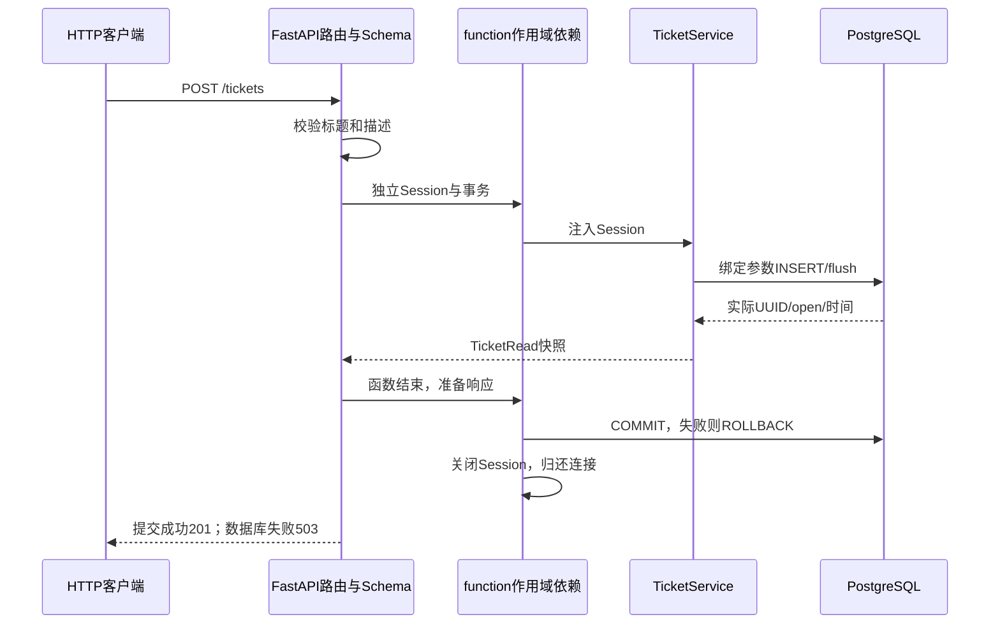

# 【Day 20 整合开发批次报告】

开发日期：2026-10-26；学习与手测收尾：2026-10-27。覆盖原D20连接、D21模型迁移、D22 Service/API、D23事务与持久化四项。开发提交7d78db8已推送，用户亲自完成三项手测并确认ChatGPT学习理解，阶段A/B均完成；本次收尾文档待用户提交，D24未开始。

## 1. 今日开发目标

交付可独立使用的PostgreSQL工单后端：应用持有Engine、每请求独立Session与事务、工单模型/请求响应Schema/显式Alembic迁移、创建/列表/详情及状态/关键词筛选、真实提交/回滚/重启持久化验证。只整合交付与学习流程，不缩减必要检查，不实现Agent工具、人工确认、状态变更接口或前端。

## 2. 新增和修改的文件

| 类型 | 文件 | 职责 |
| --- | --- | --- |
| 修改 | [config.py](../../src/project_copilot/config.py)、[main.py](../../src/project_copilot/main.py) | 可选SecretStr PG连接配置、超时；lifespan创建/释放Engine，注册工单路由 |
| 修改 | [docker-compose.yml](../../docker-compose.yml)、[.env.example](../../.env.example)、[pyproject.toml](../../pyproject.toml)、[uv.lock](../../uv.lock) | 官方PG17.11，独立业务卷/测试集群，数据库依赖与锁定 |
| 新增 | [db/session.py](../../src/project_copilot/db/session.py) | 懒连接Engine、Session工厂、事务边界及关闭 |
| 新增 | [db/models.py](../../src/project_copilot/db/models.py)、[schemas/tickets.py](../../src/project_copilot/schemas/tickets.py) | ORM映射与独立API输入/输出契约 |
| 新增 | [alembic.ini](../../alembic.ini)、[migrations/env.py](../../migrations/env.py)、[revision模板](../../migrations/script.py.mako)、[0001迁移](../../migrations/versions/0001_create_tickets.py)、[db/migrations.py](../../src/project_copilot/db/migrations.py) | 空库升级、版本记录、ORM漂移检查及后续revision生成，启动不自动改表 |
| 新增 | [services/tickets.py](../../src/project_copilot/services/tickets.py)、[api/tickets.py](../../src/project_copilot/api/tickets.py) | 确定性工单业务、绑定参数查询及HTTP/错误映射 |
| 新增 | [services/ticket_checks.py](../../src/project_copilot/services/ticket_checks.py)、[scripts/ticket_db.py](../../scripts/ticket_db.py) | 连接/迁移CLI、真实flush后受控回滚诊断，无API故障后门 |
| 新增 | [postgres_support.py](../../scripts/postgres_support.py)、[postgres_smoke.py](../../scripts/postgres_smoke.py) | 严格测试库/角色门禁，随机独立库、真实HTTP与API进程重启验收 |
| 新增/修改 | [数据库测试](../../tests/test_database.py)、[Schema测试](../../tests/test_ticket_schemas.py)、[PG迁移/约束测试](../../tests/test_ticket_database.py)、[查询/隔离测试](../../tests/test_ticket_service.py)、[API/事务测试](../../tests/test_ticket_api.py)、[CLI测试](../../tests/test_ticket_cli.py)、[conftest.py](../../tests/conftest.py) | 87项新增，明确区分本地对象/编译/Mock与真实PG |
| 新增/修改 | README、AGENTS、协作规则、计划、日志、学习/面试笔记、[三个手动验证](../D20_MANUAL_VERIFICATION.md)、本报告、[PG原始收据](../evidence/D20_POSTGRES_SMOKE.json)、[批次审计](../evidence/D20_BATCH_AUDIT.json)、[2026-10-27手测记录](../evidence/D20_MANUAL_VERIFICATION_20261027.json) | 批次编号、系统教学与可复现交接；包入口`db/__init__.py`、`services/__init__.py`随模块增加；本次仅改6份关联Markdown并新增独立手测记录，原收据/源码不改 |

新增直接依赖SQLAlchemy2.0.55（ORM/连接池）、Psycopg3.3.6含binary（PG驱动）、Alembic1.20.1（迁移）；Mako/greenlet等为锁定传递依赖。同步安装用--inexact保留已有GPU依赖，未修改原参考项目环境。

## 3. 核心实现内容

| 接口 | 契约 |
| --- | --- |
| `POST /tickets` | title非空≤200、description非空≤10000，拒绝额外字段；PG生成UUID、open、时区时间，提交后返回201 |
| `GET /tickets` | 可选status=open/in_progress/closed、字面且不区分英文大小写的q；limit默认20/1–100，offset0–10000；返回items/limit/offset，按created_at/id倒序 |
| `GET /tickets/{ticket_id}` | UUID参数，返回数据库实际工单，不存在404 |

创建不接受客户端id/status/时间，也未新增更新状态或删除HTTP接口。状态筛选的其它状态由真实PG测试种子覆盖，不声称已有状态流转功能。关键词用SQLAlchemy绑定参数与自动转义的ILIKE，不由模型编SQL；有界分页不表示已搜索完整数据库。

完整调用链：

依赖获取与请求参数解析由FastAPI统一调度；非法参数可能已创建一个尚未连接的Session，但不会执行Service写入。Service只add/flush/read，不私自commit，事务所有权在Database.transaction调用边界，可供后续受控业务组合；创建DTO不是已经对外确认提交。

## 4. 关键设计决策

1. **请求独立Session，应用共享Engine**：构造Engine/Session不连接PG；无DATABASE_URL时health/RAG继续可用，工单503；配置了但PG不可达时工单503。lifespan最终dispose，事务正常commit、异常rollback，Session最终关闭。
2. **提交在响应之前**：依赖显式`scope="function"`，避免yield默认request作用域在201发出后才遇提交失败。真实PG延迟唯一约束测试在flush成功、COMMIT失败时实际返回503，原成功记录仍1条。依据[FastAPI依赖作用域](https://fastapi.tiangolo.com/tutorial/dependencies/dependencies-with-yield/)、[SQLAlchemy事务上下文](https://docs.sqlalchemy.org/en/20/orm/session_transaction.html)自主接入。
3. **三层约束不混淆**：Pydantic负责传输类型/长度与字段权限；ORM负责映射；PG迁移负责物理NOT NULL、varchar长度、描述长度、空白/状态CHECK、UUID与timestamptz默认。updated_at创建时由DB生成，ORM后续更新使用onupdate；本批次无更新接口，不承诺直接SQL更新触发自动时间戳。
4. **显式版本迁移**：不在启动create_all；空库upgrade、重复upgrade与Alembic.check均真实通过。脚本接收已有连接，不把密钥写入alembic.ini；标准downgrade定义保留但本批次不执行。
5. **隔离与演进边界**：应用PG为5433/named volume；测试PG为5434/独立tmpfs实例。真实测试必须显式启用，严格验证测试库、角色和地址，仅创建/删除自己刚创建的pc_test_d20_随机库。不删除旧表/业务卷。原项目没有工单模块，本批次业务/迁移自主实现，原项目仅参考配置、API分层、Compose风格；不借本批次完成D24或D29确认/幂等。

## 5. 自动测试结果

实际执行者为Codex，无收费模型调用、无SQLite替代。阶段结果不累加成额外用例：

| 命令/环境 | 实际结果与范围 |
| --- | --- |
| `HF_HUB_OFFLINE=1 .venv/bin/python -m pytest -q tests/test_database.py tests/test_main.py` | 阶段A本地14 passed；未连接数据库，证明懒连接与生命周期分支 |
| `... pytest -q tests/test_ticket_schemas.py` | 阶段B本地21 passed；Schema、PG DDL编译与离线迁移，不冒充真实约束 |
| `PROJECT_COPILOT_RUN_POSTGRES_INTEGRATION=1 ... pytest -q tests/test_ticket_database.py` | 阶段B初版真实PG11 passed；最终新增制表/换行约束后本文件13项包含于联合/全量 |
| 同环境`... pytest -q tests/test_ticket_service.py tests/test_ticket_api.py` | 阶段C20 passed，含真实创建、列表/详情、状态/中文/字面词项与非法输入 |
| 同环境`... pytest -q tests/test_ticket_api.py` | 阶段D22 passed，包含先前API测试与新增真实回滚/提交失败/连接异常路径 |
| 同环境`... pytest -q tests/test_database.py tests/test_ticket_schemas.py tests/test_ticket_database.py tests/test_ticket_service.py tests/test_ticket_api.py tests/test_ticket_cli.py` | 最终批次87 passed，5.81秒；其中36项真实PG，其余51项本地/编译/Mock门禁，不将其全部算真实DB |
| `PROJECT_COPILOT_RUN_POSTGRES_INTEGRATION=1 PROJECT_COPILOT_RUN_QDRANT_INTEGRATION=0 HF_HUB_OFFLINE=1 timeout --signal=INT 240s .venv/bin/python -m pytest -q` | 最终1192 passed、1 skipped，74.28秒；包含全部87项新增，失败0。唯一跳过为原有显式启用的真实Qdrant集成，本批次未启用，不计通过 |
| `HF_HUB_OFFLINE=1 .venv/bin/python -m scripts.postgres_smoke --local --output-dir data/auto-d20/pg-smoke-accepted` | 真实PG17.11＋8次真实HTTP，UUID/时间/原始数据库行一致；flush后受控失败不存在残留；实际不同API进程重启后同一工单保留；池checkedout=0、自己的进程与测试库已清理 |

真实PostgreSQL为17.11（Debian 17.11-1.pgdg12+2）；完整报告保存自己的随机库名、创建ID、两个进程PID、响应/run_id、迁移版本、回滚探针及执行源码SHA。初次smoke的Alembic一致性提示混入stdout，改为仅捕获提示、保留异常后重新执行最终smoke；未复用旧报告冒充最终源码。数据保留验证仅针对API进程重启，不扩大为PG崩溃恢复或跨主机容灾。

最终审查补齐了标准revision模板，并在临时副本实际生成后续迁移文件；未创建后续业务表。NUL和非法UTF-8在Schema阶段拒绝（422），不等PG报数据库503。原D19前置已核实，真实PG迁移/API/事务/API进程重启验收完成；业务5433命名卷未作为自动测试靶标，未验证PG崩溃恢复/跨主机容灾。227份原受保护非Markdown文件保持，详见[批次审计](../evidence/D20_BATCH_AUDIT.json)。用户学习和三个手测另列阶段B，原D24–D34均未实施。

**2026-10-27用户手动验证（与上表自动测试分开）：**

| 项目 | 用户亲自执行并反馈的结果 |
| --- | --- |
| 创建/查询闭环 | 业务PG17.11 healthy、5433端口；upgrade返回head；POST /tickets为201，详情200及psql一行对应同一UUID/open/时间 |
| 受控事务失败 | probe f0173a76-b92d-4303-82eb-9fb8f23ba64c；flushed_before_failure=true、visible_after_rollback=false、pool_checked_out_after=0 |
| API重启持久化 | PID 56610→58981后GET原ID返回200，created_at/updated_at仍2026-10-27T06:25:08.567833Z；新进程日志run_id与请求路径对应 |

成功工单ID为0e4f3559-4beb-4c2b-9cfe-b5ddd6ae869b，保留用于后续演示；本地ticket.json与用户粘贴响应一致。其余证据来自用户终端反馈，Codex未代发HTTP/SQL或重跑业务测试；未取得本轮完整shell历史、初进程退出日志或最终API停止结果，不补写为已自动采集/清理。原自动验收和历史pending快照不改，三项手测及学习确认见[独立记录](../evidence/D20_MANUAL_VERIFICATION_20261027.json)。

## 6. GitHub 提交信息

- 起点main已同步[30fc9a86a388d6d79d36ae3119dada6ce6528873](https://github.com/yan-ye-dhy/project-copilot/commit/30fc9a86a388d6d79d36ae3119dada6ce6528873)，工作区干净、D19阶段A/B均完成。
- 用户本批次明确授权的开发提交为[7d78db860abcb7b31fa96d36a9849c3d03eb5824](https://github.com/yan-ye-dhy/project-copilot/commit/7d78db860abcb7b31fa96d36a9849c3d03eb5824)，分支main；当时push成功并只读核对远端SHA一致。此次收尾开始时本地main/origin/main同指该提交且工作区干净。
- 2026-10-27学习/手测收尾按默认规则由用户亲自add/commit/push，当前待提交；不将已完成的开发推送冒充本次文档已同步。
- 运行收据如实记录base commit/dirty和实际源码SHA，不修改历史归档的执行身份或强推历史。

## 7. 后续学习提示

用户已确认通过ChatGPT学习并能解释主流程；以下五条作为后续复习线索：

1. `main.lifespan→Database→sessionmaker→transaction→yield依赖`：Engine/池/连接/Session分别是什么，懒连接与每请求资源关闭如何验证，为什么Session不能全局共享。
2. `TicketCreate / TicketRead→Ticket ORM→0001迁移→PG物理表`：输入字段权限、模型映射与实际约束的职责，UUID/时区时间为何由数据库生成，Alembic.check证明的范围。
3. `POST /tickets→Service.create→add/flush→RETURNING→DTO→commit→close→201`：flush为何有ID却未提交，为什么Service不自行commit，function作用域怎样避免“201后提交失败”。
4. `rollback-check`和真实延迟约束测试：主动业务失败、flush错误、COMMIT错误、连接失败的差异，为什么新Session查证和pool.checkedout比一个HTTP错误码更有说服力。
5. 列表的参数绑定、ILIKE字面转义/中文/状态/有界分页，错误脱敏与run_id；测试库防误用、实际API进程重启证据及尚未做的并发确认/幂等边界。

## 8. 下一步计划

本批次开发同步、用户系统学习及[仅三个手动验证项目](../D20_MANUAL_VERIFICATION.md)均已完成，阶段A/B完成；下一步只提交本次学习/手测收尾文档，不重复实施原四日内容。本批次归为D20，覆盖原D20–D23；实际31个主任务批次＋1弹性，共32，原D24–D34暂留编号。等待用户明确要求后才进入D24。
