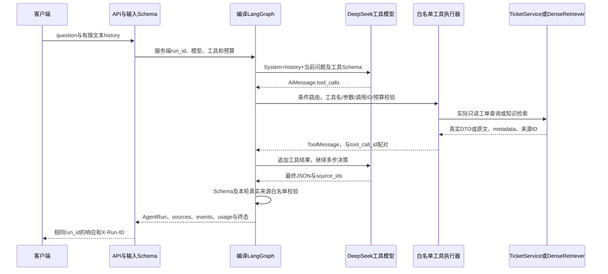

# 【Day 24 整合开发批次报告】

日期：2026-10-27。覆盖原D24–D28完整只读业务Agent；本报告记录第一批代码与自动验收，用户ChatGPT学习和手动验证尚未确认。按本次授权，第一批必须独立验收、提交推送后才进入原D29–D31第二批，不将批次数减少解释为删减功能/测试，不提前完成D32–D34。

## 1. 今日开发目标

实现真正编译的LangGraph状态/节点/条件路由和模型工具闭环，复用已有工单Service、PostgreSQL和Dense检索。提供get_ticket、search_tickets、search_knowledge三个真实只读工具、历史文本、多步决策、工具消息配对、来源合同、失败分类及执行预算；保留run_id、实际工具/模型记录、耗时与可取得usage，为D33实际Trace验收提供基础。

原任务映射：D24负责get_ticket闭环；D25扩充另外两工具和Schema；D26覆盖历史、组合证据与HTTP入口；D27覆盖错误/超时/预算；D28完成三类路径与模型/真实存储分层验收，MCP保留独立知识补充。各项在本批内依赖顺序实施，不逐日重复暂停。

## 2. 新增和修改的文件

| 类型 | 文件 | 职责 |
| --- | --- | --- |
| 新增 | [agent/state.py](../../src/project_copilot/agent/state.py) | AgentState、消息reducer、GraphLimits与服务端运行计数 |
| 新增 | [agent/tools.py](../../src/project_copilot/agent/tools.py) | 三类参数Schema、ToolRegistry白名单与ToolResult校验 |
| 新增 | [agent/graph.py](../../src/project_copilot/agent/graph.py) | AgentRunner、实际StateGraph编译、模型/工具节点、条件路由与终态 |
| 新增 | [agent/backend.py](../../src/project_copilot/agent/backend.py) | 复用TicketService/DenseRetriever；工单SQL事务显式READ ONLY |
| 新增 | [agent/service.py](../../src/project_copilot/agent/service.py)、[agent/__init__.py](../../src/project_copilot/agent/__init__.py) | 后端装配模型、真实工具与预算，不从客户端取得权限 |
| 新增 | [infrastructure/agent_model.py](../../src/project_copilot/infrastructure/agent_model.py) | 独立异步DeepSeek工具协议适配，保留AI/Tool消息和实际usage，零自动重试 |
| 新增 | [schemas/agent.py](../../src/project_copilot/schemas/agent.py)、[api/agent.py](../../src/project_copilot/api/agent.py) | HTTP输入/最终来源合同/运行结果及POST /agent/ask |
| 修改 | [config.py](../../src/project_copilot/config.py)、[main.py](../../src/project_copilot/main.py)、[.env.example](../../.env.example) | 服务端预算配置、注册独立Agent路由；不改变原RAG路由或默认Prompt |
| 修改 | [pyproject.toml](../../pyproject.toml)、[uv.lock](../../uv.lock) | 新增LangGraph1.2.18及其锁定依赖；既有langchain-core1.6.9未升级 |
| 新增 | [scripts/agent_smoke.py](../../scripts/agent_smoke.py)、[agent_budget_demo.py](../../scripts/agent_budget_demo.py) | 受控/真实/回放模式的隔离存储验收，以及本地预算演示 |
| 新增 | [模型协议测试](../../tests/test_agent_model.py)、[图测试](../../tests/test_agent_graph.py)、[API测试](../../tests/test_agent_api.py) | SDK协议Mock、受控编译图/Schema/预算、真实ASGI合同与脱敏 |
| 新增 | [后端测试](../../tests/test_agent_backend.py)、[真实集成测试](../../tests/test_agent_integration.py) | 真实PG只读拒写、真实PG/Qdrant和编译图三路径，明确模型/向量替身 |
| 新增/修改 | [手动验证](../D24_MANUAL_VERIFICATION.md)、本报告、README、计划、日志、学习/面试笔记、AGENTS与协作规则 | 两批映射、学习交接和真实验收边界；仅在学习后由用户开启2–3项手测 |
| 新增 | [原真实调用](../evidence/D24_AGENT_LIVE.json)、[当前受控验收](../evidence/D24_AGENT_CONTROLLED.json)、[当前图回放](../evidence/D24_AGENT_REPLAY.json)、[批次审计](../evidence/D24_BATCH_AUDIT.json) | 原字节/源码身份分离、测试与调用统计，不重签旧运行 |

新增LangGraph用于实际状态图和消息reducer，不为展示技术引入多Agent或MCP服务。同步依赖保留既有GPU可选依赖；旧RAG评测数据/配置/归档和D20业务能力保持。

## 3. 核心实现内容

新增`POST /agent/ask`，输入为question及最多8条、总计10000字符的user/assistant文本历史；question最多2000字符。拒绝客户端System/Tool角色、任意工具结果或权限字段，不声称具有服务端持久会话。

完整执行链：



`AgentRunner`编译model/tools两个节点与条件边，State保存消息、来源、尝试/执行计数和失败状态。`build_readonly_registry`只注册get_ticket、search_tickets、search_knowledge；后端执行真实业务，模型不能调用create_ticket、确认接口、SQL或通用HTTP。TicketSource包含实际UUID/状态/时间；KnowledgeSource包含实际chunk原文/metadata/检索分数。最终来源只从本轮成功工具结果选取，模型不能编造文件名、工单DTO或来源内容。

响应状态包括answered、insufficient_evidence、failed和budget_exhausted。HTTP422表示请求未通过校验，缺模型配置返回503；已启动的图以结构化运行结果返回HTTP200，因此必须同时检查status/failure_type。引用ID合法不等于自然语言每句话都受到证据支持，本批次未实现语义事实裁判。

## 4. 关键设计决策

1. **复用原服务并限定只读**：每次工单工具使用独立事务，执行`SET TRANSACTION READ ONLY`及5秒statement_timeout，再调用TicketService。真实PG测试强行尝试INSERT，实际收到SQLSTATE25006并保持原记录；不是仅凭Prompt禁止写入。知识工具复用DenseRetriever及完成清单，不在每个工具内嵌套原RAG回答模型。
2. **工具协议与业务权限分层**：DeepSeekToolModel编码消息、校验供应商原JSON与finish_reason，保留合法tool_call_id及坏参数JSON；执行器再校验工具白名单、Pydantic参数与后端权限。合法可配对ID都有成功或脱敏错误ToolMessage；重复/非法ID等协议损坏明确终止，不虚构配对。
3. **可确定终止**：默认4次模型决策、6次工具尝试预算，单工具10秒、单模型30秒、总120秒；单结果24000字符、累计消息60000字符、同轮最多12个调用。超预算调用仍记录拒绝而不执行，tool_calls包含被拒绝尝试，tool_executions记录实际进入handler次数；工具分数不是答案置信度。
4. **失败有分类与资源边界**：未知工具、坏参数、not_found、工具异常/超时、过大输出、模型错误/超时、非法最终来源及预算分别记录。工具错误可在剩余预算内反馈给模型修正；模型/合同失败或预算终态停止。同步PG/Qdrant操作通过线程执行，async超时取消等待不等于强杀线程/远端请求；PG和SDK超时约束实际I/O，最终退出事务/客户端上下文释放资源，不承诺毫秒级硬终止。
5. **观测先记录、D33再导出**：HTTP头、响应体及日志共用服务端run_id，工具记录保存call_id/name/status/failure_type/耗时，模型记录保存实际model/可用usage。缺失用量为null，不把未知值填0；任一步缺失usage则不报完整总量，可选计数仅在每步都有时聚合。日志不打印问题、证据、工具参数或供应商私密异常，trace_exported仍false，未冒充Phoenix已导出。

MCP作为原D28独立知识补充：Host管理Client，Client连接Server并发现/调用Tools；本项目Tool Calling是模型根据Schema提出调用，后端执行并回传结果，LangGraph管理循环。MCP规定应用访问工具的协议，可以承载这些工具，但不替代模型调用、状态管理或后端权限。本批次没有新增MCP服务器/部署依赖。概念对应[LangGraph图API](https://docs.langchain.com/oss/python/langgraph/graph-api)、[DeepSeek Tool Calls](https://api-docs.deepseek.com/guides/tool_calls/)、[MCP架构](https://modelcontextprotocol.io/docs/learn/architecture)。

## 5. 自动测试结果

执行者为Codex；下列类别分别记录，不能将脚本决策或Mock响应写成真实LLM能力验收：

| 类别/实际命令 | 结果与证明范围 |
| --- | --- |
| `.venv/bin/python -m pytest -q tests/test_agent_model.py` | 65项，httpx.MockTransport驱动实际异步SDK；协议/消息顺序、并行好坏参数、usage、脱敏、零重试及关闭；不调用供应商 |
| `.venv/bin/python -m pytest -q tests/test_agent_graph.py` | 60项，实际编译LangGraph＋受控模型/工具，覆盖多步/历史/坏参数/注入字段/消息配对/超时/预算/来源及可选usage；不冒充真实存储 |
| `.venv/bin/python -m pytest -q tests/test_agent_api.py` | 10项，真实ASGI/图合同、422/503、HTTP头与body的run_id一致、失败脱敏；模型/工具受控 |
| 两个真实存储门禁下`... pytest -q tests/test_agent_backend.py tests/test_agent_integration.py` | 8项通过，其中7项真实服务（4项PG＋3项编译图/PG/Qdrant），1项本地缺数据库；模型和二维Embedding为明确离线替身，不产生付费请求 |
| 两个真实存储门禁下全量pytest | `data/auto-d24/full-tests.txt`实际1336 passed、0 skipped、0 failed，73.83秒；143项为本批新增，其余包含既有36项PG及本轮启用的原Qdrant集成，不把原D20一次skip抹掉 |
| `scripts.agent_smoke --local`受控决策＋真实存储 | 三类路径通过，保留实际PG17.11/Qdrant查询、来源与配对，外部模型调用0，usage为未知；当前代码结果另存公开CONTROLLED记录 |
| `scripts.agent_smoke --local --live`真实模型＋真实存储 | 三类路径均answered，实际6次DeepSeek＋3次Embedding，无自动重试；原live产物及源码SHA保持，不挪用后续代码身份 |
| 当前图重放保存的真实模型消息＋真实存储 | 三类路径再次通过，模型/Embedding新增0；usage为历史live消息来源，不重复计费、不当作新的真实模型效果观测 |

主要实际运行命令：

```bash
PROJECT_COPILOT_RUN_POSTGRES_INTEGRATION=1 PROJECT_COPILOT_RUN_QDRANT_INTEGRATION=1 \
  HF_HUB_OFFLINE=1 .venv/bin/python -m pytest -q
.venv/bin/python -m scripts.agent_smoke --local \
  --output-dir data/auto-d24/controlled-01
.venv/bin/python -m scripts.agent_smoke --local --live \
  --output-dir data/auto-d24/live-01
.venv/bin/python -m scripts.agent_smoke --local \
  --replay-model data/auto-d24/live-01/report.json \
  --output-dir data/auto-d24/current-replay-01
```

真实live三路径：知识调用search_knowledge；工单调用get_ticket；组合在同一轮模型消息提出search_tickets、search_knowledge、get_ticket，后端顺序执行三个工具，再把结果回传生成最终回答。组合的关键词`D24 上传故障`带空格，字面筛选返回空，已知UUID的get_ticket取得真实工单；最终回答明确分页/词项未命中不代表全库不存在。此例不能证明空格词项自动语义匹配，也不是“收到空结果后模型再决定get_ticket”的多轮实验；独立受控测试另行覆盖真正多轮状态更新。

真实live输入6750、输出735、总7485 tokens，输入缓存hit3968/miss2782；全部actual_model为deepseek-flash。按已核实[官方Flash高峰价格](https://api-docs.deepseek.com/quick_start/pricing/)（每百万tokens：hit US$0.006、miss US$0.3、output US$1.2）估算DeepSeek约US$0.001740408，实际账号账单未采集。Embedding适配未提供usage，本轮只能确认3次请求，tokens及实际费用未采集；不以请求次数伪造用量。

原live后仅修正可选usage计数的聚合规则，新增对应合同测试。原live graph SHA为`404d239ce1d8a0922e63cb65ef5d0c29ed78add9e132ef75f84ce5b85e2e2a99`，当前图回放SHA为`946ffce5dacc13298f03c5f64cf13c18112a2cb1d00b3205939a2be1504a472d`；[LIVE](../evidence/D24_AGENT_LIVE.json)和[REPLAY](../evidence/D24_AGENT_REPLAY.json)分别保留执行身份，原结果不重签。当前受控结果见[CONTROLLED](../evidence/D24_AGENT_CONTROLLED.json)，实际测试/源码/调用核对见[批次审计](../evidence/D24_BATCH_AUDIT.json)。

验收使用测试bootstrap之外自己新建的随机PG库及pc_test_d24_随机Qdrant集合，结束只清理本次拥有的资源，工单数始终1、pool.checkedout=0，不删除业务库/命名卷。真实模型smoke通过服务装配运行编译图，HTTP入口另由ASGI合同测试覆盖；不声称live模型本轮经过真实Uvicorn网络请求。用户学习和手测未开始，Phoenix Trace/MCP服务、持久会话、语义事实裁判仍不在本批验收范围。

## 6. GitHub 提交信息

- 起点main与origin/main为已同步[ec781f7b7ef5ad183295f6717bc1c6af7140042c](https://github.com/yan-ye-dhy/project-copilot/commit/ec781f7b7ef5ad183295f6717bc1c6af7140042c)，D20阶段A/B均完成、工作区干净。
- 用户明确授权本批验收后独立提交推送，再进入第二批；首批真实commit SHA、push结果与远端核对在最终会话填写，不预填未来提交ID，也不将尚未执行的第二批标完成。
- 原live记录base commit与执行源码SHA，对应运行身份保留；本批Git不强推、不改已有历史，不提交.env、缓存、向量、运行日志或密钥。

## 7. 后续学习提示

交ChatGPT结合本报告、commit和真实调用记录进行系统教学，重点为：

1. 从HTTP输入到AgentState的初始化，add_messages如何追加Human/AI/Tool消息，State/Node/条件边与实际compile/ainvoke如何构成循环。
2. LLM生成AIMessage.tool_calls与后端真实执行的区别，JSON Schema/Pydantic/白名单为何分层，ToolMessage和tool_call_id如何一一对应，普通API与Tool Calling/MCP各解决什么。
3. 三类路径的实际工具序列、并行提出与顺序执行、多轮决策的差别；历史文本不能赋予权限或伪造可见来源。
4. 工单只读事务、参数绑定及知识完成清单如何复用；工具异常与模型失败如何不同，线程等待超时为何不等于杀掉远端执行。
5. run_id、失败类别、尝试/执行预算、延迟、usage/null、实际费用与估算的关系；来源ID正确为何仍不能证明每句答案有事实支持。

## 8. 下一步计划

第一批验收及独立Git推送通过后，按用户本次连续执行授权进入原D29–D31受控创建工单批次，另行报告和提交。用户学习与[2–3项高价值手动验证](../D24_MANUAL_VERIFICATION.md)单独保留，不能因自动验收或Git同步推定已完成。

第二批必须保留不可变提案、上下文绑定、有效期、预览/确认/拒绝、PG行锁/唯一键/幂等及真实并发/回滚验收；关键失败不得带病继续或冒充通过。两批完成后停止，不自动开始D32，D32–D34未提前登记完成。
